# Chronology Anchors: What Can Actually Be Dated, and How Tightly

**Forty-one events between Solomon's temple and the Resurrection can be placed on a Gregorian calendar, and thirty-one of them carry an error bar of a year or less.** That rail is the fixed part of biblical chronology. Everything upstream of Abraham — the genealogies of Genesis 5 and 11, the Flood, creation itself — is measured *backward* from it, which is why the anchors deserve their own page.

This is the reference table the genealogy work depends on, and the [Prophetic Timeline](/timeline/#kingdom-exile) draws from the same data: each row's name below opens its description on this page, and its *timeline* link opens its panel there, with the records that date it. For the elastic stretch before Abraham, and for the manuscript variants that stretch it, see [Genealogy and Times](genealogy-times.md). For the priestly calendar whose sabbaticals and jubilees the site counts in, see [The Zadok Calendar](../feasts/zadok-calendar.md).

**In one sentence:** Solomon's temple, an Assyrian eclipse, Daniel's own prophetic arithmetic, and Luke's Roman regnal dates lock forty-one events to a Gregorian calendar, closing with the crucifixion, which [Dating the Cross](dating-the-cross.md) places on Friday, 3 April AD 33.

## Key Takeaways

*(This section follows the [Key Takeaways](../about/key-takeaways.md) format — see that page for what each part is for.)*

### Lessons about Jesus

Luke fixes the year of the cross, and Daniel's prophecy lands beside it. Luke 3:1 dates John's ministry to the fifteenth year of Tiberius (AD 28/29), and the Passovers John records carry Jesus' ministry to Friday, 3 April AD 33. Nehemiah's own two dates put Artaxerxes' twentieth year, the year of the decree to rebuild Jerusalem, in 444 BC (Nehemiah 1:1; 2:1). Daniel's sixty-nine weeks, counted from it in prophetic years, run 69 × 7 × 360 = 173,880 days, or 476 solar years, and reach AD 33. That agreement rests on two readings this page argues and marks: the decree of Daniel 9:25 is Nehemiah's, the one that rebuilds the city, and Daniel's years are 360 days long. A prophecy given in Babylon and a Roman regnal date preserved by a physician converge on the same Passover.

### Prayer

Lord of the times and seasons, you set the eclipse in the sky that dates the reign of a king who never knew you, and you kept your word to the year. Thank you that the years are yours, that Cyrus signed his decree in your service (Isaiah 44:28), and that you were not late. Teach me to trust the God who keeps appointments I cannot see, and to wait as one who knows the calendar belongs to you. In Jesus' name. Amen.

## Study outline

- **[How the tiers work](#how-the-tiers-work)** and **[the anchor table](#the-anchor-table).**
  Forty-one events from Solomon's temple to the Resurrection, each marked Fixed, Anchored or
  Bracketed, and drawn to scale on [the rail](#the-rail-drawn-to-scale).
- **[The entries that carry the rest](#the-entries-that-carry-the-rest).** The Bur-Sagale eclipse,
  Jehoiachin's deportation, Ezekiel's vision, Jeremiah's seventy years, the 444 BC decree, and the
  Nativity and Passover brackets, with row 41 argued in [Dating the Cross](dating-the-cross.md).
- **[Outside witnesses](#outside-witnesses).** The five records the whole rail rests on, and the
  monuments and tablets behind each date, from Merneptah to the Pilate Stone.
- **[The four hundred silent years](#the-four-hundred-silent-years).** Daniel's kingdoms, the
  desecration and rededication, the 2,300 evenings and mornings, and the sabbatical cycle.
- **[What the rail cannot do](#what-the-rail-cannot-do).** How its error carries back to creation,
  and why sabbatical cycles cannot be counted from creation.

## How the tiers work

Every entry carries a tier rather than a bare year, because a date derived from an eclipse and a date derived from a regnal reconstruction are not the same kind of thing.

| Tier | Meaning | Typical error |
|---|---|---|
| **Fixed** | Astronomically computable, or dated by a contemporary document naming the event | 0 to 1 year |
| **Anchored** | Tied to a Fixed point by a stated interval, in Scripture, Maccabees or Josephus | 1 to 5 years |
| **Bracketed** | Constrained between two dated points, not fixed within them | range given |
| **Elastic** | A function of which manuscript tradition is followed | not on this page |

No entry below is Elastic. That tier begins at Abraham and runs backward, and it is handled in the genealogy study.

**Two units, never mixed.** Historical intervals — reign lengths, the 430 years, the 480 years — are ordinary solar years. Prophetic spans in Daniel and Revelation are 360-day years, since Genesis 7:11-8:4 counts 150 days as five months and Revelation 11:2-3 equates 42 months with 1,260 days. One prophetic year is 0.98565 solar years, so 490 of them are 483 solar years. Every interval on this page is solar unless it says otherwise.

## The anchor table

The AM column (*anno mundi*, "year of the world") counts ordinary solar years from creation, with
creation's own year as AM 0 in 3959 BC, so AD 1 is AM 3959. It is the count the Prophetic Timeline
prints, and what [The Zadok Calendar](../feasts/zadok-calendar.md) calls a Zadok year. That epoch is
the Masoretic chain of Genesis 5 and 11 anchored on an Exodus of 1446 BC, which 1 Kings 6:1's 480
years give when counted back from entry 1. Until 2026-10-01 the site counted from Ussher's 4004 BC. His Exodus of 1491 BC came from
his date of 1012 BC for entry 1, which he reached by adding the kings' reigns end to end; [Why Not
4004 BC?](why-not-4004-bc.md) traces where those forty-six years came from. The alternates, and the arguments each way,
are set out in [Genealogy and Times](genealogy-times.md#where-year-0-sits).

| # | Event | Scripture | Date | Tier | ± | AM |
|---|---|---|---|---|---|---|
| 1 | [Temple begun, Solomon's 4th year](#tyres-king-list-solomons-temple-from-a-second-direction-check) · [timeline](/timeline/#event=anchor_01) | 1 Kings 6:1 | 966 BC | Anchored | ±5 | 2993 |
| 2 | [Temple completed, 11th year](#the-5-year-uncertainty-and-what-it-propagates-to) · [timeline](/timeline/#event=anchor_02) | 1 Kings 6:38 | 959 BC | Anchored | ±5 | 3000 |
| 3 | [Solomon dies; kingdom divides](#the-5-year-uncertainty-and-what-it-propagates-to) · [timeline](/timeline/#event=anchor_03) | 1 Kings 11:42-43 | 931 BC | Anchored | ±5 | 3028 |
| 4 | [Shishak invades, Rehoboam's 5th year](#shishaks-campaign-list-check) · [timeline](/timeline/#event=anchor_04) | 1 Kings 14:25-26 | 925 BC | Anchored | ±5 | 3034 |
| 5 | [Ahab at Qarqar](#qarqar-and-jehu-the-assyrian-synchronisms-fix) · [timeline](/timeline/#event=anchor_05) | — | 853 BC | Fixed | ±1 | 3106 |
| 6 | [Jehu pays tribute to Shalmaneser III](#qarqar-and-jehu-the-assyrian-synchronisms-fix) · [timeline](/timeline/#event=anchor_06) | — | 841 BC | Fixed | ±1 | 3118 |
| 7 | [**Bur-Sagale eclipse**](#the-bur-sagale-eclipse) · [timeline](/timeline/#event=anchor_07) | — | **763 BC** | **Fixed** | **0** | 3196 |
| 8 | [Samaria falls, Hoshea's 9th year](#where-the-date-is-disputed) · [timeline](/timeline/#event=anchor_08) | 2 Kings 17:6 | 722 BC | Fixed | ±1 | 3237 |
| 9 | [Sennacherib besieges Jerusalem](#sennacheribs-prism-fix) · [timeline](/timeline/#event=anchor_09) | 2 Kings 18:13 | 701 BC | Fixed | ±1 | 3258 |
| 10 | [Carchemish; Nebuchadnezzar accedes](#nebuchadnezzars-years-the-chronicle-and-vat-4956-fix) · [timeline](/timeline/#event=anchor_10) | Jeremiah 46:2; Daniel 1:1 | 605 BC | Fixed | ±1 | 3354 |
| 11 | [Jehoiachin deported](#jehoiachins-deportation-and-the-accession-year-gap) · [timeline](/timeline/#event=anchor_11) | 2 Kings 24:12 | 597 BC | Fixed | 0 | 3362 |
| 12 | [Jerusalem falls; temple burned](#nebuchadnezzars-years-the-chronicle-and-vat-4956-fix) · [timeline](/timeline/#event=anchor_12) | 2 Kings 25:8-9 | 586 BC | Fixed | ±1 | 3373 |
| 13 | [Ezekiel's temple vision](#ezekiels-vision-dated-to-the-beginning-of-the-year) · [timeline](/timeline/#event=anchor_13) | Ezekiel 40:1 | 573 BC | Anchored | ±1 | 3386 |
| 14 | [Babylon falls to Cyrus](#babylon-falls-and-cyrus-sends-the-peoples-home-fix-confirm) · [timeline](/timeline/#event=anchor_14) | Daniel 5:30-31 | 539 BC | Fixed | 0 | 3420 |
| 15 | [Cyrus's decree](#babylon-falls-and-cyrus-sends-the-peoples-home-fix-confirm) · [timeline](/timeline/#event=anchor_15) | Ezra 1:1; 2 Chronicles 36:22-23 | 538 BC | Fixed | ±1 | 3421 |
| 16 | [Temple foundation laid](#jeremiahs-seventy-years-closed-twice) · [timeline](/timeline/#event=anchor_16) | Ezra 3:8 | 536 BC | Anchored | ±2 | 3423 |
| 17 | [Work resumes, Darius's 2nd year](#the-persian-kings-years-ptolemys-canon-and-elephantine-fix) · [timeline](/timeline/#event=anchor_17) | Ezra 4:24; Haggai 1:1 | 520 BC | Fixed | 0 | 3439 |
| 18 | [Second temple completed](#the-persian-kings-years-ptolemys-canon-and-elephantine-fix) · [timeline](/timeline/#event=anchor_18) | Ezra 6:15 | 515 BC | Fixed | 0 | 3444 |
| 19 | [Ezra returns, Artaxerxes' 7th year](#the-persian-kings-years-ptolemys-canon-and-elephantine-fix) · [timeline](/timeline/#event=anchor_19) | Ezra 7:7-8 | 457 BC | Anchored | ±1 | 3502 |
| 20 | [Decree to restore Jerusalem, 20th year](#the-444-bc-decree-behind-daniels-sixty-nine-weeks) · [timeline](/timeline/#event=anchor_20) | Nehemiah 2:1 | 444 BC | Anchored | ±1 | 3515 |
| 21 | [Malachi, the last writing prophet](#the-four-hundred-silent-years) · [timeline](/timeline/#event=anchor_21) | Malachi 1:1 | 430 BC | Bracketed | 460-400 BC | 3529 |
| 22 | [Alexander breaks Persia at Gaugamela](#alexander-by-the-sky-the-astronomical-diaries-fix) · [timeline](/timeline/#event=anchor_22) | Daniel 8:5-7, 20-21; 11:3 | 331 BC | Fixed | 0 | 3628 |
| 23 | [Alexander dies; the horn is broken](#alexander-by-the-sky-the-astronomical-diaries-fix) · [timeline](/timeline/#event=anchor_23) | Daniel 8:8, 22; 11:4 | 323 BC | Fixed | 0 | 3636 |
| 24 | [Four kingdoms settled at Ipsus](#daniel-names-the-kingdoms-himself) · [timeline](/timeline/#event=anchor_24) | Daniel 8:22; 11:4 | 301 BC | Fixed | ±1 | 3658 |
| 25 | [Antiochus III takes Judea at Panium](#the-four-hundred-silent-years) · [timeline](/timeline/#event=anchor_25) | Daniel 11:15-16 | 200 BC | Fixed | ±2 | 3759 |
| 26 | [Antiochus IV Epiphanes accedes](#two-dates-fixed-to-the-day-desecration-and-rededication) · [timeline](/timeline/#event=anchor_26) | Daniel 8:9, 23; 11:21 | 175 BC | Fixed | 0 | 3784 |
| 27 | [Onias III murdered; Menelaus high priest](#daniel-814s-2300-evenings-and-mornings-two-readings) · [timeline](/timeline/#event=anchor_27) | Daniel 11:22 | 171 BC | Anchored | ±1 | 3788 |
| 28 | [**Temple desecrated; the abomination set up**](#two-dates-fixed-to-the-day-desecration-and-rededication) · [timeline](/timeline/#event=anchor_28) | Daniel 11:31; 8:11-13 | **167 BC** | **Fixed** | **0** | 3792 |
| 29 | [**Temple rededicated — Hanukkah**](#two-dates-fixed-to-the-day-desecration-and-rededication) · [timeline](/timeline/#event=anchor_29) | Daniel 8:14; John 10:22 | **164 BC** | **Fixed** | **0** | 3795 |
| 30 | [Sabbatical year — siege of Beth-zur](#the-sabbatical-cycle-anchored-by-three-sieges) · [timeline](/timeline/#event=anchor_30) | 1 Maccabees 6:49, 53 | 163 BC | Fixed | ±1 | 3796 |
| 31 | [Hasmonean independence under Simon](#the-seleucid-era-how-1-maccabees-counts-fix) · [timeline](/timeline/#event=anchor_31) | 1 Maccabees 13:41-42 | 142 BC | Fixed | ±1 | 3817 |
| 32 | [Sabbatical year — Hyrcanus besieges Ptolemy](#the-sabbatical-cycle-anchored-by-three-sieges) · [timeline](/timeline/#event=anchor_32) | Josephus, *Ant.* 13.234 | 135 BC | Fixed | ±1 | 3824 |
| 33 | [Pompey takes Jerusalem; Rome rules Judea](#rome-herods-eclipse-pilate-and-gallio-fix-confirm) · [timeline](/timeline/#event=anchor_33) | — | 63 BC | Fixed | 0 | 3896 |
| 34 | [Herod appointed king by Rome](#rome-herods-eclipse-pilate-and-gallio-fix-confirm) · [timeline](/timeline/#event=anchor_34) | — | 40 BC | Fixed | ±1 | 3919 |
| 35 | [Sabbatical year — Herod takes Jerusalem](#the-sabbatical-cycle-anchored-by-three-sieges) · [timeline](/timeline/#event=anchor_35) | Josephus, *Ant.* 14.475 | 37 BC | Fixed | ±1 | 3922 |
| 36 | [Herod begins the temple](#the-forty-six-years-passover-bracket) · [timeline](/timeline/#event=anchor_36) | Josephus, *Ant.* 15.380 | 20 BC | Bracketed | 20-16 BC | 3939 |
| 37 | [Nativity](#the-nativity-bracket) · [timeline](/timeline/#event=anchor_37) | Matthew 2:1, 16; Luke 2:1-2 | 5 BC | Bracketed | 6-4 BC | 3954 |
| 38 | [Herod dies](#rome-herods-eclipse-pilate-and-gallio-fix-confirm) · [timeline](/timeline/#event=anchor_38) | Josephus, *Ant.* 17.167, 191 | 4 BC | Anchored | ±1 | 3955 |
| 39 | [John's ministry begins](#rome-herods-eclipse-pilate-and-gallio-fix-confirm) · [timeline](/timeline/#event=anchor_39) | Luke 3:1-2 | AD 29 | Anchored | ±1 | 3987 |
| 40 | [Temple "forty-six years" Passover](#the-forty-six-years-passover-bracket) · [timeline](/timeline/#event=anchor_40) | John 2:13, 20 | AD 30 | Bracketed | AD 27-30 | 3988 |
| 41 | [**Crucifixion and Resurrection**](dating-the-cross.md) · [timeline](/timeline/#event=anchor_41) | the Gospels | **AD 33** | **Anchored** | **0** | 3991 |

Twenty-five Fixed, twelve Anchored, four Bracketed. Tier and precision are not the same axis: thirty-one entries carry an error bar of a year or less, which includes seven Anchored entries at ±1 or better and excludes one Fixed entry at ±2.

**Where the date itself is disputed.** Seven entries rest on a question scholars still argue, and the ± column is sized to hold it. Samaria (#8): 2 Kings 17:6 and the Babylonian Chronicle credit Shalmaneser V, and Sargon II claims the capture for himself. Jerusalem's fall (#12): 587 or 586 BC. No Babylonian chronicle survives for that year, so the date is argued from biblical synchronisms; this page follows Thiele's 586, and the *ESV Study Bible* uses 587. Ezekiel's vision (#13) moves with it: 573 BC on the Nisan reading, 574 on the jubilee reading set out below. Nehemiah 2:1 (#20): 445 or 444 BC, taken up below. Herod's death (#38): 4 BC is the majority view, and a minority argues for 1 BC. The crucifixion (#41): AD 30 or AD 33, argued out below. Shishak (#4) depends on identifying him with Shoshenq I, which is widely held; its year comes from 1 Kings 14:25 counted from Thiele's 931 BC, so it carries that date's ±5, since the Bubastite Portal lists the campaign's towns and carries no date.
{ #where-the-date-is-disputed }

### The rail, drawn to scale

[![The rail. A line of time from 1000 BC at the top to AD 40 at the bottom, at a constant scale, with all forty-one rows of the anchor table on it, each drawn as Fixed (solid dot), Anchored (hollow dot) or Bracketed (dashed range) with its error bar to scale. Shaded bands mark the five outside records that date each stretch: Assyria, Babylon, Persia, the Greeks and Rome. Four red bars beside the line are the spans Scripture counts: Jeremiah's seventy years from 605 to 536 BC; the seventy years of indignation from 586 to 515 BC, dashed as this site's reading; Daniel's sixty-nine weeks from 444 BC to AD 33, dashed; and Daniel 8:14's 2,300 evenings and mornings from 171 to 164 BC, dashed as contested. Above the line, dashed, the Exodus in 1446 BC and creation in 3959 BC, counted back from row 1.](../assets/img/chronology/the-rail.svg)](../assets/img/chronology/the-rail.svg)

Drawn to scale, the rail shows what the table only lists. The error bars are widest at the top, where Solomon's reign is counted back from Assyria, and shrink to nothing at the eclipses. The rows crowd where Daniel's prophecies are fulfilled, 175 to 164 BC, and thin out across the Persian centuries Scripture passes over. Each row's *timeline* link above opens it on the [Prophetic Timeline](/timeline/#kingdom-exile), with the records that date it.

## The entries that carry the rest

### The Bur-Sagale eclipse

**Bur-Sagale, 15 June 763 BC (#7).** A solar eclipse recorded in the Assyrian eponym list, computable to the day. It converts the entire eponym sequence from a relative list into an absolute one, and every synchronism between Assyria and Israel inherits its precision. Nothing else on this page is as load-bearing, and it comes from a document with no interest in biblical chronology whatever.

### Jehoiachin's deportation and the accession-year gap

**Jehoiachin's deportation, 16 March 597 BC (#11).** Babylonian Chronicle BM 21946 dates the capture of Jerusalem to 2 Adar of Nebuchadnezzar's seventh year. Second Kings 24:12 calls it his eighth. Scripture carries both counts: Jeremiah 52:28 dates the same deportation to Nebuchadnezzar's "seventh year" (ESV), in agreement with the chronicle. The usual explanation is accession-year reckoning — Babylonian scribes counted a king's partial first year as his "accession year" and began year one the following spring, and 2 Kings counts that partial year as year one. Some reconstructions attribute the gap to a year counted from Tishri instead. On either explanation the difference is one of convention, and it recurs wherever Scripture and a Mesopotamian record date the same event.

Scripture shows the same convention inside its own pages. Daniel, writing at the Babylonian court, puts Nebuchadnezzar's first siege "in the third year of the reign of Jehoiakim" (Daniel 1:1, ESV), and Jeremiah dates Carchemish, the same campaign, to "the fourth year of Jehoiakim" (Jeremiah 46:2, ESV). Jeremiah 52 carries both counts for the fall itself, a chapter apart: Nebuzaradan enters Jerusalem in "the nineteenth year of King Nebuchadnezzar" (Jeremiah 52:12, ESV), and the deportation from Jerusalem is "in the eighteenth year of Nebuchadnezzar" (Jeremiah 52:29, ESV). The Babylonian count runs a year behind the Judean one every time, which is what a single convention would produce.

### Ezekiel's vision, dated to the beginning of the year

**Ezekiel's vision, 573 BC (#13).** Dated to the twenty-fifth year of the exile, "at the beginning of the year, on the tenth day of the month."

> ✝️ Ezekiel 40:1 (ESV)
>
> 1 In the twenty-fifth year of our exile, at the beginning of the year, on the tenth day of the month, in the fourteenth year after the city was struck down, on that very day, the hand of the LORD was upon me, and he brought me to the city.

The verse names no month. Its phrase for "the beginning of the year" is רֹאשׁ הַשָּׁנָה (*rosh hashanah*, ROHSH hah-shah-NAH; H7218 and H8141), "head of the year", which occurs nowhere else in Scripture ([The Feast of Trumpets](../feasts/trumpets.md) traces it), and it is read two ways.

**The first month.** Taken as Nisan, the first month (Exodus 12:2), the date is 10 Nisan, April 573 BC, the day the Passover lamb was chosen (Exodus 12:3). This is the oldest reading on record: the Septuagint, translated before the Talmud's sources were written down, renders the phrase ἐν τῷ πρώτῳ μηνί (*en tō prōtō mēni*, G4413 and G3376), "in the first month". The *ESV Study Bible* and the NLT date the vision that way.

**The Day of Atonement.** Taken as the start of the year counted from the seventh month, the tenth day is the Day of Atonement, the day the jubilee trumpet sounds: "on the tenth day of the seventh month. On the Day of Atonement you shall sound the trumpet throughout all your land" (Leviticus 25:9, ESV). This is the rabbis' reading. The Babylonian Talmud asks which year begins on the tenth of the month, answers that it is the jubilee, which begins on the Day of Atonement (b. *Arakhin* 12a), and cites a teaching that Israel counted seventeen jubilees from entering the land to the first temple's fall (12b). Rodger Young has dated that reading to 10 Tishri 574 BC, a year earlier than the table, because he puts Jerusalem's fall in 587 ("Ezekiel's Jubilee: Real or Rabbinic Fiction?", *JETS* 67.3 and 67.4, 2024).

Young also draws a consequence that bears on this whole page. Counting 49-year jubilee cycles from an entry into the land in 1406 BC, the date 1 Kings 6:1 gives, he finds the seventeenth jubilee beginning on 10 Tishri 574 BC. If he is right, Ezekiel's date and Solomon's 480 years are two witnesses to one Exodus in 1446 BC. The Talmud's own teaching starts the count fourteen years after the entry, once the land had been conquered and divided, so the agreement rests on Young's choice of starting point as much as on the text. Which month Ezekiel means is contested, and this page does not settle it. If the jubilee reading holds, the vision is an **attracted** date — Scripture attaching an event to a cycle — as distinct from a modern reader snapping an undated event to the nearest one.

### Jeremiah's seventy years, closed twice

**The seventy years (#10 to #18).** Jeremiah's seventy years (Jeremiah 25:11-12) close twice over.

**Exile to return.** From the first deportation in 605 BC (entry 10) to the return and the temple's foundation in 536 BC (entry 16) is seventy years counted inclusively. Daniel read Jeremiah's number in 539 BC, "in the first year" of Darius the Mede, and understood "the number of years that ... must pass before the end of the desolations of Jerusalem, namely, seventy years" (Daniel 9:2, ESV); sixty-six of them had passed.

**Temple to temple.** From the temple burned in 586 BC (entry 12) to the temple finished in 515 BC (entry 18) is seventy-one years. Scripture counts this second seventy too. In Darius's second year, 519 BC, the angel of the LORD asks how long the LORD will be angry with Jerusalem, "against which you have been angry these seventy years" (Zechariah 1:12, ESV), and in his fourth year the people's fasts in the fifth and seventh months have run "these seventy years" (Zechariah 7:5, ESV). Zechariah's figure is a round one, spoken sixty-seven and sixty-eight years after the burning, and the rebuilding it looks to was finished four years later.

Second Chronicles 36:21 supplies the reason for the number: the land was repaying sabbaths it had not been given, as Leviticus 26:34 had warned: "the land shall enjoy its Sabbaths as long as it lies desolate" (ESV). Many interpreters read that as seventy missed sabbath years, 490 years of breach, which puts Daniel's seventy weeks (Daniel 9:24) on the same arithmetic. Both spans are drawn on [the rail](#the-rail-drawn-to-scale) and on the [Prophetic Timeline](/timeline/#kingdom-exile).

### The 444 BC decree behind Daniel's sixty-nine weeks

**The decree, 444 BC (#20).** Nehemiah dates two events to Artaxerxes I's twentieth year: the news from Jerusalem in Chislev, the ninth month (Nehemiah 1:1), and his commission in Nisan, the first (Nehemiah 2:1). Chislev comes before Nisan in one regnal year only when the year begins in the autumn, in Tishri, the way Judah counted its kings' years on Thiele's reconstruction. Counted so from Artaxerxes' accession late in 465 BC, the twentieth year runs from Tishri 445 to Tishri 444, and its Nisan is 444 BC, Hoehner's date. The *ESV Study Bible* counts Persian spring-to-spring years and dates Nehemiah 2:1 to Nisan 445 BC; on that count the twentieth year's Nisan falls eight months before its Chislev, and the commission would come before the news that prompted it. The single year matters because Daniel 9:25's sixty-nine weeks are measured from it: 69 × 7 × 360 days is 173,880 days, or 476 solar years, which reaches AD 32 from 445 BC and AD 33 from 444 BC. So 444 rests on Nehemiah's own two dates and reaches the year entry 41 settles on other grounds. It does depend on one outside fact, an accession after Tishri 465; an accession before it would give 445 on the same count.

**Ezra's return, 457 BC (#19).** Ezra and Nehemiah are one book in the Hebrew Bible, so Ezra's dates take the same count. He set out in the first month and reached Jerusalem in the fifth, in Artaxerxes' seventh year (Ezra 7:8-9): Nisan to Ab 457 BC, thirteen years before Nehemiah's commission, as the seventh and twentieth years require. The *ESV Study Bible*'s 458 is the spring count again.

### The Nativity bracket

**The Nativity bracket, 6-4 BC (#37).** Matthew 2:1 places the birth "in the days of Herod the king," and Matthew 2:16's order against boys "two years old or under" suggests a gap of up to two years before Herod's death. Luke 3:23's "about thirty years of age" at the start of the ministry pulls the other way, toward a later birth. The bracket holds both; a single year would not.

**Herod's death, 4 BC (#38).** Josephus records an eclipse of the moon shortly before Herod died (*Antiquities* 17.167), and gives his reign as thirty-four years from the death of Antigonus in 37 BC and thirty-seven from his appointment in 40 BC (17.191). Both counts end in 4 BC, and the eclipse of 13 March 4 BC fits them. The minority date of 1 BC rests on the eclipse of 10 January 1 BC and on counting Herod's years differently.

**Quirinius.** Luke dates the birth by a census: "This was the first registration when Quirinius was governor of Syria" (Luke 2:2, ESV). Josephus has Quirinius governing Syria and taking a census in AD 6 (*Antiquities* 18.1-2), the census Luke himself mentions at Acts 5:37, "in the days of the census", and that is ten years after Herod's death. Luke knew of both, and his care with names and titles elsewhere (Luke 3:1-2) tells against a slip. The answers on offer are three, none of them settled:

- **"Before" Quirinius.** The Greek πρώτη (*prōtē*, G4413) can mean "before" with a genitive, giving "this registration was before Quirinius was governor". The *ESV Study Bible* calls it grammatically possible, and the ESV prints it as a footnote. Luke would then be distinguishing this registration from the famous one of AD 6.
- **Quirinius in charge of it.** The participle ἡγεμονεύοντος (*hēgemoneuontos*, G2230) is a general word for ruling, so Quirinius may have administered the earlier census without being the governor proper.
- **Two terms in Syria.** Quirinius governed Syria twice, the second time in AD 6. This lacks confirming evidence.

The bracket does not depend on which answer is right, because Matthew 2:1 already puts the birth under Herod.

### The "forty-six years" Passover bracket

**"Forty-six years," AD 27-30 (#40).** Josephus puts Herod's start on the temple in his eighteenth year (*Antiquities* 15.380), which is 20/19 BC counting his reign from 37 BC; *Jewish War* 1.401 gives the fifteenth year instead. Adding the forty-six years of John 2:20 to that start gives a first Passover in AD 27 or 28. Counting instead from the sanctuary's completion in 18/17 BC gives AD 29/30 ([Dating the Cross](dating-the-cross.md#john-220-and-the-forty-six-years)). The bracket spans both readings, and its width is what leaves the ministry's length open between roughly three and five years. The table sets the row at AD 30, the year the verdict in Dating the Cross needs, and after John's ministry begins (#39), since Jesus came to that Passover after His baptism (John 1:29-34; 2:13).

Row 41's year has its own study. [Friday, 3 April AD 33: Dating the Cross](dating-the-cross.md) narrows Pilate's eleven Passovers to two Fridays, AD 30 and AD 33, and weighs Luke 3:1, the Passovers in John, Sejanus, Daniel 9:25 and Paul's chronology between them.

## Outside witnesses

The Fixed rows in the anchor table rest on records written by Israel's neighbours, who had no
interest in the Bible's dates. This section shows those records, and adds the ones that check a
date from another direction. Each does one of five jobs. It **fixes** a year on its own, **checks**
a date the table reaches some other way, **confirms** people and events without giving a year,
sets a **limit**, or offers a **rival** date. Fuller descriptions of most of these objects are in
[Ancient Texts, Manuscripts, and Inscriptions](../scripture/ancient-texts-manuscripts.md).

**Five records carry the whole rail.** Each stretch of the table finally rests on one outside
record that runs year by year, and four of the five are pinned to the sky: the Assyrian eponym list
by the eclipse of 763 BC, the Babylonian Chronicle by VAT 4956's planets, the Persian kings' years by
the eclipses Ptolemy dates by their reigns, and the Greek kings' years by the astronomical diaries.
Rome counts by its consuls, year by year. The five were kept by different peoples for their own
purposes, and where they overlap they agree.

[![What dates what. A chart of five panels, one for each outside record the anchor table rests on, each beside the rows it dates. Assyria: the Assyrian eponym list, fixed by the solar eclipse of 15 June 763 BC, dates rows 1 to 9, Solomon's temple to Sennacherib. Babylon: the Babylonian Chronicle, fixed by VAT 4956's moon and planet positions for 568/567 BC, dates rows 10 to 14, Carchemish to the fall of Babylon. Persia: Ptolemy's Canon and the Elephantine papyri, fixed by lunar eclipses in Cambyses' and Darius I's years, date rows 15 to 21, Cyrus's decree to Malachi. The Greeks: the astronomical diaries and the Seleucid era, fixed by the lunar eclipse of 20 September 331 BC, date rows 22 to 32, Gaugamela to the sabbatical year of 135 BC. Rome: the consuls' and emperors' years date rows 33 to 41, Pompey to the cross. Each row shows its tier and the witnesses that bear on it with the job each does. Above them, dashed, the Exodus in 1446 BC and creation in 3959 BC, counted back from row 1.](../assets/img/chronology/what-dates-what.svg)](../assets/img/chronology/what-dates-what.svg)

### Merneptah's stele: Israel in Canaan by about 1208 BC (limit)

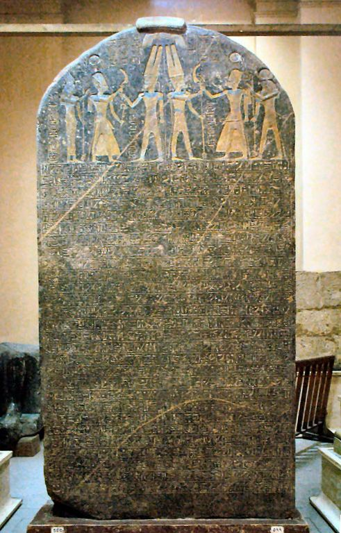{ loading=lazy }
*The Merneptah Stele, Egyptian Museum, Cairo. Image details and credit in [Ancient Texts](../scripture/ancient-texts-manuscripts.md#11-the-merneptah-stele-c-1208-bc).*

Pharaoh Merneptah's victory hymn, from his fifth year, lists "Israel" among the peoples he claims to
have crushed in Canaan, written with the sign for a people rather than a city. It is the earliest
mention of Israel outside the Bible. It gives no date for the Exodus or the conquest. It says only
that Israel was a people in the land by about 1208 BC, which both the early Exodus (1446 BC) and the
late one (the 1200s) allow.

### The eclipse at Gibeon: 30 October 1207 BC? (rival, contested)

Colin Humphreys and Graeme Waddington proposed in 2017 that Joshua's long day (Joshua 10:12-14) was
an annular eclipse visible from Gibeon on 30 October 1207 BC. If they are right, the conquest
belongs in the late 1200s and the Exodus about forty years before it, two centuries after this
site's 1446 BC. The proposal sits awkwardly with the passage, which describes a day made longer,
not darker; [Prophecy Events and
Times](../last-things/prophecy-events-times.md#joshuas-long-day-at-gibeon-reinterpreted-as-an-eclipse-contested)
weighs it. It is listed here because it is the one astronomical date anyone has offered before
Solomon, and it points away from this page's line.

### Tyre's king list: Solomon's temple from a second direction (check)

Josephus quotes the Tyrian annals, as Menander of Ephesus had translated them. Solomon's temple was
begun in the twelfth year of Hiram, Solomon's ally (1 Kings 5:1-12), and Carthage was founded 143
years and eight months later (*Against Apion* 1.17-18). This route to the temple runs through
Phoenicia and never touches Assyria or the kings of Judah. Its result depends on which ancient date
for Carthage is used. Pompeius Trogus's 825 BC puts the temple in 968 or 967 BC, a year or two from
the table's 966; Rodger Young sets out that case ("Solomon and the Kings of Tyre", *Bible and
Spade*, Summer 2017). Timaeus's 814 BC puts it eleven years later. Either way the answer is within
a dozen years of 966 BC and nowhere near Ussher's 1012.

### Shishak's campaign list (check)

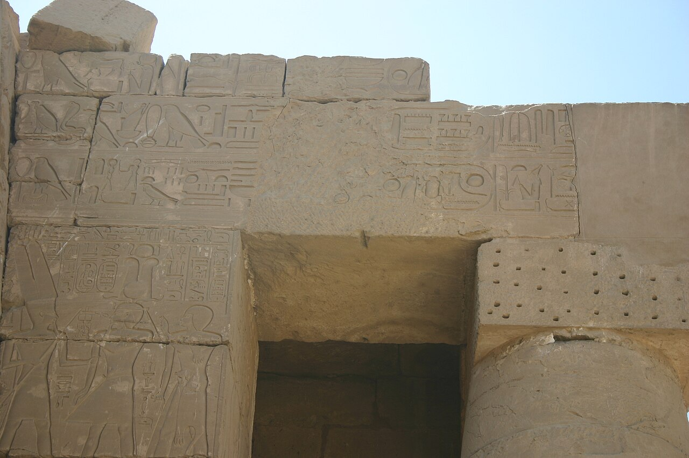{ loading=lazy }
*The Bubastite Portal at Karnak, with the cartouches of Shoshenq I. His list of conquered towns is
carved on the wall beside it. Photo: [Markh](https://commons.wikimedia.org/wiki/File:Bubastis_portal_at_Karnak.jpg), [CC BY-SA 3.0](https://creativecommons.org/licenses/by-sa/3.0/), via Wikimedia Commons.*

Shishak came up against Jerusalem "in the fifth year of King Rehoboam" (1 Kings 14:25, ESV; 2
Chronicles 12:2). Shoshenq I, the pharaoh behind the name, carved a list of the towns he took on
this portal at Karnak, and the list includes towns of Judah and Israel. The check runs partly in a
circle. Egypt's dates for this dynasty are uncertain by a decade or so, and Egyptologists use the
biblical synchronism at 925 BC to refine them. So the campaign confirms the event and its order,
and the table holds it at ±3 years.

### Qarqar and Jehu: the Assyrian synchronisms (fix)

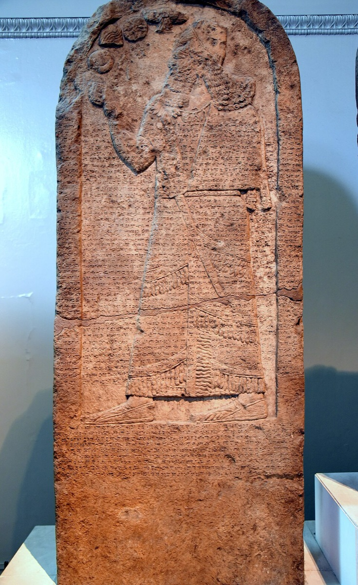{ loading=lazy }
*The Kurkh Monolith of Shalmaneser III, British Museum. Its account of the battle of Qarqar names
"Ahab the Israelite". Photo: [Osama Shukir Muhammed Amin](https://commons.wikimedia.org/wiki/File:Kurkh_stele_of_Shalmaneser_III._From_Diyarbak%C4%B1r,_southern_Turkey._British_Museum.jpg), [CC BY-SA 4.0](https://creativecommons.org/licenses/by-sa/4.0/), via Wikimedia Commons.*

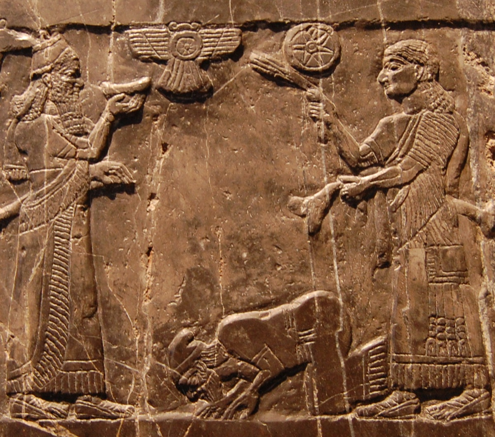{ loading=lazy }
*Jehu, or his envoy, bowing before Shalmaneser III on the Black Obelisk, British Museum. The caption
calls him "Jehu son of Omri". Photo: [Steven G. Johnson](https://commons.wikimedia.org/wiki/File:Jehu-on-Obelisk-of-Shalmaneser_(cropped).jpg), [CC BY-SA 3.0](https://creativecommons.org/licenses/by-sa/3.0/), via Wikimedia Commons.*

These two are rows 5 and 6 of the table. Shalmaneser III dates both by his own regnal years, and the
Bur-Sagale eclipse turns his years into BC dates. Ahab was alive at Qarqar in 853 BC, and Jehu was
king by 841. Scripture's twelve years between them, counted as Kings counts them, fit exactly; [Why
Not 4004 BC?](why-not-4004-bc.md#the-assyrian-check) works the arithmetic. Neither monument is
mentioned in the Bible, and between them they fix the divided monarchy to the year.

### The Moabite Stone and the Tel Dan Stele (confirm)

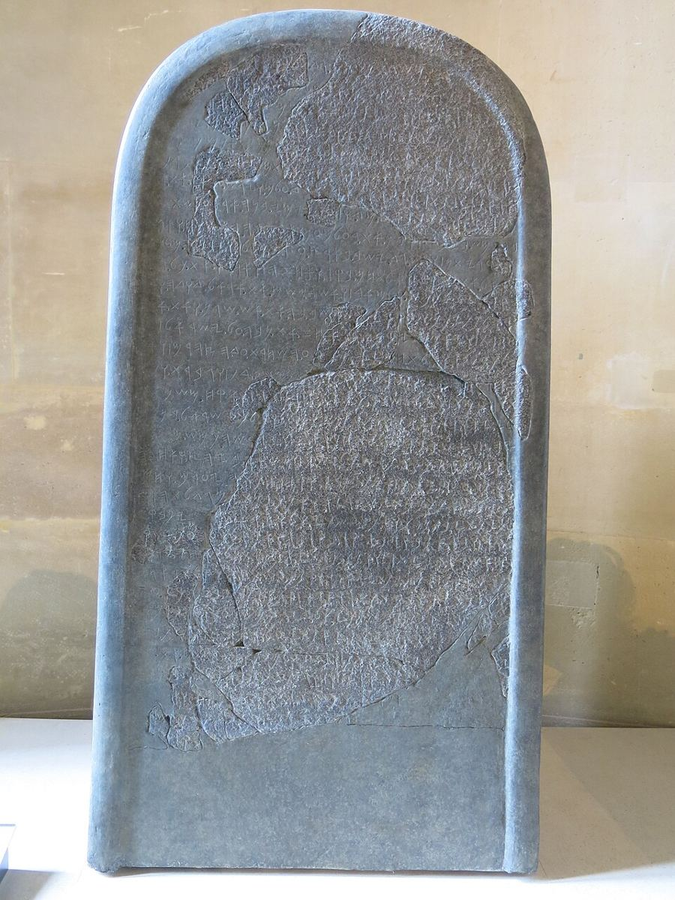{ loading=lazy }
*The Mesha Stele (Moabite Stone), Louvre. Image details and credit in [Ancient
Texts](../scripture/ancient-texts-manuscripts.md#3-the-mesha-stele-moabite-stone-c-840-bc).*

King Mesha of Moab set up this stone about 840 BC. He says that "Omri was king of Israel" and
oppressed Moab many days, that his son did the same, and that Mesha threw Israel off. Second Kings
tells the same story from Israel's side: "after the death of Ahab, Moab rebelled against Israel"
(2 Kings 1:1, ESV; 3:4-5). Mesha also says Israel held the land of Medeba through Omri's days and
half his son's, "forty years". That figure is longer than Omri's twelve years and half of Ahab's
twenty-two, and it reads as a round number, or one that counts the dynasty down to Ahab's sons. The
stone confirms the dynasty and the order of events, and gives no year.

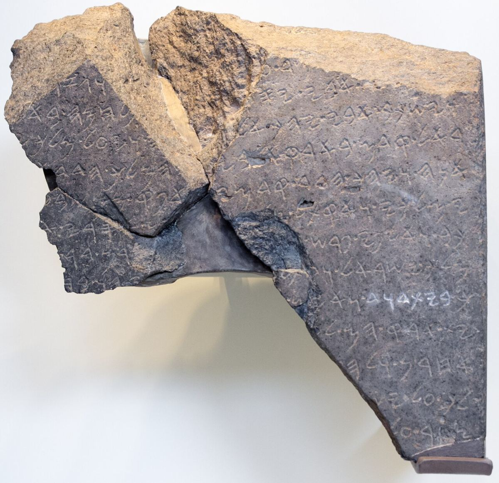{ loading=lazy }
*The Tel Dan Stele, Israel Museum. Image details and credit in [Ancient
Texts](../scripture/ancient-texts-manuscripts.md#4-the-tel-dan-inscription-c-841-bc).*

The Tel Dan Stele, set up by an Aramean king, almost certainly Hazael, claims to have killed a king
of Israel and a king of "the house of David". The names are broken and partly restored, usually as
Joram and Ahaziah, the two kings Jehu killed in 841 BC (2 Kings 9:24-27). If that restoration is
right, the stele and the Black Obelisk both put the same upheaval in the same few years, from two
different foreign courts. It confirms the event and gives no year of its own.

### Sennacherib's prism (fix)

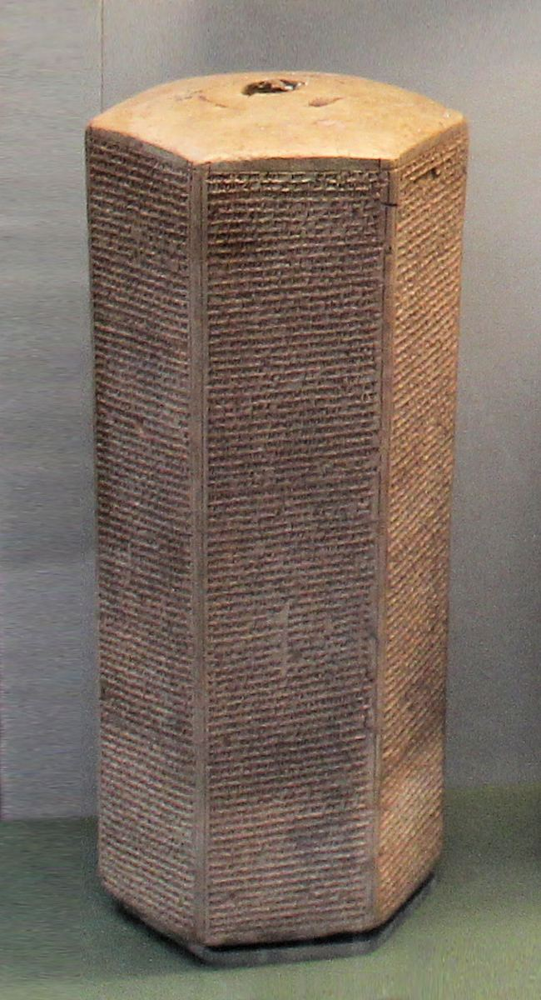{ loading=lazy }
*The Taylor Prism of Sennacherib, British Museum. Image details and credit in [Ancient
Texts](../scripture/ancient-texts-manuscripts.md#8-the-taylor-prism-sennacheribs-prism-c-690-bc).*

Sennacherib's annals say he shut Hezekiah up in Jerusalem "like a bird in a cage" in his third
campaign, 701 BC on the eponym list. Second Kings puts the invasion in "the fourteenth year of King
Hezekiah" (2 Kings 18:13, ESV). This is row 9 of the table, and Hezekiah's reign is where Thiele's
system needed adjusting ([Why Not 4004 BC?](why-not-4004-bc.md#what-is-still-contested)).

### Nebuchadnezzar's years: the Chronicle and VAT 4956 (fix)

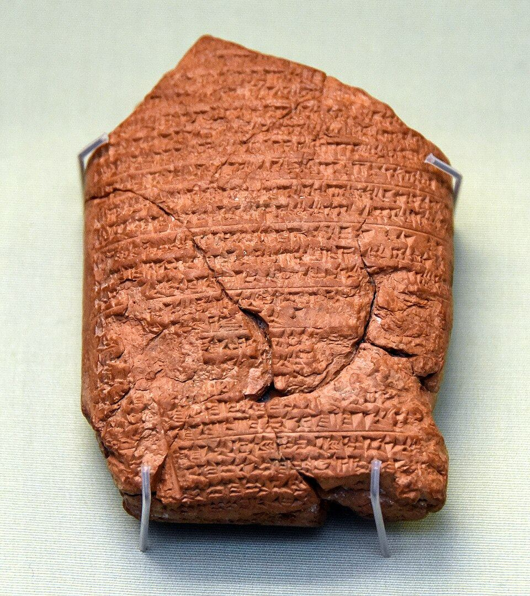{ loading=lazy }
*The Babylonian Chronicle for Nebuchadnezzar's early years, British Museum. Image details and credit
in [Ancient Texts](../scripture/ancient-texts-manuscripts.md#6-the-babylonian-chronicles-various-dates-7th-6th-centuries-bc).*

The Babylonian Chronicle dates Jerusalem's surrender to the second day of Adar in Nebuchadnezzar's
seventh year, 16 March 597 BC (row 11). A second Babylonian tablet fixes his years by the sky.
VAT 4956, in the Vorderasiatisches Museum in Berlin, is an astronomical diary for his 37th year. It
records about thirty positions of the moon and planets that can still be computed, and they fit
568/567 BC and no other year. That puts his accession in 605 BC and his nineteenth year, when the
temple burned (2 Kings 25:8), in 587/586 BC. A minority has challenged the tablet's reading. The
challenge has not persuaded the scholars who edit these texts, and the Chronicle gives the same
years without it.

### Lachish: the last fortified cities (confirm)

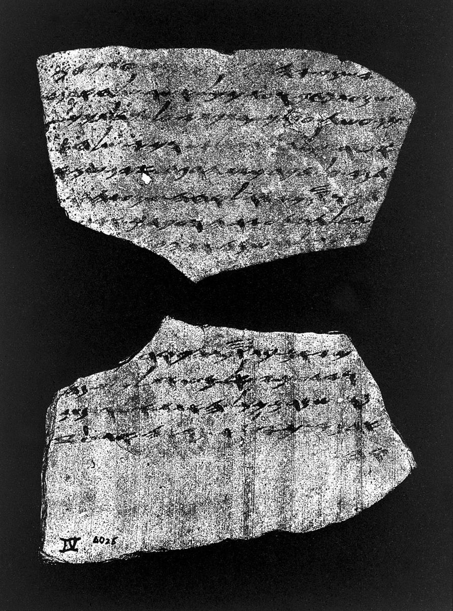{ loading=lazy }
*Lachish Letter 4. Image details and credit in [Ancient
Texts](../scripture/ancient-texts-manuscripts.md#7-the-lachish-letters-c-588-586-bc).*

An officer writing to Lachish during Nebuchadnezzar's last campaign says he is watching for the
fire-signals of Lachish, because he can no longer see Azekah. Jeremiah describes the same moment,
when the Babylonian army was fighting against "Lachish and Azekah, for these were the only fortified
cities of Judah that remained" (Jeremiah 34:7, ESV). The letter gives no year. It confirms the order
of the final siege that row 12 dates.

### Babylon falls, and Cyrus sends the peoples home (fix, confirm)

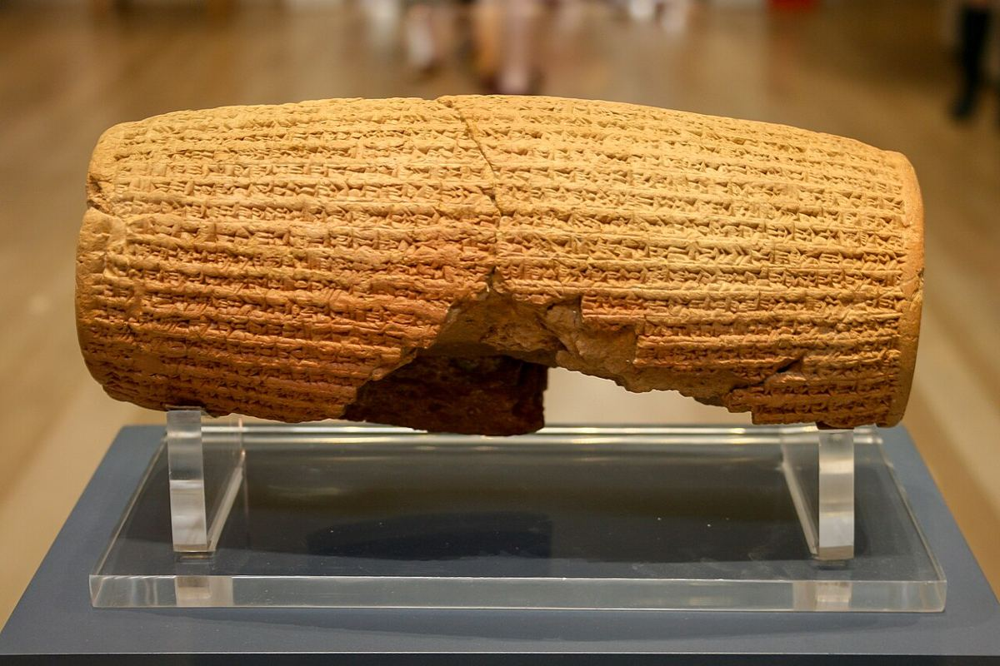{ loading=lazy }
*The Cyrus Cylinder, British Museum. Image details and credit in [Ancient
Texts](../scripture/ancient-texts-manuscripts.md#5-the-cyrus-cylinder-c-539-bc).*

The Nabonidus Chronicle, one of the same Babylonian series, records Cyrus's army entering Babylon
without a battle on 16 Tishri, 12 October 539 BC (row 14), and Cyrus himself entering seventeen
days later. Daniel 5:30-31 tells the fall from inside the city. The Cyrus Cylinder records Cyrus returning
displaced peoples and their gods to their own cities. It names no Jews and gives no year for any
decree; it confirms that the decree of Ezra 1:1-4 (row 15) is the policy Cyrus followed, as Isaiah
had said he would: "who says of Cyrus, 'He is my shepherd, and he shall fulfill all my purpose';
saying of Jerusalem, 'She shall be built'" (Isaiah 44:28, ESV).

### The Persian kings' years: Ptolemy's Canon and Elephantine (fix)

Rows 15 to 21 are dated in Persian kings' years: Darius's second and sixth years, Artaxerxes'
seventh and twentieth. Two independent records turn those into BC dates. **Ptolemy's Canon**, the
list of reigns the astronomer Claudius Ptolemy kept in the second century AD, runs from Nabonassar
(747 BC) through Babylon, Persia, Alexander and the Ptolemies to Rome, and Ptolemy ties it to eclipses
he dates by the kings' years, among them lunar eclipses in Cambyses' seventh year and Darius I's
twentieth and thirty-first. The **Elephantine papyri**, letters and contracts of a Jewish garrison on
the Nile, carry dates in both the Egyptian and the Jewish calendars across Artaxerxes I's reign, and
fix his years independently of the canon. One of them, from 407 BC, names the sons of Sanballat,
Nehemiah's opponent (Nehemiah 2:10), as running his affairs: the right generation for a Nehemiah of
444 BC. [Prophecy: Events and Times](../last-things/prophecy-events-times.md) sets out the decree
dates the papyri support.

### Alexander by the sky: the astronomical diaries (fix)

Babylonian astronomers kept a diary of the sky night by night from at least 652 BC to 61 BC, and
added the news. The diary for 331 BC records an eclipse of the moon on 20 September, and eleven days
later the rout of Darius's army: Gaugamela, 1 October 331 BC (row 22), the ram broken by the goat
(Daniel 8:5-7, 20-21). Plutarch and Arrian both remember the eclipse before the battle. The diary
for 323 BC notes on the 29th of Aiaru, 11 June, "the king died": Alexander, the great horn broken at
the height of its strength (row 23; Daniel 8:8). Both rows are Fixed to the day.

### The Seleucid era: how 1 Maccabees counts (fix)

First Maccabees dates by the Seleucid era, a running count of years from Seleucus I's return to
Babylon in 312/311 BC, the first era in the region that did not restart with each king. Its "hundred
forty and fifth year" (1 Maccabees 1:54) is 167 BC, its 148th (4:52) is 164 BC, its 150th (6:20) is
163/162 BC and its 170th (13:41) is 143/142 BC. That count is why rows 28 to 31 are Fixed, and it is
the same era the Babylonian diaries and king lists use for the same kings, so the two check each
other. Second Maccabees supplies the high priests: Jason's purchase of the office at Antiochus IV's
accession, and Menelaus's three years later, when Onias III was killed (2 Maccabees 4:7-10, 23-34;
row 27).

### Rome: Herod's eclipse, Pilate and Gallio (fix, confirm)

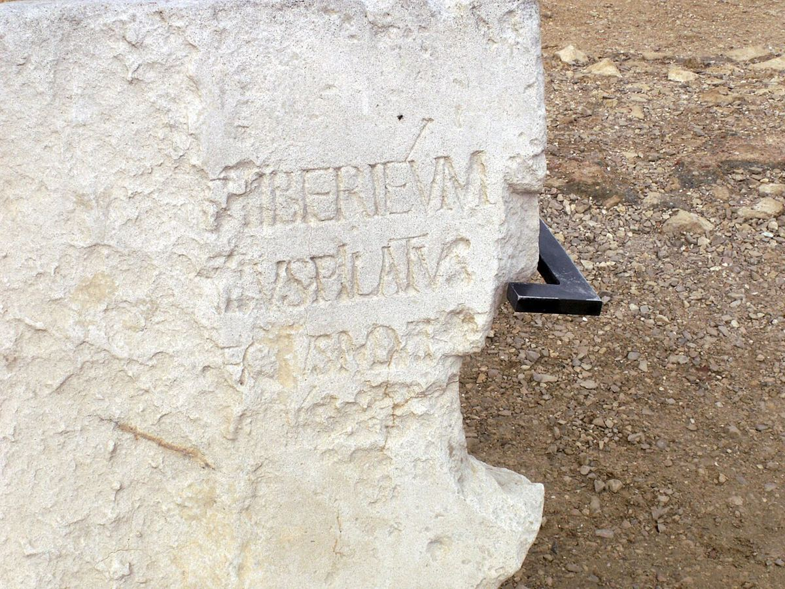{ loading=lazy }
*The Pilate Stone, Caesarea Maritima. Image details and credit in [Ancient
Texts](../scripture/ancient-texts-manuscripts.md#19-the-pontius-pilate-stone-c-ad-26-36).*

From Pompey on, Roman dates run by the consuls' years and then the emperors', and Josephus dates
Judea's events by them. Herod's death is fixed by an eclipse of the moon Josephus records just before
it (*Antiquities* 17.167; row 38). The Pilate Stone, a dedication to Tiberius found at Caesarea in
1961, names "[Pon]tius Pilatus, [praef]ectus Iuda[ea]e", the office Luke gives him in Tiberius's
fifteenth year (Luke 3:1). It confirms the man and his title, and gives no year. The **Gallio
inscription** at Delphi, a letter of the emperor Claudius dated by his twenty-sixth acclamation, AD 52,
names Gallio proconsul of Achaia, which dates Paul's hearing before him (Acts 18:12) to AD 51/52 and
gives the one fixed point in Paul's chronology ([Dating the Cross](dating-the-cross.md#pauls-three-years-and-fourteen-years)).

| Witness | Date | Job |
|---|---|---|
| Merneptah Stele | c. 1208 BC | Limit: Israel in Canaan |
| Gibeon eclipse (Humphreys) | 1207 BC? | Rival: a late conquest |
| Tyre's king list (Josephus) | temple 968-957 BC | Check on 966 BC |
| Bubastite Portal (Shoshenq I) | 925 BC | Check, partly circular |
| Kurkh Monolith; Black Obelisk | 853; 841 BC | Fix |
| Moabite Stone; Tel Dan Stele | c. 840 BC | Confirm |
| Taylor Prism (Sennacherib) | 701 BC | Fix |
| Babylonian Chronicle; VAT 4956 | 597; 568/567 BC | Fix |
| Lachish Letters | 588-586 BC | Confirm |
| Nabonidus Chronicle; Cyrus Cylinder | 539 BC | Fix; confirm |
| Ptolemy's Canon; Elephantine papyri | 520-444 BC | Fix |
| Astronomical diaries | 331; 323 BC | Fix |
| 1 and 2 Maccabees (Seleucid era) | 175-142 BC | Fix |
| Josephus (Herod's eclipse) | 4 BC | Fix |
| Pilate Stone; Gallio inscription | AD 26-36; AD 52 | Confirm; fix |

Before Solomon there is no outside record that fixes a year. The Exodus, the patriarchs and the
genealogies are dated by Scripture's own intervals, counted back from the temple, and the records
above are why the temple itself can be trusted to within a few years. Every record here is on the
[Prophetic Timeline](/timeline/#kingdom-exile)'s "texts and finds" lane, and each anchor's panel there
names the witnesses that bear on it and the job each one does.

## The four hundred silent years

Nothing in Scripture narrates the stretch from Malachi to Matthew, and the table above carries fifteen entries across it. They are there because Daniel does narrate it — in advance, and in enough detail that the fulfilments are datable.

### Daniel names the kingdoms himself

**Daniel supplies his own interpretation.** The Greek-period entries need no interpretive licence, because the angel names the kingdoms outright.

> ✝️ Daniel 8:20-22 (ESV)
>
> 20 As for the ram that you saw with the two horns, these are the kings of Media and Persia. 21 And the goat is the king of Greece. And the great horn between his eyes is the first king. 22 As for the horn that was broken, in place of which four others arose, four kingdoms shall arise from his nation, but not with his power.

The ram broken by the goat is Persia falling to Alexander at Gaugamela in 331 BC (entry 22). The great horn broken at the height of its strength is Alexander dead at thirty-two in 323 BC (entry 23). The four horns toward the four winds are the Diadochi, settled at Ipsus in 301 BC (entry 24). Daniel 11:3-4 runs the same sequence in plainer terms. Three entries, one prophecy, and the angel doing the identifying.

### Two dates fixed to the day: desecration and rededication

**The two entries Daniel dwells on are both datable to the day.** Antiochus IV Epiphanes took the throne in 175 BC (entry 26), and the "little horn" of Daniel 8:9-14 and the contemptible king of Daniel 11:21-35 are recognised as him across the interpretive spectrum. First Maccabees dates his desecration of the temple to 15 Kislev 167 BC and the sacrifice on the pagan altar to the 25th, then dates the rededication to 25 Kislev 164 BC — three years to the day. That rededication is the Feast of Dedication at which John places Jesus walking in Solomon's colonnade (John 10:22), so the New Testament names this event outright.

### Daniel 8:14's 2,300 evenings and mornings: two readings

**Daniel 8:14's number does not resolve cleanly, and this page does not force it.**

> ✝️ Daniel 8:14 (ESV)
>
> 14 And he said to me, "For 2,300 evenings and mornings. Then the sanctuary shall be restored to its rightful state."

Two readings are defensible and they land in different places. Taken as 2,300 evening-and-morning *sacrifices* — a pair per day — the span is 1,150 days, about 3.15 years, reaching back from the rededication to roughly October 167 BC, just before the desecration. Taken as 2,300 whole days, the span is 6.3 years, reaching back to August 170 BC and the murder of Onias III, the last high priest of the old line, after Jason and then Menelaus had bought the office from Antiochus (2 Maccabees 4:7-10, 23-34). Many read him as the "prince of the covenant" broken in Daniel 11:22, and entry 27 exists in the table to mark that second terminus. Neither reading lands on the desecration itself. The "three years" of 1 Maccabees, from the first pagan sacrifice on 25 Kislev 167 BC to the rededication on 25 Kislev 164 BC (1 Maccabees 1:59; 4:52-54), are three years of the lunar calendar, about 1,063 days, or 1,092 if a month was added, and match neither number. Second Maccabees counts the gap as "two years" (2 Maccabees 10:3), apparently from the desecration's first full year; it agrees that the rededication fell "on the very same day" of Kislev (10:5).

### The sabbatical cycle, anchored by three sieges

**The sabbatical cycle can be anchored, and three entries do it.** Josephus and 1 Maccabees each mention a sabbatical year in passing while telling of a siege: the defenders short of food because the land lay fallow, or a siege abandoned when the year of rest came on. None names the year for chronological effect. Three such years survive:

| Sabbatical year | Occasion | Source |
|---|---|---|
| 163/162 BC | Siege of Beth-zur | 1 Maccabees 6:49, 53 |
| 135/134 BC | Hyrcanus besieges Ptolemy at Dagon, near Jericho | Josephus, *Ant.* 13.234 |
| 37/36 BC | Herod besieges Jerusalem | Josephus, *Ant.* 14.475 |

The intervals are 28 years and 98 years — both exact multiples of seven, as is the 126 years spanning the outer pair. Three independent incidental notices sit on one unbroken cycle. That is what makes sabbatical and jubilee reckoning usable for the historical era at all, and counting forward from 37 BC on the same cycle gives sabbatical years at 2 BC, AD 6, 13, 20, 27, 34.

One caution on those figures. The two standard reconstructions of the cycle differ by a single year. The years above, and the forward count, are Ben Zion Wacholder's (1973); Benedict Zuckermann's (1857) put each a year earlier, Herod's siege in 38/37 BC and the year before the temple's fall in AD 68/69 where Wacholder has 69/70. So the absolute placement carries ±1 even though the internal spacing is exact. The cycle is anchored; which of two adjacent years each falls in is not quite settled. The three sieges are joined on the [Prophetic Timeline](/timeline/#between) as one thread.

## What the rail cannot do

### The ±5-year uncertainty and what it propagates to

Solomon's fourth year carries ±5 years, and every entry above it inherits that. The whole pre-Abrahamic chronology is measured back from this rail, so the ±5 propagates to creation unchanged — small beside the far larger uncertainties in the genealogies themselves, where a single decision about what Exodus 12:40's 430 years measure moves the answer by 215.

### Sabbatical and jubilee cycles: where this page uses them

Sabbatical and jubilee cycles are used on this page only where Scripture attaches an event to one. Counting cycles forward from creation is not possible: Leviticus 25:8-10 leaves the cycle ambiguous between 49 and 50 years, and the two readings drift a year apart with every cycle, about 80 years by the cross (AM 3991) and about 120 by today. Counting from the entry into the land, as Ezekiel 40:1's jubilee reading does, is a shorter count with the same ambiguity, which is why that reading is marked contested above.

## References & Recommended Reading

- **ESV Bible** (Crossway) — all scripture verified against `study-notes.db`.
- **Edwin R. Thiele, *The Mysterious Numbers of the Hebrew Kings*** — the regnal reconstruction behind entries 1-9, and the accession-year convention.
- **Babylonian Chronicle series**, principally BM 21946 — entries 10 and 11; the 2 Adar date for Jehoiachin's deportation. The chronicle runs 605-594 BC and does not reach the fall of Jerusalem (entry 12).
- **Nabonidus Chronicle** — the fall of Babylon, 16 Tishri (12 October) 539 BC.
- **Assyrian Eponym List** and the **Bur-Sagale** entry — the 763 BC eclipse.
- **Kurkh Monolith** and the **Black Obelisk of Shalmaneser III** — Ahab at Qarqar, and Jehu's tribute.
- **Sennacherib's Annals (Taylor Prism)** — the 701 BC campaign, naming Hezekiah.
- **Bubastite Portal, Karnak** — Shoshenq I's campaign list.
- **Josephus, *Against Apion*** 1.17-18, quoting Menander of Ephesus — the Tyrian king list,
  Solomon's temple in Hiram's twelfth year, 143 years and eight months before Carthage.
- **Rodger C. Young, "Solomon and the Kings of Tyre"**, *Bible and Spade* (Summer 2017) — the Tyrian
  list worked against 966/967 BC.
- **VAT 4956** (Vorderasiatisches Museum, Berlin), published in A. J. Sachs and H. Hunger,
  *Astronomical Diaries and Related Texts from Babylonia*, vol. 1 (1988), as no. -567 — Nebuchadnezzar's
  37th year, 568/567 BC.
- **Mesha Stele** (Louvre AO 5066) and **Tel Dan Stele** (Israel Museum) — the Omride dynasty and
  the events of 841 BC, from Moab and Aram.
- **Merneptah Stele** (Egyptian Museum, Cairo) — Israel in Canaan by about 1208 BC.
- **Colin J. Humphreys and W. Graeme Waddington, "Solar eclipse of 1207 BC helps to date
  pharaohs"**, *Astronomy & Geophysics* 58.5 (2017) — the Gibeon eclipse proposal.
- [Ancient Texts, Manuscripts, and Inscriptions](../scripture/ancient-texts-manuscripts.md) — fuller
  descriptions and credits for the inscriptions pictured here.
- **1 Maccabees** — 1:54, 1:59, 4:52-59 (the desecration and rededication dates), 6:20, 49, 53 (the sabbatical year at Beth-zur) and 13:41-42 (Simon's independence). **2 Maccabees** 4:7-10, 23-34 (Jason, Menelaus and the murder of Onias III) and 10:3-5. Neither is in `bible-text.db`; every passage cited here was checked against the KJV Apocrypha text in this repo's deuterocanonical source (`references/open-data/scrollmapper-bible-databases-deuterocanonical`).
- **Josephus, *Antiquities*** 13.228-235 (Hyrcanus's siege of Ptolemy at Dagon, abandoned in a sabbatical year, 13.234) and 14.475 (Herod's siege) — the two later attested sabbatical years; 15.380 and 15.421 for Herod's temple works; 17.167 and 17.191 for Herod's death; 18.1-2 for Quirinius's census of AD 6. The William Whiston translation.
- **Ben Zion Wacholder**, "The Calendar of Sabbatical Cycles during the Second Temple and the Early Rabbinic Period", *Hebrew Union College Annual* 44 (1973), whose years this page follows, and **Benedict Zuckermann**, *A Treatise on the Sabbatical Cycle and the Jubilee* (1857; English 1866), whose cycle runs a year earlier.
- **Babylonian Talmud, *Arakhin* 12a-b** — Ezekiel 40:1 read as the start of a jubilee, and the seventeen jubilees from the entry to the first temple's fall. Read in the William Davidson Edition (Koren-Steinsaltz, CC BY-NC) via Sefaria, and paraphrased here.
- **Rodger C. Young, "Ezekiel's Jubilee: Real or Rabbinic Fiction?"**, *Journal of the Evangelical Theological Society* 67.3 and 67.4 (2024) — 10 Tishri 574 BC, and the seventeenth jubilee counted from 1406 BC. Young argues his own reconstruction, and the page marks it contested.
- **Claudius Ptolemy, the Canon of kings** (in the *Handy Tables*) and the eclipses of the *Almagest* — the Persian kings' years.
- **The Elephantine papyri** — Artaxerxes I's years in two calendars, and Sanballat's sons in 407 BC.
- **A. J. Sachs and H. Hunger, *Astronomical Diaries and Related Texts from Babylonia*, vol. 1** — the diaries for 331 BC (the eclipse before Gaugamela) and 323 BC (Alexander's death). Plutarch, *Alexander* 31, and Arrian, *Anabasis* 3.7.6, for the eclipse.
- **The Lachish Letters** (Letter 4), the **Cyrus Cylinder** (British Museum), the **Pilate Stone** (Israel Museum) and the **Gallio inscription** (Delphi) — see [Ancient Texts](../scripture/ancient-texts-manuscripts.md) for the first three.
- [The Prophetic Timeline](/timeline/#kingdom-exile) — every row of the anchor table plotted, each with its own panel naming the record that dates it and its witnesses (a row's link in the table opens it), the seventy years, Daniel 8:14 and the sabbatical cycle drawn as threads, and [the years Jesus was on earth](/timeline/#christ) and [Passion week](/timeline/#passion-week) in their own views. The page's table, the two charts and the timeline all read `docs/data/chronology.json`.
- [Genealogy and Times](genealogy-times.md) — the elastic zone before Abraham, and the manuscript variants.
- [The Zadok Calendar](../feasts/zadok-calendar.md) — the 364-day priestly calendar whose sabbaticals and jubilees the site counts in, and the epoch of the AM count.
