# Precious Stones in Scripture

By the Chebar canal in Babylon, Ezekiel saw the throne of God move. He had to describe it to exiles
who had lost their land, and the words kept failing him. In three verses (Ezekiel 1:26-28) he writes
"appearance" nine times and "likeness" four, the Hebrew מַרְאֶה (*marʾeh*,
H4758) and דְּמוּת (*demut*, H1823). The throne itself was "in appearance
like sapphire" (Ezekiel 1:26, ESV). Then he gave up and fell down:

> ✝️ Ezekiel 1:28 (ESV)
>
> 28 Like the appearance of the bow that is in the cloud on the day of rain, so was the appearance of
> the brightness all around. Such was the appearance of the likeness of the glory of the LORD. And
> when I saw it, I fell on my face, and I heard the voice of one speaking.

When words failed him before the glory of God, he reached for a stone and a rainbow.

**In one sentence:** When the prophets saw God's glory they reached for precious stones, because a
gem shows a light it does not make; so the stones that carried Israel's names on the high priest's
heart become the foundations of a city lit by God and the Lamb, and God means you to shine in the
same way, with His light.

## Key Takeaways

*(This section follows the [Key Takeaways](../about/key-takeaways.md) format — see that page for what each part is for.)*

### Types & Prophecy

**Prophecy.** God promised afflicted Jerusalem, "I will … lay your foundations with sapphires. I will
make your pinnacles of agate, your gates of carbuncles, and all your wall of precious stones"
(Isaiah 54:11-12, ESV). John sees the city built that way: "The foundations of the wall of the city
were adorned with every kind of jewel" (Revelation 21:19, ESV).

**Type.** Aaron carried the twelve tribes on twelve stones "on his heart, when he goes into the Holy
Place, to bring them to regular remembrance before the LORD" (Exodus 28:29, ESV). Hebrews names
Jesus the "great high priest who has passed through the heavens" (Hebrews 4:14, ESV). Scripture never
says the breastpiece pictures Him, so this is a pattern drawn from the two, and it fits: He carries
His people into God's presence by name.

### Lessons about Jesus

- **Jesus is the city's lamp.** "The glory of God gives it light, and its lamp is the Lamb"
  (Revelation 21:23, ESV). He said it first: "I am the light of the world" (John 8:12, ESV).
- **God's glory is seen in Jesus' face.** God "has shone in our hearts to give the light of the
  knowledge of the glory of God in the face of Jesus Christ" (2 Corinthians 4:6, ESV).

### Memory verses

> ✝️ Revelation 21:23 (ESV)
>
> 23 And the city has no need of sun or moon to shine on it, for the glory of God gives it light, and
> its lamp is the Lamb.

> ✝️ Philippians 2:15 (ESV)
>
> 15 that you may be blameless and innocent, children of God without blemish in the midst of a
> crooked and twisted generation, among whom you shine as lights in the world,

### Be Transformed

- **Think.** Whatever shines in you is God's light falling on you. The city has "the glory of God"
  and no light of its own (Revelation 21:11, 23).
- **Attitude.** Point away from yourself. John the Baptist "came to bear witness about the light"
  (John 1:8, ESV). The king of Tyre kept the shine for himself: "your heart was proud because of your
  beauty" (Ezekiel 28:17, ESV).
- **Do.** Name one person who sees you every week, and ask God this week for a way your good works
  can show them His glory, so that they "give glory to your Father who is in heaven" (Matthew 5:16,
  ESV).

### Prayer

Father of lights, you dwell in light, and in you is no darkness at all. Thank you that you showed
Ezekiel and John your glory, and that you have shown it to us in the face of your Son Jesus. Thank
you that He carries our names before you as the high priest carried Israel's. Shine on us, and
through us, until we shine as lights in this generation, and bring us at last into the city whose
lamp is the Lamb.

In Jesus' name. Amen.

## Study outline

- [The stones Scripture names](#the-stones-scripture-names). Where gems appear, from Eden to the
  city, and a plate of the three lists.
- [What the stones looked like](#what-the-stones-looked-like). Why translations disagree, what the
  ancient names meant, and photographs of each.
- [The language of appearance](#the-language-of-appearance). How Ezekiel and John describe what they
  saw, and what they pick out of each stone.
- [A light the stone does not make](#a-light-the-stone-does-not-make). Where the city's light comes
  from, and a first-century tradition that the breastpiece shone.
- [What a gem does with light](#what-a-gem-does-with-light). Five things a gem does with light, the
  star stone Pliny saw, and the colour that turns.
- [Names on the stones](#names-on-the-stones). The tribes on the priest's heart and the apostles on
  the foundations.
- [Stones worn and stones built](#stones-worn-and-stones-built). The cherub of Tyre, Babylon and the
  Bride.
- [So you may shine](#so-you-may-shine). The same word for the city's light and for yours.
- [Discussion questions](#discussion-questions) and an [annex](#annex-correlations-scripture-does-not-make)
  on the charts that pair stones with tribes, apostles and months.

## The stones Scripture names

[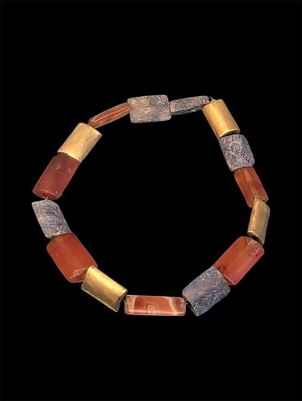{ loading=lazy }](../assets/img/gems/ur-beads.jpg)
*Gold, carnelian and lapis lazuli beads from a grave at Ur, 2600-2400 BC, now in the British
Museum: the wealth of the ancient Near East a thousand years before Moses.*

Gems turn up at a handful of moments, and nearly every one is a meeting between God and people.

- **Eden.** The river of Eden ran through Havilah: "the gold of that land is good; bdellium and onyx
  stone are there" (Genesis 2:12, ESV).
- **Sinai.** Moses and the elders "saw the God of Israel. There was under his feet as it were a
  pavement of sapphire stone, like the very heaven for clearness" (Exodus 24:10, ESV).
- **The high priest.** Two onyx stones on his shoulders and twelve stones on his breastpiece carried
  the names of Israel's sons (Exodus 28:9-21).
- **The throne-chariot.** Ezekiel saw wheels "like the gleaming of beryl" and a throne "like
  sapphire" (Ezekiel 1:16, 26, ESV), and saw them again in Ezekiel 10:1, 9.
- **The man by the Tigris.** Daniel saw a man whose "body was like beryl, his face like the
  appearance of lightning" (Daniel 10:6, ESV).
- **The cherub of Tyre.** "Every precious stone was your covering" (Ezekiel 28:13, ESV).
- **The throne in heaven.** "He who sat there had the appearance of jasper and carnelian, and around
  the throne was a rainbow that had the appearance of an emerald" (Revelation 4:3, ESV).
- **Babylon and the Bride.** The prostitute is "adorned with gold and jewels and pearls"
  (Revelation 17:4, ESV). The New Jerusalem is built of them (Revelation 21:18-21).

Three of these are lists of stones, and they are one list. Exodus 28:17-20 gives twelve. The Hebrew
of Ezekiel 28:13 gives nine of the same twelve, every row of the breastpiece except the third.
Revelation 21:19-20 gives twelve foundations, and eight of them carry the same Greek names as the
breastpiece in the Septuagint, the Greek Old Testament John's readers knew.

## What the stones looked like

### Why the translations disagree

Nobody now knows for certain which stone each Hebrew name meant. The BSB, CSB and NLT all footnote
Exodus 28:17 to say so. The Hebrew words are rare. The three stones of the breastpiece's third row,
לֶשֶׁם (*leshem*, H3958), שְׁבוֹ (*shevo*, H7618) and
אַחְלָמָה (*ʾachlamah*, H306), occur only in Exodus 28:19 and its repeat in
Exodus 39:12. So translators lean on three things: the Septuagint, translated in the third century BC; a root
meaning where one exists, as with אֹדֶם (*ʾodem*, H124), from the word for
red; and ancient writers on stones such as Pliny the Elder.

Rows one, two and four are where the English versions part:

| # | Hebrew | Septuagint | ESV | NIV | NASB 2020 |
|---|---|---|---|---|---|
| 1 | *ʾodem* | σάρδιον | sardius | carnelian | ruby |
| 2 | *pitdah* | τοπάζιον | topaz | chrysolite | topaz |
| 3 | *bareqet* | σμάραγδος | carbuncle | beryl | emerald |
| 4 | *nofekh* | ἄνθραξ | emerald | turquoise | turquoise |
| 5 | *sappir* | σάπφειρος | sapphire | lapis lazuli | sapphire |
| 6 | *yahalom* | ἴασπις | diamond | emerald | diamond |
| 10 | *tarshish* | χρυσόλιθος | beryl | topaz | beryl |
| 11 | *shoham* | βηρύλλιον | onyx | onyx | onyx |
| 12 | *yashpeh* | ὀνύχιον | jasper | jasper | jasper |

The third row (*leshem*, *shevo*, *ʾachlamah*) is jacinth, agate and amethyst in all three,
following the Septuagint.

### What the ancient names meant

The Greek names are what Revelation shares with Exodus, so the Greek names are the ones to identify.
Pliny the Elder wrote a book on stones a generation before John, *Natural History* 37, and two of his
descriptions change how these chapters read:

- **Sapphire.** Pliny's *sapphirus* is blue and never transparent, and "gold gleams in it in
  spots" (*Natural History* 37.119-120). That is lapis lazuli, the deep blue stone flecked with gold pyrite. The
  NIV prints "lapis lazuli" for סַפִּיר (*sappir*, H5601), and the *NIV
  Cultural Backgrounds Study Bible* notes that the ancient world often identified the two (note on
  Revelation 4:3). The pavement under God's feet at Sinai, "like the very heaven for clearness"
  (Exodus 24:10, ESV), was then a deep sky-blue flecked with gold.
- **Jasper.** Pliny's *iaspis* "is green and often translucent" (*Natural History* 37.115). John's
  jasper is "clear as crystal" (Revelation 21:11, ESV). The modern stone sold as jasper is opaque, so
  the name has moved to another stone since John wrote. John F. Walvoord reads the same: "in verse 11
  the jasper is translucent" (*Bible Knowledge Commentary*, on Revelation 21:17-18).

The photographs below show the stone each foundation's name most probably meant, in John's order,
with three breastpiece stones that do not reappear. Where the identification is uncertain, the
caption says so.

-   [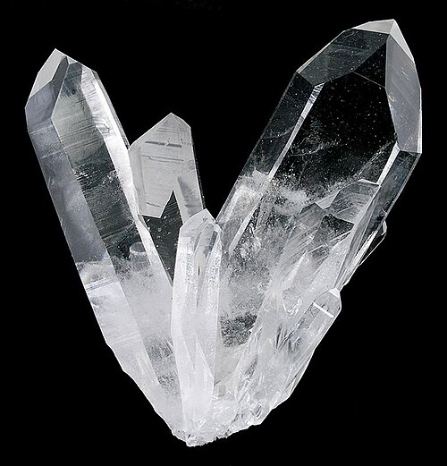{ loading=lazy }](../assets/img/gems/rock-crystal.jpg)

    __1st · Jasper__ · ἴασπις (*iaspis*, G2393). Shown: rock crystal, the clearness John names.
    Ancient jasper was often green and translucent (Pliny 37.115).

-   [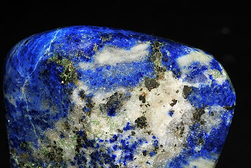{ loading=lazy }](../assets/img/gems/lapis-lazuli.jpg)

    __2nd · Sapphire__ · σάπφειρος (*sappheiros*, G4552). Lapis lazuli: the throne of Ezekiel 1:26 and the pavement of
    Exodus 24:10.

-   [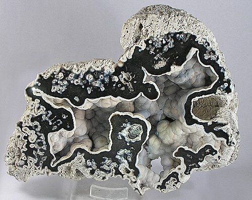{ loading=lazy }](../assets/img/gems/chalcedony.jpg)

    __3rd · Chalcedony__ · χαλκηδών (*chalkēdōn*, G5472, ESV "agate"). Uncertain: Pliny has no stone by this name.
    Shown: modern chalcedony.

-   [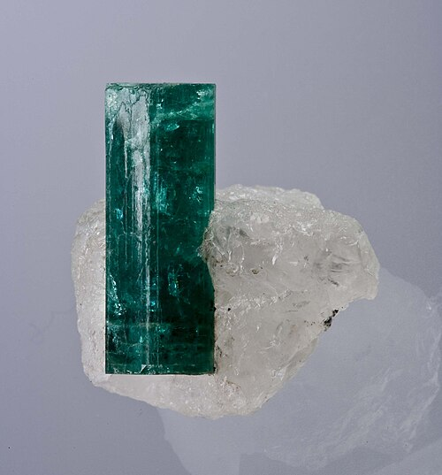{ loading=lazy }](../assets/img/gems/emerald.jpg)

    __4th · Emerald__ · σμάραγδος (*smaragdos*, G4665). "Nothing green is greener" (Pliny 37.62). The rainbow of
    Revelation 4:3.

-   [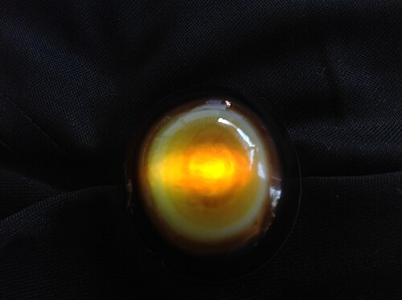{ loading=lazy }](../assets/img/gems/sardonyx-lit.jpg)

    __5th · Sardonyx__ · σαρδόνυξ (*sardonyx*, G4557, ESV "onyx"). White layered over red sard (Pliny 37.86). Shown lit
    from behind.

-   [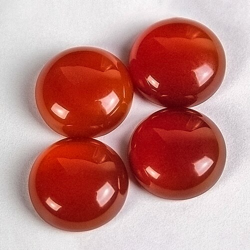{ loading=lazy }](../assets/img/gems/carnelian.jpg)

    __6th · Carnelian__ · σάρδιον (*sardion*, G4556). The first stone of the breastpiece, and the second stone of
    Revelation 4:3.

-   [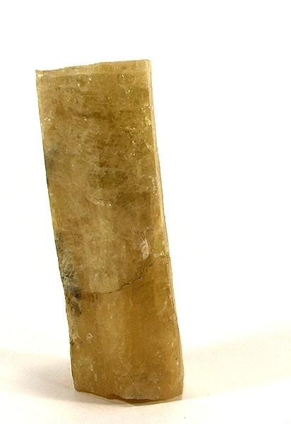{ loading=lazy }](../assets/img/gems/golden-beryl.jpg)

    __7th · Chrysolite__ · χρυσόλιθος (*chrysolithos*, G5555, "gold-stone"). "Translucent with a golden gleam" (Pliny
    37.126). Shown: golden beryl.

-   [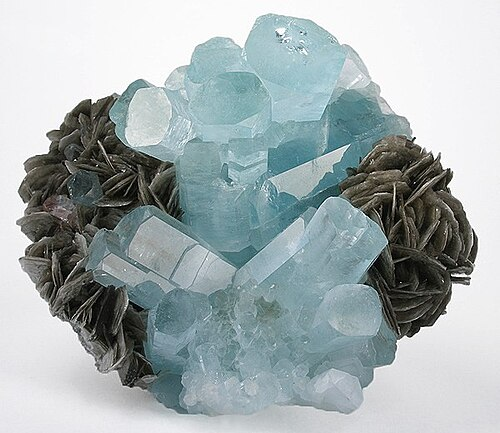{ loading=lazy }](../assets/img/gems/beryl.jpg)

    __8th · Beryl__ · βήρυλλος (*bēryllos*, G969). "The green of a clear sea" (Pliny 37.76).

-   [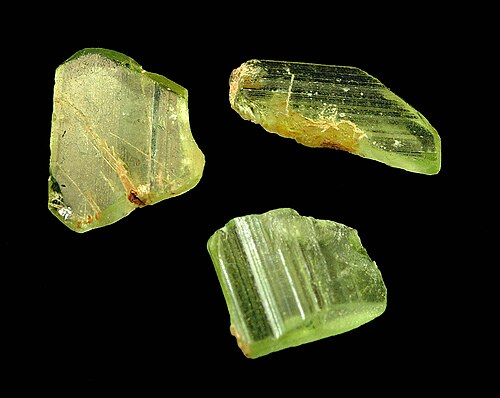{ loading=lazy }](../assets/img/gems/peridot.jpg)

    __9th · Topaz__ · τοπάζιον (*topazion*, G5116). Pliny's topaz is green (37.107), most likely the stone now called
    peridot.

-   [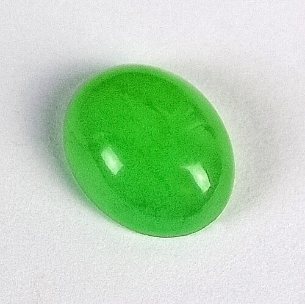{ loading=lazy }](../assets/img/gems/chrysoprase.jpg)

    __10th · Chrysoprase__ · χρυσόπρασος (*chrysoprasos*, G5556, "gold-leek"). The colour of leek juice (Pliny 37.113).

-   [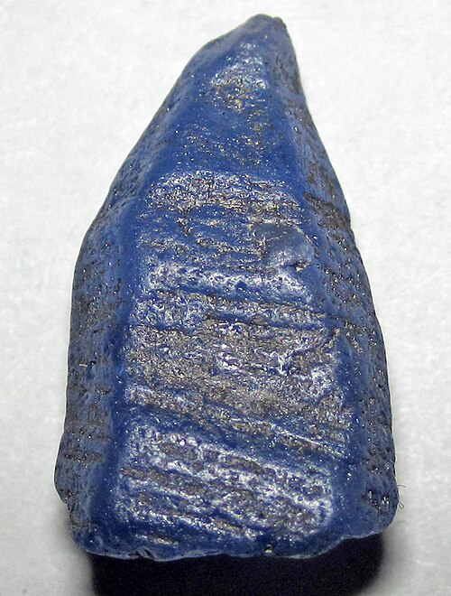{ loading=lazy }](../assets/img/gems/sapphire.jpg)

    __11th · Jacinth__ · ὑάκινθος (*hyakinthos*, G5192). Uncertain: a blue-violet stone (Pliny 37.125), perhaps the modern
    sapphire shown here.

-   [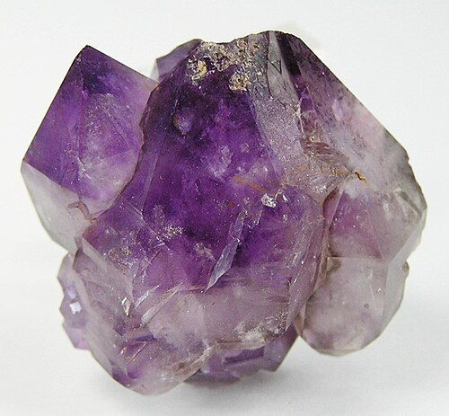{ loading=lazy }](../assets/img/gems/amethyst.jpg)

    __12th · Amethyst__ · ἀμέθυστος (*amethystos*, G271). "All shine through with a violet beauty" (Pliny 37.121).

-   [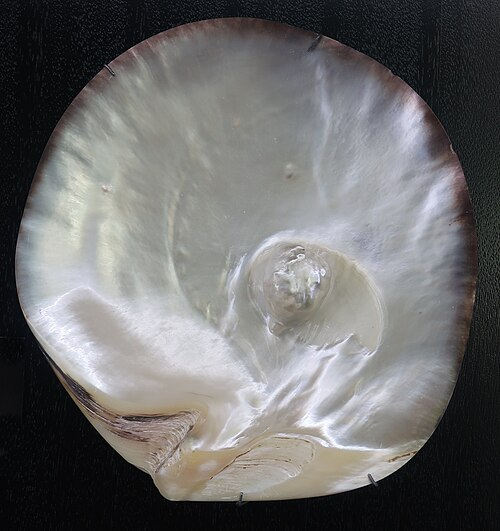{ loading=lazy }](../assets/img/gems/pearl.jpg)

    __The gates · Pearl__ · μαργαρίτης (*margaritēs*, G3135). "Each of the gates made of a single pearl" (Revelation 21:21,
    ESV).

-   [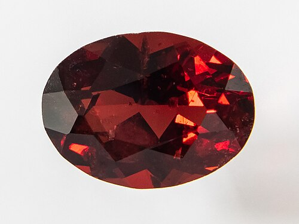{ loading=lazy }](../assets/img/gems/garnet.jpg)

    __Breastpiece 4 · Carbuncle__ · ἄνθραξ (*anthrax*, G440, "burning coal"), named "for its likeness to fire" (Pliny
    37.92). Shown: red garnet.

-   [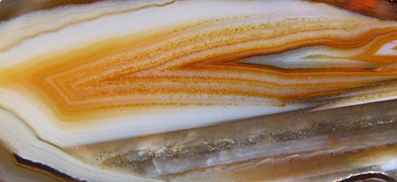{ loading=lazy }](../assets/img/gems/agate.jpg)

    __Breastpiece 8 · Agate__ · ἀχάτης (*achatēs*). A banded stone; Pliny lists many colours (37.139).

-   [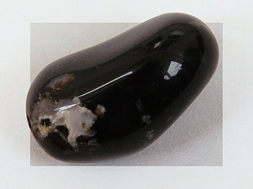{ loading=lazy }](../assets/img/gems/onyx.jpg)

    __Breastpiece 12 · Onyx__ · ὀνύχιον (*onychion*). White like a fingernail over dark (Pliny 37.90).

## The language of appearance

### Ezekiel's likenesses

Ezekiel describes by likeness. Beside *marʾeh*, "appearance", his working word is
עַיִן (*ʿayin*, H5869), literally "eye", used of the sparkle of a thing. The wheels were "like the gleaming of beryl", כְּעֵין
תַּרְשִׁישׁ (*keʿeyn tarshish*, Ezekiel 1:16, ESV), the eye of the stone. The expanse over
the creatures was "shining like awe-inspiring crystal" (Ezekiel 1:22, ESV), and the LSB footnotes
"Or ice". In the fire was חַשְׁמַל (*chashmal*, H2830), "gleaming metal"
(Ezekiel 1:4, 27, ESV), a word found only in Ezekiel 1:4, 27 and 8:2. The Septuagint translated it
ἤλεκτρον (*ēlektron*), the shining alloy of gold and silver.

Then he stacks the words until they run out: "Such was the appearance of the likeness of the glory
of the LORD" (Ezekiel 1:28, ESV). The *ESV Study Bible* sees John "imitating Isaiah's and Ezekiel's
reserve in describing visions of God's glory" (note on Revelation 4:3).

### John builds on Ezekiel

John's throne room in Revelation 4 is drawn from Ezekiel 1:

- Ezekiel's throne was "in appearance like sapphire" (Ezekiel 1:26, ESV). The One on John's throne
  "had the appearance of jasper and carnelian" (Revelation 4:3, ESV).
- Ezekiel's brightness was "like the appearance of the bow that is in the cloud on the day of rain"
  (Ezekiel 1:28, ESV). John's throne has "a rainbow that had the appearance of an emerald"
  (Revelation 4:3, ESV). Both look back to the bow God set in the cloud after the flood (Genesis
  9:13).
- Ezekiel's expanse shone like crystal, κρύσταλλος in the Septuagint. Before John's throne "there was
  as it were a sea of glass, like crystal" (Revelation 4:6, ESV).

John keeps the reserve. Each comparison carries ὅμοιος (*homoios*, G3664) or ὡς (*hōs*, G5613),
"like", and he describes no face.

### What the prophets took from the stones

Read every verse above for what it says about the stones, and one property comes back: light.
Gleaming, sparkling, shining, clear as the sky, clear as crystal, fire, brightness, a rainbow. One
word touches price beyond the name "precious stone" itself: "most rare" (Revelation 21:11, ESV), and
it describes the city's radiance. The
prophets used precious stones as a vocabulary for light. The likeliest reason is the plain one:
short of fire and the sky, a gem was the brightest thing they had seen.

Walvoord says John is "using the language of appearance" (on Revelation 21:17-18). The city is still
real: "the wall was built of jasper" (Revelation 21:18, ESV), and [The New
Jerusalem](../last-things/new-jerusalem.md) argues the case. The stones tell you how that place looks
in the light of God.

## A light the stone does not make

### Where the city's light comes from

John says where:

> ✝️ Revelation 21:10-11 (ESV)
>
> 10 And he carried me away in the Spirit to a great, high mountain, and showed me the holy city
> Jerusalem coming down out of heaven from God, 11 having the glory of God, its radiance like a most
> rare jewel, like a jasper, clear as crystal.

"Radiance" is φωστήρ (*phōstēr*, G5458), which the LSB footnotes "Lit luminary". The Septuagint
uses it for the sun, moon and stars that God set in the sky (Genesis 1:14-16). "Clear as crystal" is
κρυσταλλίζοντι (*krystallizonti*, G2929), the only use of the verb in the New Testament. The city
holds "the glory of God", and it shines it out like a jewel.

Twelve verses later John names the source: "The city has no need of sun or moon to shine on it, for
the glory of God gives it light, and its lamp is the Lamb" (Revelation 21:23, ESV). Isaiah had
promised it: "the LORD will be your everlasting light" (Isaiah 60:19, ESV). The gold of the city is
"like clear glass" (Revelation 21:18, ESV), and its street "like transparent glass" (Revelation
21:21, ESV), διαυγής (*diaugēs*, G1307), letting the light through. Every surface in the city is
made to carry a light that comes from the throne.

### A tradition about the breastpiece

Josephus, writing in the 90s AD, records a tradition about the high priest's stones. The sardonyx on
the right shoulder "shined out when God was present at their sacrifices … which splendor yet was not
before natural to the stone", and the twelve stones of the breastpiece shone before Israel went out
to win a battle. He says both had stopped shining two hundred years before he wrote (*Antiquities*
3.8.9, Whiston). Scripture does not record this. It shows how one first-century Jewish writer
understood those stones: they shone with God's presence and lost the light when He withdrew it.

**This shows that God is the light His works display.** "God is light, and in him is no darkness at
all" (1 John 1:5, ESV). The throne, the wheels and the city shine because He is there. He made the
stones, and He made them able to show His light. In Christ He has made you able to as well.

## What a gem does with light

Here is how a stone does it: five ways it handles a light that is not its own.

### Five ways a stone returns light

A gem in a dark room shows nothing. Everything it shows, it shows by doing something with light that
comes from outside it.

| What the eye sees | Gemmologist's term | Related terms |
|---|---|---|
| Light passes through | Transparency (diaphaneity) | transparent, translucent, opaque |
| A polished face gleams | Lustre | vitreous (glassy), adamantine (diamond's) |
| Light bends inside the stone | Refraction | refractive index, brilliance |
| White light spreads into colours | Dispersion | fire |
| A star glides across a dome | Asterism | star stone, phenomenal gem, silk, chatoyancy (cat's eye) |
| Light splits in two | Double refraction | birefringence, doubly refractive, anisotropic; single refraction, isotropic |
| Colour changes with direction | Pleochroism | dichroism, trichroism |

The plate's first three are the prophets' own words. John's jasper is "clear as crystal" (Revelation 21:11,
ESV). Ezekiel's "gleaming" is the stone's eye (Ezekiel 1:16). A clear stone also spreads white light
into its colours, and Ezekiel and John both put a rainbow around the throne (Ezekiel 1:28;
Revelation 4:3). Pliny describes a crystal that, struck by the sun under a roof,
"throws the appearance and colours of the rainbow onto the nearest walls", and in the open sun
scatters the rays that strike it (*Natural History* 37.136-137).

Diamond spreads light into colour more strongly than any stone in these lists, in the flashes
jewellers call its "fire" (GIA), and its adamantine lustre outshines the glassy, vitreous lustre of
the rest. It is probably not among the Bible's stones. The ESV and NASB print "diamond" for *yahalom* in Exodus
28:18, but the Septuagint reads it as jasper, and Pliny knew diamond as the point engravers set in
iron to cut other stones (*Natural History* 37.60). A stone that cuts every other stone is an
unlikely one to be engraved with a name (Exodus 28:21).

### The star in the stone

[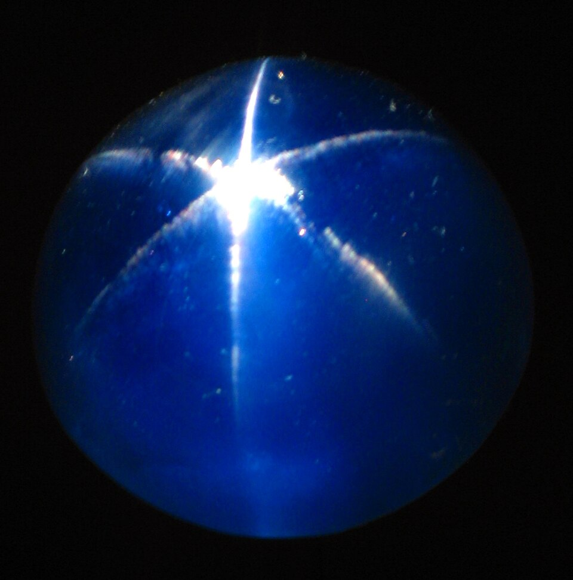{ loading=lazy }](../assets/img/gems/star-sapphire.jpg)
*The Star of Asia, a 330-carat star sapphire from Burma, in the Smithsonian's National Museum of
Natural History.*

Pliny describes a stone he calls *asteria*. "By a property of its nature it holds an enclosed light,
in a kind of pupil." As the stone is tilted the light passes "from one place to another, as though walking
inside", and turned to the sun it throws back white rays "in the shape of a star" (*Natural
History* 37.131). Pliny counts it among the whitish stones, so it was probably a pale star corundum, the mineral of
sapphire.
The effect is asterism, and gemmologists class such stones as phenomenal gems. Fine needles of
another mineral, called silk, lie inside the crystal in three directions, and each set throws one
bright line across the dome; the three lines cross to make the six rays (Jin and others,
*Gems & Gemology*, Summer 2025). Take the stone out of the light and the star is gone; move the light
and it moves.

No verse names this stone. Pliny and Ezekiel did reach for the same picture, though. Ezekiel's word
for the gleam of the wheels is *ʿayin*, "eye" (Ezekiel 1:16; 10:9). Pliny's word for the star is
*pupilla*, the pupil of an eye. Nearly seven centuries apart, both men likened the light living in a
stone to an eye, Ezekiel by a Hebrew idiom, Pliny by a picture. That tells you how people saw gems, and it settles
nothing about which stone Ezekiel meant.

### The colour that turns

[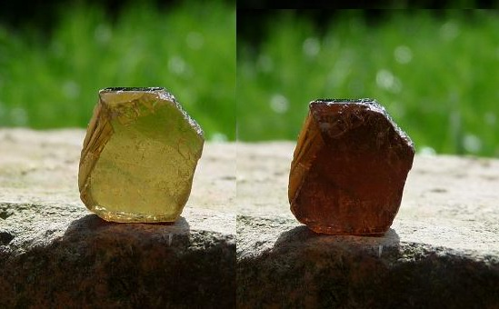{ loading=lazy }](../assets/img/gems/tourmaline-pleochroism.jpg)
*One tourmaline in two directions of light, photographed through a turning polarising filter. To the
unaided eye the shift shows as the stone is turned.*

Most clear gems are doubly refractive, or anisotropic, a property called birefringence: the crystal
splits each ray in two, and the two rays can
carry different colours, so the stone's colour changes with the direction you look through it. That is pleochroism (dichroism where there are two colours,
trichroism where there are three). GIA's Richard Hughes calls blue sapphire "strongly dichroic". Emerald, beryl and amethyst show it too, in varying strength.
Diamond and garnet are isotropic and cannot do it at all, since "pleochroism cannot occur in singly
refractive stones"
(Hughes, *Gems & Gemology*, Fall 2014). Chalcedony, sardonyx, carnelian and chrysoprase among the
foundations, and agate and onyx on the breastpiece, are cryptocrystalline, masses of tiny crystals
that look the same from every side.

No ancient writer described double refraction. Rasmus Bartholin first did, with Iceland spar, in
1669, so it explains nothing in the text. It is one more way these stones return light from outside:
many show a different colour from each side.

## Names on the stones

The stones carried names. "There shall be twelve stones with their names according to the names of
the sons of Israel. They shall be like signets, each engraved with its name, for the twelve tribes"
(Exodus 28:21, ESV). The two shoulder stones were "stones of remembrance", and Aaron bore Israel's
names "before the LORD on his two shoulders for remembrance" (Exodus 28:12, ESV). Every time he went
in, Israel went in with him:

> ✝️ Exodus 28:29 (ESV)
>
> 29 So Aaron shall bear the names of the sons of Israel in the breastpiece of judgment on his heart,
> when he goes into the Holy Place, to bring them to regular remembrance before the LORD.

In the city the stones carry names again. "The wall of the city had twelve foundations, and on them
were the twelve names of the twelve apostles of the Lamb" (Revelation 21:14, ESV). The names of the
twelve tribes are on the gates (Revelation 21:12). [The New
Jerusalem](../last-things/new-jerusalem.md) works through what the two sets of names say about
Israel and the church. The stones that once went into the Holy Place on one man's chest are now
the foundations of a city shaped like the Most Holy Place, where all God's people live.

**This shows that God remembers His people by name.** He had their names cut into stone and carried
before Him, and He has written the names of His Son's apostles into the foundations of the city.
Jesus, the great high priest, "always lives to make intercession" for those who come to God through
Him (Hebrews 7:25, ESV). He knows your name.

## Stones worn and stones built

### The cherub of Tyre

Ezekiel's lament over the king of Tyre dresses him in the stones:

> ✝️ Ezekiel 28:13-14 (ESV)
>
> 13 You were in Eden, the garden of God; every precious stone was your covering, sardius, topaz,
> and diamond, beryl, onyx, and jasper, sapphire, emerald, and carbuncle; and crafted in gold were
> your settings and your engravings. On the day that you were created they were prepared. 14 You
> were an anointed guardian cherub. I placed you; you were on the holy mountain of God; in the midst
> of the stones of fire you walked.

The Hebrew names nine stones, all from the breastpiece. The Septuagint names all twelve, σάρδιον,
τοπάζιον, σμάραγδος, ἄνθραξ, σάπφειρος, ἴασπις, then λιγύριον, ἀχάτης, ἀμέθυστος, χρυσόλιθος,
βηρύλλιον, ὀνύχιον, in exactly the breastpiece's order, with silver and gold after the sixth. In
that text the king wears every stone of the high priest's breastpiece, and no tribe is named on
them. (The Septuagint also places him "with the cherub" in 28:14, where the Hebrew calls him one.) Then: "Your heart was
proud because of your beauty; you corrupted your wisdom for the sake of your splendor" (Ezekiel
28:17, ESV).

Whether this lament describes Satan behind the king of Tyre is contested. [Pride](../sin/pride.md#did-satan-fall-through-pride)
sets out the case on both sides. Either way, the passage shows a creature dressed in stones that
were made to show God's light, who came to treat the shining as his own.

### Babylon and the Bride

Revelation sets two women side by side, and both are cities. The prostitute "was arrayed in purple
and scarlet, and adorned with gold and jewels and pearls" (Revelation 17:4, ESV), and the merchants
mourn the city "adorned with gold, with jewels, and with pearls!" (Revelation 18:16, ESV). The
Greek for "adorned" is κεχρυσωμένη (*kechrysōmenē*, G5558), "gilded", a covering laid over her. The Bride has "the glory of God" (Revelation 21:11, ESV), and the same materials, gold,
precious stone and pearl, are what she is built of (Revelation 21:18-21). [The Harlot and the
Bride](../last-things/the-harlot-and-the-bride.md) treats the two cities in full.

**This shows that God gives His glory to His people as their home.** Babylon wore the stones. God
builds His city out of them, and lights it Himself.

## So you may shine

The word John used for the city's radiance, φωστήρ, appears in only one other place in the New
Testament. Paul uses it of you:

> ✝️ Philippians 2:14-15 (ESV)
>
> 14 Do all things without grumbling or disputing, 15 that you may be blameless and innocent,
> children of God without blemish in the midst of a crooked and twisted generation, among whom you
> shine as lights in the world,

Paul is echoing Daniel. In the Old Greek of Daniel 12:3, at the resurrection, the wise will shine
"like the luminaries of heaven", with the same verb, φαίνω (*phainō*, G5316), and the same noun,
φωστήρ, that Paul uses. The ESV renders the Hebrew: they "shall shine like the brightness of the sky
above" (Daniel 12:3, ESV). What the city will be, God's people are already becoming. "We all, with unveiled
face, beholding the glory of the Lord, are being transformed into the same image from one degree of
glory to another" (2 Corinthians 3:18, ESV). Zechariah saw it coming for Israel: "like the jewels of
a crown they shall shine on his land" (Zechariah 9:16, ESV). Peter calls you "living stones" being
built into a house where you serve as priests (1 Peter 2:5, ESV).

John's Gospel shows what this looks like in one man:

> ✝️ John 1:7-9 (ESV)
>
> 7 He came as a witness, to bear witness about the light, that all might believe through him. 8 He
> was not the light, but came to bear witness about the light. 9 The true light, which gives light to
> everyone, was coming into the world.

Jesus called John the Baptist "a burning and shining lamp" (John 5:35, ESV), ὁ λύχνος (*lychnos*,
G3088). In the city that word belongs to Jesus: "its lamp is the Lamb", and the glory of God "gives
it light" (Revelation 21:23, ESV), with φωτίζω (*phōtizō*, G5461), the verb of the true light in
John 1:9. The Baptist shone, and everything he shone with pointed to the Light. A witness carries
light the way a stone does.

This is the work of the Holy Spirit, "for this comes from the Lord who is the Spirit" (2
Corinthians 3:18, ESV), and it ends in glorification, when Christ "will transform our lowly body to
be like his glorious body" (Philippians 3:21, ESV). A stone shines only while it faces the light. So
you may shine, keep your face toward Jesus, in whose face God's glory is seen (2 Corinthians 4:6).

## Discussion Questions

1. **The language.** Ezekiel says the wheels looked "like the gleaming of beryl", כְּעֵין תַּרְשִׁישׁ (*keʿeyn tarshish*), literally "like the eye of the stone"
   (Ezekiel 1:16). Why would a prophet describe God's throne by the sparkle of a stone, and what
   would he lose by describing its substance?
2. **The text in its context.** Ezekiel saw the throne of God in Babylon, by a canal, among exiles
   whose temple was about to fall (Ezekiel 1:1-3). What did it tell them that the glory of God
   appeared there?
3. **Christ.** The stones over Aaron's heart carried Israel's names into the Holy Place (Exodus
   28:29), and Jesus "always lives to make intercession" for His people (Hebrews 7:25). What changes
   in how you pray when you know He carries your name?
4. **The hard part.** The Septuagint dresses the king of Tyre in all twelve breastpiece stones;
   the Hebrew names nine (Ezekiel 28:13). Read Ezekiel 28:11-19 with the Greek list in mind. Does it
   make the lament read more like the fall of a priestly being than the fall of a king, and how far
   can a variant like this carry an argument?
5. **Looking closer.** Pliny called the star in a sapphire a "pupil"; Ezekiel called the gleam of a
   stone its "eye" (Ezekiel 1:16). Neither light belongs to the stone. Where else does Scripture show
   a person shining with a light that is not their own (Exodus 34:29-35; 2 Corinthians 3:18), and
   what happened when the light was taken away?
6. **Be transformed.** The city has "no need of sun or moon" because God's glory gives it light
   (Revelation 21:23), and Paul says you "shine as lights in the world" (Philippians 2:15). Where are
   you most tempted to treat God's gifts in you as your own shine, and what would it look like to
   turn that back toward Him this week?

## Annex: Correlations Scripture does not make

Popular charts pair each stone with a tribe, an apostle, a month or a meaning. Here is what each
rests on.

- **Stone to tribe.** Exodus 28:21 says each stone bears one son's name, and it does not say which.
  Exodus 28:10 sets the shoulder stones' names "in the order of their birth" (ESV). Josephus applies
  birth order to the breastpiece too (*Antiquities* 3.7.5), which in his own list
  puts Reuben on a sardonyx.
  That is his reading, and the text is silent.
- **Stone to apostle.** Revelation 21:14 puts the twelve apostles' names on the foundations and does
  not pair them with stones.
- **Stones and the months or the zodiac.** Josephus says the twelve stones may be read as the months
  "or the like number of the signs of that circle which the Greeks call the Zodiac", and the two
  shoulder stones as the sun and moon (*Antiquities* 3.7.7, Whiston). Scripture makes neither
  connection.
- **A meaning for each colour.** Victorinus of Pettau, in the oldest surviving Latin commentary on
  Revelation (died about AD 304), read the jasper as water and the sardius as fire, the two
  judgments of the flood and the end (*Commentary on the Apocalypse*, on 4:3). It is an early
  example of assigning each stone its own lesson.

The text gives the stones two jobs: to carry names and to show light. The *ESV Study Bible* says the
jewels "are not meant to be interpreted individually but together" (note on Revelation 4:3), and
Walvoord, from the dispensational side, says "no clue is given as to the precise interpretation" (on
Revelation 21:19-21). Read them as the prophets used them, together, as the glory of God.

## References & Recommended Reading

### Ancient sources

- Pliny the Elder, *Natural History* 37.53, 60, 62, 76, 86, 90, 92, 105, 107, 113, 115, 119-121, 125-126, 131,
  136-137, 139, Latin text via LacusCurtius (public domain) — what each Greek stone name meant, the
  rainbow-throwing crystal. Translations in this study are its own.
- Flavius Josephus, *Antiquities of the Jews* 3.7.5, 3.7.7 and 3.8.9, trans. William Whiston (1737,
  public domain) — the order of the stones, their reading as months and zodiac, and the tradition
  that they shone.
- Rasmus Bartholin, *Experimenta crystalli Islandici disdiaclastici* (Copenhagen, 1669) — the first
  description of double refraction.
- Victorinus of Pettau, *Commentary on the Apocalypse*, on 4:3, *Ante-Nicene Fathers* vol. 7 (public
  domain).

### Gemmology

- Shiyun Jin, Nathan D. Renfro, Aaron C. Palke and James E. Shigley, "Structures Behind the
  Spectacle: A Review of Optical Effects in Phenomenal Gemstones and Their Underlying Nanotextures,"
  *Gems & Gemology* (Gemological Institute of America) 61, no. 2, Summer 2025
  ([gia.edu](https://www.gia.edu/gems-gemology/summer-2025-phenomenal-gemstones)) — needle
  inclusions and the star in star sapphire.
- Richard W. Hughes, "Pleochroism in Faceted Gems: An Introduction," *Gems & Gemology*
  (Gemological Institute of America) 50, no. 3, Fall 2014
  ([gia.edu](https://www.gia.edu/gems-gemology/fall-2014-introduction-pleochroism-faceted-gems)) —
  double refraction and pleochroism; none in diamond or garnet.
- Gemological Institute of America, "Diamond Cut" ([gia.edu](https://4cs.gia.edu/en-us/diamond-cut/))
  — fire as the dispersion of light into spectral colours.

### Commentaries and study Bibles

- John F. Walvoord, "Revelation," in *The Bible Knowledge Commentary*, ed. John F. Walvoord and Roy
  B. Zuck (Victor Books) — on Revelation 21:17-21. Quoted briefly with attribution.
- *ESV Study Bible* (Crossway) — verse text (ESV) and notes on Revelation 4:3 and 21:19-21.
- *NIV Cultural Backgrounds Study Bible* (Zondervan) — notes on Revelation 4:3 and 21:11, 19-21;
  NIV text of Exodus 28:17-20.
- *NIV Biblical Theology Study Bible* (Zondervan) — notes on Revelation 4:3 and 21:19.
- *Legacy Standard Bible* (The Lockman Foundation) — footnotes on Ezekiel 1:22 and Revelation 21:11.
- *New American Standard Bible* 2020 (The Lockman Foundation) — text of Exodus 28:17-20.
- Berean Standard Bible, CSB and NLT footnotes on Exodus 28:17 — the identifications uncertain.
- Brenton's Septuagint and Tischendorf's Greek New Testament (public domain) — the Greek stone names
  of Exodus 28, Ezekiel 28 and Revelation 21.

### Photographs

All via Wikimedia Commons, resized.

- Gold, carnelian and lapis lazuli beads from Ur: [SpeakingArch](https://commons.wikimedia.org/wiki/File:Gold,_Carnelian_and_Lapis_Lazuli_beads,_PG_1236,_Ur,_Early_Dynastic_III_Period,_British_Museum.jpg), [CC BY-SA 4.0](https://creativecommons.org/licenses/by-sa/4.0/).
- Rock crystal: [Robert M. Lavinsky](https://commons.wikimedia.org/wiki/File:Quartz-153471.jpg), [CC BY-SA 3.0](https://creativecommons.org/licenses/by-sa/3.0/).
- Lapis lazuli: [Parent Géry](https://commons.wikimedia.org/wiki/File:Lazurite_polie_(Afghanistan)_1.JPG), [CC BY-SA 3.0](https://creativecommons.org/licenses/by-sa/3.0/).
- Chalcedony: [Robert M. Lavinsky](https://commons.wikimedia.org/wiki/File:Chalcedony-121756.jpg), [CC BY-SA 3.0](https://creativecommons.org/licenses/by-sa/3.0/).
- Emerald: [Robert M. Lavinsky](https://commons.wikimedia.org/wiki/File:Beryl-Quartz-Emerald-Zambia-33mm_0891.jpg), [CC BY-SA 3.0](https://creativecommons.org/licenses/by-sa/3.0/).
- Sardonyx lit from behind: [Warclachaja](https://commons.wikimedia.org/wiki/File:Sardonyx_illuminated.JPG), [CC BY-SA 4.0](https://creativecommons.org/licenses/by-sa/4.0/).
- Carnelian: [W.carter](https://commons.wikimedia.org/wiki/File:Four_carnelian_cabochons.jpg), [CC BY-SA 4.0](https://creativecommons.org/licenses/by-sa/4.0/).
- Golden beryl: [Robert M. Lavinsky](https://commons.wikimedia.org/wiki/File:Beryl-51201.jpg), [CC BY-SA 3.0](https://creativecommons.org/licenses/by-sa/3.0/).
- Beryl: [Robert M. Lavinsky](https://commons.wikimedia.org/wiki/File:Beryl-209736.jpg), [CC BY-SA 3.0](https://creativecommons.org/licenses/by-sa/3.0/).
- Peridot: [Darla Sondrol](https://commons.wikimedia.org/wiki/File:Peridot_(GeoDIL_number_-_1027).jpg), CC0.
- Chrysoprase: [W.carter](https://commons.wikimedia.org/wiki/File:Chrysoprase_cabochon_1.jpg), [CC BY-SA 4.0](https://creativecommons.org/licenses/by-sa/4.0/).
- Sapphire: [James St. John](https://commons.wikimedia.org/wiki/File:Sapphire_(gem_gravel_mine,_Ratnapura_area,_Sri_Lanka)_2_(34726082111).jpg), [CC BY 2.0](https://creativecommons.org/licenses/by/2.0/).
- Amethyst: [Robert M. Lavinsky](https://commons.wikimedia.org/wiki/File:Quartz-214680.jpg), [CC BY-SA 3.0](https://creativecommons.org/licenses/by-sa/3.0/).
- Pearl: [Wmpearl](https://commons.wikimedia.org/wiki/File:Black_lipped_oyster_with_natural_pearl,_Robert_Wan_Pearl_Museum.JPG), CC0.
- Garnet: [W.carter](https://commons.wikimedia.org/wiki/File:Oval_faceted_red_garnet_1.jpg), [CC BY 4.0](https://creativecommons.org/licenses/by/4.0/).
- Agate: [Ra'ike](https://commons.wikimedia.org/wiki/File:Quartz_-_Agateplate,_redbrown-white_(cropped).jpg), [CC BY-SA 3.0](https://creativecommons.org/licenses/by-sa/3.0/).
- Star of Asia sapphire: [thisisbossi](https://commons.wikimedia.org/wiki/File:Natural_History_Museum_-_Star_of_Asia_Sapphire_(close_crop).jpg), [CC BY-SA 2.0](https://creativecommons.org/licenses/by-sa/2.0/).
- Tourmaline in two directions: [Mauswiesel](https://commons.wikimedia.org/wiki/File:Tourmalinex2.JPG), public domain.
- Onyx: [Simon Eugster](https://commons.wikimedia.org/wiki/File:Onyx.jpg), [CC BY-SA 3.0](https://creativecommons.org/licenses/by-sa/3.0/).

### On this site

- [The New Jerusalem](../last-things/new-jerusalem.md) — the city, its cube, and the tribes and
  apostles on its gates and foundations.
- [The Harlot and the Bride](../last-things/the-harlot-and-the-bride.md) — Babylon and the Bride as
  two cities.
- [Pride](../sin/pride.md) — Ezekiel 28 and the question of Satan's fall.
- [The Heavenly Pattern](../jesus/the-heavenly-pattern/index.md) — the tabernacle furniture drawn to
  the pattern shown to Moses.
