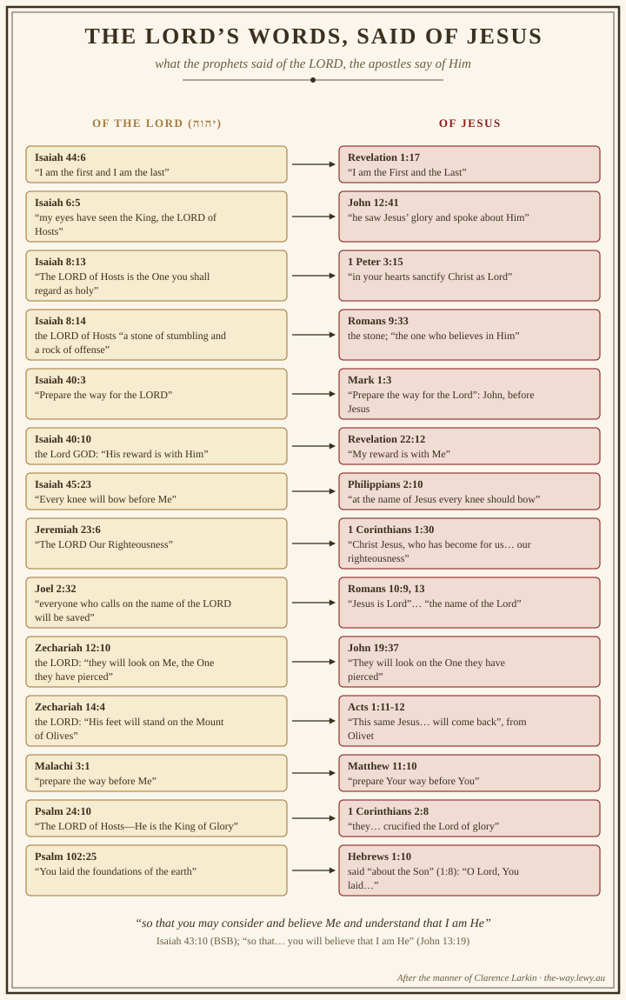

# Foretold Long Ago

**In one sentence:** More than a hundred prophecies, written centuries before Jesus was born, have
come to pass in Him, and that alone proves He is the Christ: Apollos was "proving from the
Scriptures that Jesus is the Christ" (Acts 18:28, BSB).

Every prophecy this study counts is in [The Prophecies of Christ](../prophecies-of-christ.md), the
site's ledger of them, where you can filter them by subject, by who brought each about, and by
whether Israel read it of the Messiah before He came.

## God's own argument

The case for prophecy is God's before it is ours. In Isaiah He summons the idols to court and
rests His claim to be God on what He foretold:

> ✝️ Isaiah 45:21 (BSB)
>
> 21 Speak up and present your case—yes, let them take counsel together. Who foretold this long ago? Who announced it from ancient times? Was it not I, the LORD? There is no other God but Me, a righteous God and Savior; there is none but Me.

He makes the same challenge to the idols: "Tell us the things that are to come, so that we may know
that you are gods" (Isaiah 41:23, BSB). And He gives His reason for speaking first: "I announced it
before it came to pass, so that you could not claim, 'My idol has done this'" (Isaiah 48:5, BSB).
"I declare the end from the beginning, and from ancient times what is still to come" (Isaiah 46:10,
BSB).

Jesus made the LORD's argument His own. On the night He was betrayed He told His disciples, "I am
telling you now before it happens, so that when it comes to pass, you will believe that I am He"
(John 13:19, BSB). His closing words, ἵνα πιστεύσητε... ὅτι ἐγώ εἰμι (*hina pisteusēte... hoti
egō eimi*, "so that you may believe that I am He"), take up the Septuagint's words at Isaiah 43:10,
ἵνα γνῶτε καὶ πιστεύσητε καὶ συνῆτε ὅτι ἐγώ εἰμι, where the LORD says Israel is His witness "so that
you may consider and believe Me and understand that I am He" (Isaiah 43:10, BSB). After the resurrection He showed them how far it
reached: "Everything must be fulfilled that is written about Me in the Law of Moses, the Prophets,
and the Psalms" (Luke 24:44, BSB).

This shows that God is the Lord of history, who binds Himself to His word in public and in advance,
and that the Jesus who fulfilled it is the "I am He" of Isaiah. A promise He made centuries before He
kept it is one you can rest your life on.

## The prophet's view and history's view

Peter says the prophets searched "the time and setting to which the Spirit of Christ in them was
pointing when He predicted the sufferings of Christ and the glories to follow" (1 Peter 1:11, BSB).
The chart draws both halves of that sentence. From where a prophet stood, the sufferings and the
glory lined up like two peaks, one in front of the other. From where we stand, the first peak lies
behind us, and the second is still ahead.

<!-- prophecies-of-christ: dated -->

## The LORD's words, said of Jesus

Again and again the apostles take a text about the LORD (יהוה, *YHWH*) and
say it of Jesus: the first and the last, the One before whom every knee bows, the One on whom they
look whom they pierced.

## How unlikely by chance?

This study puts no odds on any single prophecy. A probability for each one would be a guess, and one
bad guess would discredit the true fulfilments beside it. So you set the chance yourself.

Suppose the fulfilments were chance. Count only what no one could have arranged: prophecies the New
Testament says were fulfilled, at an event this site dates, by God alone, by His enemies, or by
someone with no thought of the prophecy. Leave out what Jesus did knowingly and what His followers
did, since a critic says those could be staged, and what no witness could see. Count each moment
once, however many prophecies it fulfilled, so that the prophecies fulfilled when He was crucified at
the third hour are one trial and not three. Then give each moment a chance, as generous as you like.

<!-- prophecies-of-christ: floor -->

The figure assumes two things, and says so. It treats the moments as independent, though a critic may
say one led to another. And the record of each fulfilment is the Gospels', which His opponents' own
part in it supports: they had no reason to fulfil the texts of a Messiah they rejected. The figure is
a floor, set by you: every choice above makes the number smaller.

## The studies, a week at a time

These studies take the prophecies one theme at a time, for a group or on your own. This is the
first.

<!-- series-sessions -->

## References & Recommended Reading

- **Scripture.** Berean Standard Bible (BSB), public domain. Greek: SBLGNT; the Septuagint from
  Brenton's edition. Verified against `bible-text.db`, 2026-11-26.
- **The ledger.** [The Prophecies of Christ](../prophecies-of-christ.md), rendered from
  `docs/data/prophecies-of-christ.toml`; every count in this study is drawn from it when the site is
  built.
- **On this site.** [What Literary Criticism Declares](../scripture/what-literary-criticism-declares.md)
  (the dates, and prophecies written and copied before the events); [Two mountain
  peaks](../last-things/immediately-after.md#two-mountain-peaks) (near and far in one sentence).
