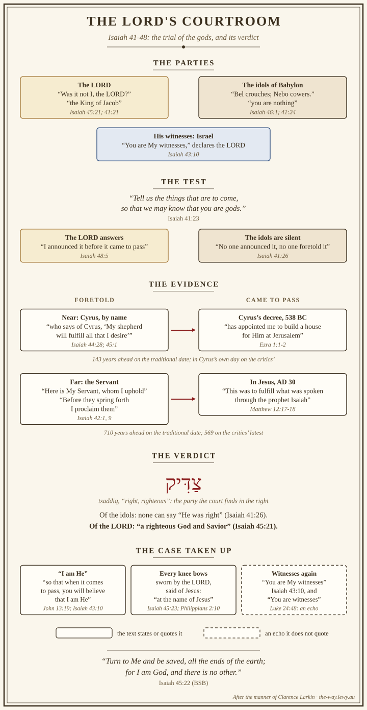

# Foretold Long Ago

"Present your case," says the LORD (Isaiah 41:21, BSB). In Isaiah He takes the gods of Babylon to
court. The charge is simple: tell us what is going to happen. They cannot. He can, and He names His
evidence before it comes to pass. Seven centuries later a Jew from Alexandria went to Achaia
and made the same case about Jesus: "he powerfully refuted the Jews in public
debate, proving from the Scriptures that Jesus is the Christ" (Acts 18:28, BSB).

**In one sentence:** More than a hundred prophecies, written centuries before Jesus was born, have
come to pass in Him, and that alone proves He is the Christ: Apollos was "proving from the
Scriptures that Jesus is the Christ" (Acts 18:28, BSB).

Every prophecy this study counts is in [The Prophecies of Christ](../prophecies-of-christ.md), the
site's ledger. There you can filter them by subject and by who brought each about.

## Key Takeaways

*(This section follows the [Key Takeaways](../about/key-takeaways.md) format — see that page for what each part is for.)*

### Types & Prophecy

A prophecy is a prediction in words: Micah names Bethlehem as the Ruler's birthplace (Micah 5:2). A
type is a person, event or institution God shaped to point to Christ: "Christ, our Passover lamb,
has been sacrificed" (1 Corinthians 5:7, BSB). The ledger counts both. God's argument in Isaiah
rests on the first kind: words spoken in public before the event, so that no one could credit an
idol (Isaiah 48:5).

### Lessons about Jesus

- **He is the One the Scriptures foretold.** "Everything must be fulfilled that is written about Me
  in the Law of Moses, the Prophets, and the Psalms" (Luke 24:44, BSB).
- **He foretells as the LORD foretells.** "I am telling you now before it happens, so that when it
  comes to pass, you will believe that I am He" (John 13:19, BSB).
- **He is the "I am He" of Isaiah.** The LORD swore that every knee will bow to Him (Isaiah 45:23),
  and Paul says every knee will bow at the name of Jesus (Philippians 2:10).
- **He is proved from the Scriptures.** Paul and Apollos opened the prophets and set the texts
  before their hearers (Acts 17:2-3; 18:28).

### Memory verses

> ✝️ Isaiah 46:10 (BSB)
>
> 10 I declare the end from the beginning, and from ancient times what is still to come. I say, ‘My purpose will stand, and all My good pleasure I will accomplish.’

> ✝️ John 13:19 (BSB)
>
> 19 I am telling you now before it happens, so that when it comes to pass, you will believe that I am He.

### Be Transformed

- **Think.** God binds Himself to His word in public and in advance, and He kept it in His Son
  Jesus. So the promises He has made to you will stand: "My purpose will stand, and all My good
  pleasure I will accomplish" (Isaiah 46:10, BSB).
- **Attitude.** Come to the Scriptures as the Bereans did, eager and checking: they "received the
  message with great eagerness and examined the Scriptures every day to see if these teachings
  were true" (Acts 17:11, BSB).
- **Do.** "You are witnesses of these things" (Luke 24:48, BSB). This week, read Isaiah 53:3-6
  aloud with one person, ask them who it describes, and then show them where it came to pass, as
  Apollos showed "from the Scriptures that Jesus is the Christ" (Acts 18:28, BSB).

### Prayer

Father, You declared the end from the beginning, and You alone were found right. You kept every word
You spoke about Your Son Jesus, though Your people were slow to see it. Thank You that the One they
pierced is the "I am He", and that I may turn to Him and be saved. Make me eager for Your word, and
make me a witness of these things to someone who has not yet seen them. In Jesus' name. Amen.

## Study outline

- [God's own argument](#gods-own-argument). Isaiah's courtroom, the verdict "He was right", Cyrus as the evidence, and the critics' date.
- [Former things, new things](#former-things-new-things). The Servant, set in the same speeches, and what was hidden until now.
- [I am He](#i-am-he). Jesus makes the LORD's argument His own, and the LORD's words are said of Him.
- [Proving from the Scriptures](#proving-from-the-scriptures). How Jesus, Paul, Apollos and Peter argued it.
- [The prophet's view and history's view](#the-prophets-view-and-historys-view). The sufferings and the glory, as the prophets saw them and as we do.
- [How unlikely by chance?](#how-unlikely-by-chance). The closing argument: you set the odds.
- [The studies, a week at a time](#the-studies-a-week-at-a-time) and [Discussion questions](#discussion-questions).

## God's own argument

### A courtroom in Babylon

Isaiah 40-48 speaks to Judah's exiles in Babylon. They live among Babylon's gods, and Isaiah pictures those gods
loaded onto animals and carried off: "Bel crouches; Nebo cowers. Their idols weigh down beasts and
cattle" (Isaiah 46:1, BSB). "They themselves go into captivity" (Isaiah 46:2, BSB). The question for
an exile is which god rules history.

The LORD answers it in court. Again and again in these chapters He summons the nations and their
gods to argue their case (Isaiah 41:21-29; 43:8-13; 44:6-8; 45:18-25; 46:8-11; 48:3-8). Each time
the test is the same.

> ✝️ Isaiah 41:22-23 (BSB)
>
> 22 “Let them come and tell us what will happen. Tell the former things, so that we may reflect on them and know the outcome. Or announce to us what is coming. 23 Tell us the things that are to come, so that we may know that you are gods. Yes, do something good or evil, that we may look on together in dismay.

The idols say nothing. "No one announced it, no one foretold it, no one heard your words" (Isaiah
41:26, BSB). Then the LORD rests His own case:

> ✝️ Isaiah 45:21 (BSB)
>
> 21 Speak up and present your case—yes, let them take counsel together. Who foretold this long ago? Who announced it from ancient times? Was it not I, the LORD? There is no other God but Me, a righteous God and Savior; there is none but Me.

He gives His reason for speaking first: "I announced it before it came to pass, so that you could
not claim, 'My idol has done this'" (Isaiah 48:5, BSB). "I declare the end from the beginning, and
from ancient times what is still to come" (Isaiah 46:10, BSB). The verb for declaring, נָגַד (*nagad*), and its place in Isaiah are treated in [What Literary Criticism
Declares](../scripture/what-literary-criticism-declares.md#declaring-the-end-from-the-beginning).

### The verdict: "He was right"

The court has a verdict word. The LORD has raised up a conqueror "from the north... from the east"
(Isaiah 41:25, BSB), whom He later names as Cyrus (Isaiah 44:28; 45:1). He asks who foretold it, "so
that we may say: 'He was right'" (Isaiah 41:26, BSB). "Right" is צַדִּיק
(*tsaddiq*, tsahd-DEEK, H6662), the word for the party a court finds in the right. The judges are
to rule "so that the innocent may be acquitted" (Deuteronomy 25:1, BSB), and "the innocent" there is
הַצַּדִּיק. No idol earns the word.
Four chapters later the LORD claims it as His title: "a righteous God and Savior" (Isaiah 45:21,
BSB), אֵל צַדִּיק (*el tsaddiq*). The Septuagint gives the two uses two
words, ἀληθῆ (*alēthē*, "true") at Isaiah 41:26 and δίκαιος (*dikaios*, "righteous") at Isaiah
45:21. Both say what the court found.

This shows that God is the righteous judge of His own case. He named His evidence in advance, in
public, and He alone was found right. And in the same breath He is "Savior": the God who proves
Himself turns at once to the nations who lost the case. "Turn to Me and be saved, all the ends of the
earth; for I am God, and there is no other" (Isaiah 45:22, BSB).

### The evidence then: Cyrus

In its own setting, the evidence is a man. The LORD "says of Cyrus, 'My shepherd will fulfill all
that I desire,' who says of Jerusalem, 'She will be rebuilt,' and of the temple, 'Let its
foundation be laid'" (Isaiah 44:28, BSB). He calls him "a bird of prey from the east, a man for My
purpose from a far-off land" (Isaiah 46:11, BSB). Cyrus king of Persia took Babylon in 539 BC, a date the
Nabonidus Chronicle fixes ([Chronology Anchors](../chronology/chronology-anchors.md#babylon-falls-and-cyrus-sends-the-peoples-home-fix-confirm)).
In his first year he decreed the return:

> ✝️ Ezra 1:1-2 (BSB)
>
> 1 In the first year of Cyrus king of Persia, to fulfill the word of the LORD spoken through Jeremiah, the LORD stirred the spirit of Cyrus king of Persia to send a proclamation throughout his kingdom and to put it in writing as follows: 2 “This is what Cyrus king of Persia says: ‘The LORD, the God of heaven, who has given me all the kingdoms of the earth, has appointed me to build a house for Him at Jerusalem in Judah.

Ezra names Jeremiah's word, the seventy years (Jeremiah 25:11-12; 29:10). Cyrus's own decree names the house
Isaiah said he would found. The law had already given Israel the test for every prophet. "When a prophet
speaks in the name of the LORD and the message does not come to pass or come true, that is a
message the LORD has not spoken" (Deuteronomy 18:22, BSB). The LORD put Himself under His own law.

### The critics' date

The traditional date puts Isaiah son of Amoz between about 740 and 681 BC, a century and a half
before Cyrus. Critical scholarship dates Isaiah 40-55 to about 560-540 BC, in Cyrus's own lifetime.
That is contested, and the dates on both views, with their sources, are in [What Literary Criticism
Declares](../scripture/what-literary-criticism-declares.md).

God's argument for His Christ does not wait on that question. Take the latest date any critic gives.
The Servant who "was pierced for our transgressions" (Isaiah 53:5, BSB) was still written 573 years
before the cross. And the Great Isaiah Scroll, copied about 125 BC, holds the chapter: a manuscript
you can stand in front of, older than the event it describes.

## Former things, new things

The courtroom speeches have a second subject. Between them stands the Servant.

> ✝️ Isaiah 42:1 (BSB)
>
> 1 “Here is My Servant, whom I uphold, My Chosen One, in whom My soul delights. I will put My Spirit on Him, and He will bring justice to the nations.

Eight verses later the LORD sets this Servant inside His argument: "Behold, the former things have
happened, and now I declare new things. Before they spring forth I proclaim them to you" (Isaiah
42:9, BSB). Cyrus was the near evidence. The Servant was the new thing, proclaimed before He
sprang forth. Matthew says which: "This was to fulfill what was spoken through the prophet Isaiah:
'Here is My Servant, whom I have chosen'" (Matthew 12:17-18, BSB).

The LORD says these new things were hidden. "From now on I will tell you of new things, hidden things
unknown to you" (Isaiah 48:6, BSB). Paul uses the same pattern for the gospel: "the mystery concealed
for ages past but now revealed and made known through the writings of the prophets" (Romans
16:25-26, BSB). So the argument from prophecy runs past Cyrus to the Christ. The God who named the
Persian named His Servant too, and in the same scroll.

## I am He

### The LORD's words in the mouth of Jesus

The LORD's courtroom has a refrain: אֲנִי הוּא (*ani hu*, ah-NEE HOO), "I am
He". "You are My witnesses," declares the LORD, "so that you may consider and believe Me and
understand that I am He" (Isaiah 43:10, BSB). "I am He; I am the first, and I am the last" (Isaiah
48:12, BSB). The Septuagint renders the clause at Isaiah 43:10 ἵνα γνῶτε καὶ πιστεύσητε καὶ συνῆτε
ὅτι ἐγώ εἰμι.

Jesus made the LORD's argument His own. On the night He was betrayed He quoted David of Judas: "The
one who shares My bread has lifted up his heel against Me" (John 13:18, BSB, from Psalm 41:9). Then
He said why He told them first: "I am telling you now before it happens, so that when it comes to
pass, you will believe that I am He" (John 13:19, BSB). His closing words, ἵνα πιστεύσητε... ὅτι ἐγώ
εἰμι (*hina pisteusēte... hoti egō eimi*, "so that you may believe that I am He"), take up the
Septuagint's words at Isaiah 43:10.

He did it more than once. "And now I have told you before it happens, so that when it does happen,
you will believe" (John 14:29, BSB). "When you have lifted up the Son of Man, then you will know that
I am He, and that I do nothing on My own, but speak exactly what the Father has taught Me" (John 8:28,
BSB). Each time He foretells, as the LORD foretold, so that the fulfilment will show who He is. And
each time He speaks as the Son, saying what the Father taught Him.

### Every knee will bow

Two verses after God's argument, in the same speech, the LORD swears an oath: "By Myself I have
sworn; truth has gone out from My mouth, a word that will not be revoked: Every knee will bow before
Me, every tongue will swear allegiance" (Isaiah 45:23, BSB). Paul says it of Jesus: "that at the
name of Jesus every knee should bow, in heaven and on earth and under the earth, and every tongue
confess that Jesus Christ is Lord, to the glory of God the Father" (Philippians 2:10-11, BSB). The
risen Christ says, "I am the First and the Last" (Revelation 1:17, BSB), the LORD's own title (Isaiah
44:6; 48:12). [The Names of God](../god/names-of-god.md) follows the LORD's name to the Son.

Again and again the apostles take a text about the LORD (יהוה, *YHWH*) and
say it of Jesus: the first and the last, the One before whom every knee bows, the One on whom they
look whom they pierced.

This shows that God has one Son who shares His name and His foreknowledge. The deity of Christ is
written into the argument itself. The God who alone foretells is the God to whom every knee will bow,
and the knee bows at the name of Jesus.

## Proving from the Scriptures

### The Law, the Prophets and the Psalms

The risen Jesus taught His disciples this method Himself. "Everything must be fulfilled that is
written about Me in the Law of Moses, the Prophets, and the Psalms" (Luke 24:44, BSB). Those are
the three parts of Israel's Scriptures. "Then He opened their minds to understand the Scriptures. And
He told them, 'This is what is written: The Christ will suffer and rise from the dead on the third
day'" (Luke 24:45-46, BSB). [Known Before, Seen After](known-before-seen-after.md), the next week of
this series, reads what that opening changed.

Then He told them their part: "You are witnesses of these things" (Luke 24:48, BSB). In Isaiah's
court Israel was the LORD's witness to what He foretold (Isaiah 43:10; 44:8). Now the apostles are
witnesses that it came to pass. Luke uses the same word, μάρτυρες (*martyres*, G3144), and the
Septuagint has it at Isaiah 43:10; the echo is likely, though Luke does not quote the verse. Jesus' commission at Acts 1:8 ends with "to the ends of the earth", ἕως ἐσχάτου
τῆς γῆς, the Septuagint's words for the Servant's mission at Isaiah 49:6, word for word. Paul and
Barnabas quote that verse whole of their own preaching (Acts 13:47).

### Opening and setting before

Paul argued the same way in Thessalonica. "On three Sabbaths he reasoned with them from the
Scriptures, explaining and proving that the Christ had to suffer and rise from the dead. 'This
Jesus I am proclaiming to you is the Christ,' he declared" (Acts 17:2-3, BSB).

Luke's two verbs show how. "Explaining" is διανοίγων (*dianoigōn*, from διανοίγω, *dianoigō*,
G1272, "to open"), the verb Luke used for the risen Jesus opening the Scriptures and their minds
(Luke 24:32, 45). Paul did what his Lord had done. "Proving" is παρατιθέμενος (*paratithemenos*, from
παρατίθημι, *paratithēmi*, pa-ra-TEE-thay-mee, G3908, "to set before"), the verb for setting food
before people (Luke 9:16; Mark 8:6) and for putting a parable before a crowd (Matthew 13:24). Paul
laid the texts out before his hearers, then named the One they spoke of: "This Jesus I am proclaiming
to you is the Christ." This study and its ledger set the texts out the same way.

In Berea the hearers checked him. "Now the Bereans were more noble-minded than the Thessalonians, for
they received the message with great eagerness and examined the Scriptures every day to see if these
teachings were true. As a result, many of them believed" (Acts 17:11-12, BSB). The argument invites
the check, and the check led to faith.

### Showing from the Scriptures

Apollos was "an eloquent man, well versed in the Scriptures" (Acts 18:24, BSB). "He powerfully
refuted the Jews in public debate, proving from the Scriptures that Jesus is the Christ" (Acts 18:28,
BSB). "Proving" here is ἐπιδεικνύς (*epideiknys*, from ἐπιδείκνυμι, *epideiknymi*, G1925, "to
show"). Matthew uses the same verb when the Pharisees and Sadducees asked Jesus "to show them a sign
from heaven" (Matthew 16:1, BSB). He gave them one: "none will be given it except the sign of Jonah"
(Matthew 16:4, BSB), a sign from the Scriptures, fulfilled when He rose. ([Three Days and Three
Nights](three-days-and-three-nights.md) reads that sign.)

Jesus had already said which proof would persuade. In His account of the rich man, Abraham refuses
a messenger from the dead: "If they do not listen to Moses and the Prophets, they
will not be persuaded even if someone rises from the dead" (Luke 16:31, BSB). Paul does name the
resurrection as God's proof: "He has given proof of this to everyone by raising Him from the dead"
(Acts 17:31, BSB). The resurrection is itself foretold. Christ "was raised on the third day according
to the Scriptures" (1 Corinthians 15:4, BSB), and Peter says of Psalm 16, "Foreseeing this, David
spoke about the resurrection of the Christ" (Acts 2:31, BSB). The greatest proof stands inside the prophecies.

### The word of the prophets, confirmed

Peter had seen Jesus' glory on the mountain and heard the Father's voice: "This is My beloved Son, in
whom I am well pleased" (2 Peter 1:17, BSB). Then he points his readers to the written word.

> ✝️ 2 Peter 1:19-21 (BSB)
>
> 19 We also have the word of the prophets as confirmed beyond doubt. And you will do well to pay attention to it, as to a lamp shining in a dark place, until the day dawns and the morning star rises in your hearts. 20 Above all, you must understand that no prophecy of Scripture comes from one’s own interpretation. 21 For no such prophecy was ever brought forth by the will of man, but men spoke from God as they were carried along by the Holy Spirit.

"Confirmed beyond doubt" is the comparative βεβαιότερον (*bebaioteron*, G949, "more sure"), and
what it compares is contested. The comparative names nothing on its other side. On one reading the
prophetic word is surer than the voice Peter heard (2 Peter 1:18): "We have also a more sure word of
prophecy" (2 Peter 1:19, KJV). On the other, the voice made the prophetic word surer: "we have the
prophetic word more fully confirmed" (2 Peter 1:19, ESV). The *ESV Study Bible* gives both. On either
reading the prophetic word is the lamp you are to heed, and the Holy Spirit is its author.
[The Bright Morning Star](the-bright-morning-star.md) follows the lamp to its dawn.

This shows that God gave His Son a proof that does not depend on being there. You did not see the
mountain or the empty tomb. You have the word of the prophets, and you can check it.

## The prophet's view and history's view

Peter says the prophets searched "the time and setting to which the Spirit of Christ in them was
pointing when He predicted the sufferings of Christ and the glories to follow" (1 Peter 1:11, BSB).
"It was revealed to them that they were not serving themselves, but you" (1 Peter 1:12, BSB).

The chart draws both halves of that sentence. From where a prophet stood, the sufferings and the
glory lined up like two peaks, one in front of the other. From where we stand, the first peak lies
behind us, and the second is still ahead. [Where Jesus Stopped Reading](where-jesus-stopped-reading.md)
follows one sentence that holds both, Isaiah 61:1-2.

<!-- prophecies-of-christ: dated -->

## How unlikely by chance?

This study puts no odds on any single prophecy. A probability for each one would be a guess, and one
bad guess would discredit the true fulfilments beside it. So you set the chance yourself.

Suppose the fulfilments were chance. Count only what no one could have arranged: prophecies the New
Testament says were fulfilled, at an event this site dates, by God alone, by His enemies, or by
someone with no thought of the prophecy. Leave out what Jesus did knowingly and what His followers
did, since a critic says those could be staged, and what no witness could see. Count each moment
once, however many prophecies it fulfilled, so that the prophecies fulfilled when He was crucified at
the third hour are one trial and not three. Then give each moment a chance, as generous as you like.

<!-- prophecies-of-christ: floor -->

The figure assumes three things, and says so.

1. **The moments are independent.** In part they depend on each other: a crucifixion put the
   condemned man's clothes in the soldiers' hands (John 19:23), so the lot cast for His garment
   followed from the cross. Counting each moment once removes part of that dependence, and a critic
   may press the rest.
2. **The record of each fulfilment is the Gospels'.** His opponents' own part supports that record:
   they had no reason to fulfil the texts of a Messiah they rejected.
3. **The texts were chosen after the events.** The apostles cited the prophecies that fit, and a
   critic may say that from enough texts some would fit anything. That is a real limit, and the
   slider does not remove it. Two things answer it in part. Some texts were chosen before the event,
   and by others: the chief priests answered Herod from Micah 5:2 before the magi found the child
   (Matthew 2:4-6), and [Known Before, Seen After](known-before-seen-after.md) counts the texts read
   so. And each moment counted is a particular a chance match must hit: a town, a price, a lot cast
   for a garment.

Within those three assumptions, the figure is a floor, set by you: every rule above makes the
number smaller.

This shows that God does what He said in Isaiah 46:10. He declared the end from the beginning, and
He declared His Son. The same God says to you, "Turn to Me and be saved" (Isaiah 45:22, BSB), and
the One you turn to is Jesus, at whose name every knee will bow.

## The studies, a week at a time

These studies take the prophecies one theme at a time, for a group or on your own. This is the
first. Beside the weeks, [Weighing the Prophecies](weighing-the-prophecies.md) takes the ledger
itself in depth: how the New Testament grades its own claims, and what the whole ledger shows that
no single prophecy does.

<!-- series-sessions -->

## Discussion questions

1. **The language.** The nations cannot say of their gods "He was right" (Isaiah 41:26, BSB), and
   the LORD calls Himself "a righteous God and Savior" (Isaiah 45:21, BSB): both are
   צַדִּיק. What does it add to God's righteousness that it is shown in a
   courtroom, over His own predictions?
2. **The text in its context.** An exile in Babylon lived under Bel and Nebo, gods Isaiah pictures
   loaded onto cattle and carried into captivity (Isaiah 46:1-2), and heard Isaiah name Cyrus
   (Isaiah 44:28). What would the decree of Ezra
   1:1-2 have said to that exile about the LORD?
3. **Christ.** Jesus told His disciples of the betrayal "before it happens, so that when it comes
   to pass, you will believe that I am He" (John 13:19, BSB). What does it tell you about Him that He
   used the LORD's argument of Himself?
4. **The hard part.** Many of these prophecies were understood only after the cross: "Then He opened
   their minds to understand the Scriptures" (Luke 24:45, BSB). How can a prophecy no one understood
   beforehand still count as evidence?
5. **Be transformed.** Apollos was "proving from the Scriptures that Jesus is the Christ" (Acts
   18:28, BSB). Who could you open one prophecy with this week, and which one would you choose?

## References & Recommended Reading

- **Scripture.** Berean Standard Bible (BSB), public domain; 2 Peter 1:19 compared in the King
  James Version (KJV) and the English Standard Version (ESV). Greek: SBLGNT; the
  Septuagint from Brenton's edition. Hebrew: the Westminster Leningrad Codex via the ULT
  interlinear. Verified against `bible-text.db` and `study-notes.db`, 2026-11-27.
- **Dead Sea Scrolls.** The Great Isaiah Scroll (1QIsaa) at Isaiah 41:26 and 45:21, in Martin G.
  Abegg Jr., James E. Bowley and Edward M. Cook's transcriptions (ETCBC Text-Fabric, CC BY-NC 4.0).
- **Commentary.** *ESV Study Bible* (Crossway): the introduction to Isaiah, and the notes on Isaiah
  45:21 and 2 Peter 1:19.
- **History.** The fall of Babylon to Cyrus, 539 BC, and Cyrus's decree: the Nabonidus Chronicle
  and the Cyrus Cylinder, as cited in [Chronology Anchors](../chronology/chronology-anchors.md).
- **The ledger.** [The Prophecies of Christ](../prophecies-of-christ.md), rendered from
  `docs/data/prophecies-of-christ.toml`; every count in this study is drawn from it when the site is
  built. Dates: `docs/data/book-authorship.toml`.
- **On this site.** [What Literary Criticism Declares](../scripture/what-literary-criticism-declares.md)
  (the dates, and prophecies written and copied before the events); [Bible Prophecy
  Essentials](../last-things/prophecy-essentials.md) (fulfilled prophecies checked against source);
  [Known Before, Seen After](known-before-seen-after.md); [Weighing the
  Prophecies](weighing-the-prophecies.md) (the ledger in depth); [The Names of God](../god/names-of-god.md);
  [Two mountain peaks](../last-things/immediately-after.md#two-mountain-peaks) (near and far in one
  sentence).
