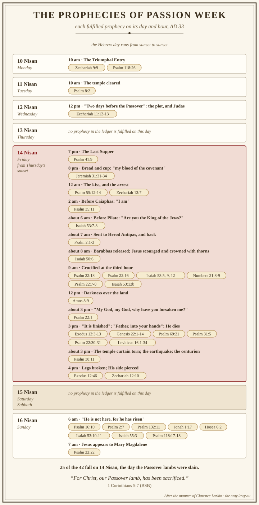
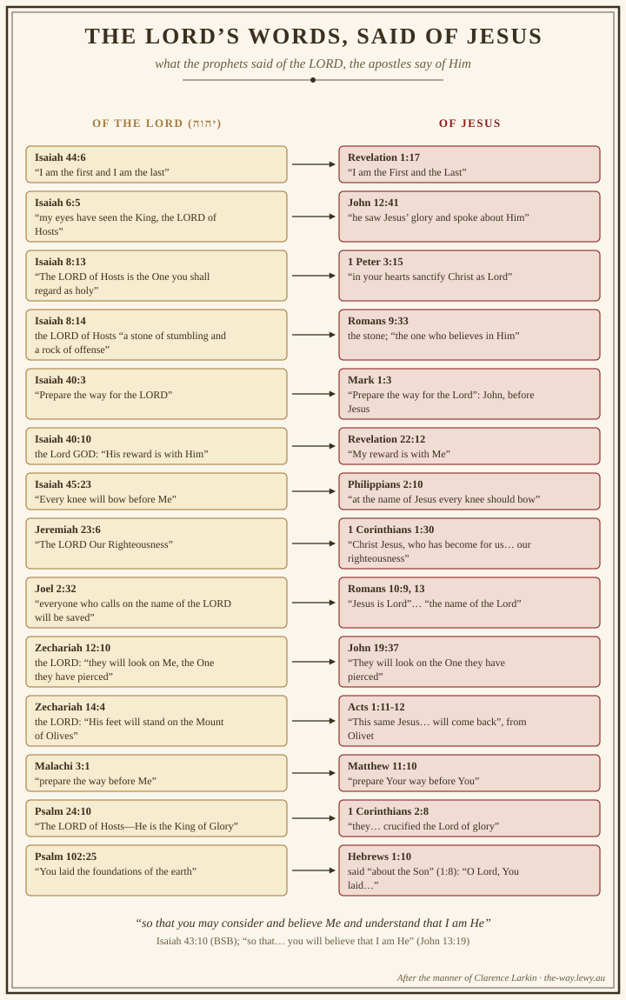
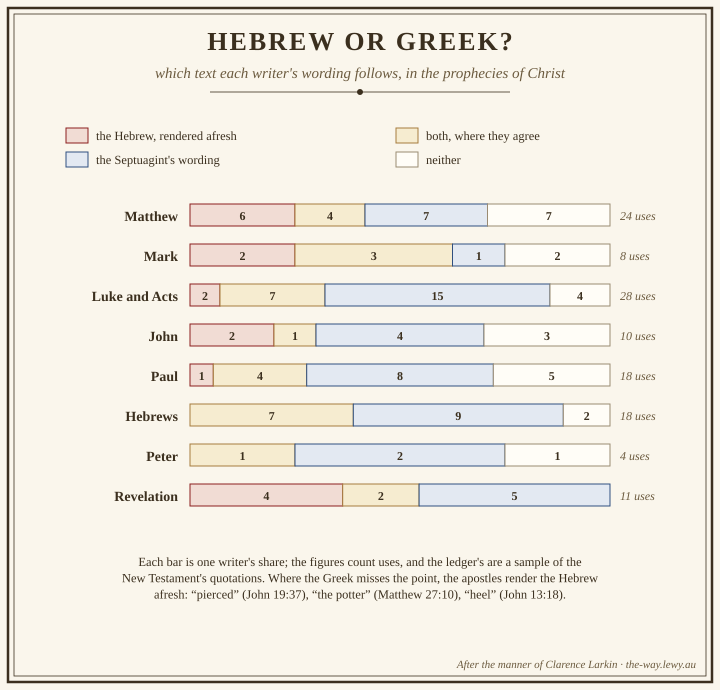

# The Prophecies of Christ

**In one sentence:** More than a hundred prophecies, written centuries before Jesus was born, have
come to pass in Him, and that alone proves He is the Christ: Apollos was "proving from the
Scriptures that Jesus is the Christ" (Acts 18:28, BSB).

## God's own argument

The case for prophecy is God's before it is ours. In Isaiah He summons the idols to court and
rests His claim to be God on what He foretold:

> ✝️ Isaiah 45:21 (BSB)
>
> 21 Speak up and present your case—yes, let them take counsel together. Who foretold this long ago? Who announced it from ancient times? Was it not I, the LORD? There is no other God but Me, a righteous God and Savior; there is none but Me.

He makes the same challenge to the idols: "Tell us the things that are to come, so that we may know
that you are gods" (Isaiah 41:23, BSB). And He gives His reason for speaking first: "I announced it
before it came to pass, so that you could not claim, 'My idol has done this'" (Isaiah 48:5, BSB).
"I declare the end from the beginning, and from ancient times what is still to come" (Isaiah 46:10,
BSB).

Jesus made the LORD's argument His own. On the night He was betrayed He told His disciples, "I am
telling you now before it happens, so that when it comes to pass, you will believe that I am He"
(John 13:19, BSB). His closing words, ἵνα πιστεύσητε... ὅτι ἐγώ εἰμι (*hina pisteusēte... hoti
egō eimi*, "so that you may believe that I am He"), take up the Septuagint's words at Isaiah 43:10,
ἵνα γνῶτε καὶ πιστεύσητε καὶ συνῆτε ὅτι ἐγώ εἰμι, where the LORD says Israel is His witness "so that
you may consider and believe Me and understand that I am He" (Isaiah 43:10, BSB). After the resurrection He showed them how far it
reached: "Everything must be fulfilled that is written about Me in the Law of Moses, the Prophets,
and the Psalms" (Luke 24:44, BSB).

This shows that God is the Lord of history, who binds Himself to His word in public and in advance,
and that the Jesus who fulfilled it is the "I am He" of Isaiah. A promise He made centuries before He
kept it is one you can rest your life on.

## The studies, a week at a time

These studies take the prophecies one theme at a time, for a group or on your own.

<!-- series-sessions -->

## How to read the ledger

Each prophecy below comes from this site's ledger of them (`docs/data/prophecies-of-christ.toml`),
and every count on this page is drawn from it when the site is built.

**Which prophecies.** A prophecy is listed when the New Testament reads it of Jesus, and its card
says how firmly:

- **The New Testament says it was fulfilled in Him or spoke of Him.** A fulfilment formula ("this
  took place to fulfill"), a writer saying the text spoke of Him (Acts 2:31), or a type: a person,
  event or institution God shaped to point to Him. A type is prophecy by design. "Christ, our
  Passover lamb, has been sacrificed" (1 Corinthians 5:7, BSB), and of the tabernacle, "By this
  arrangement the Holy Spirit was showing..." (Hebrews 9:8, BSB).
- **The New Testament applies it to Him.** The words used of Jesus, or a likeness drawn to Him,
  where the text does not say the original pointed to Him (John 1:51).
- **A reading of tradition.** The church has read it of Christ, and the New Testament at most
  alludes to it. These are the weakest, and they are marked.

**What each card measures.**

- **How far ahead it was written.** The latest year each text could have been written on the
  traditional dates, against the year it came to pass, and the critics' date too where they date the
  text later and this site's authorship table records it. Where no critical date is recorded, a
  witness brackets it: Sirach names Jeremiah, Ezekiel and "the twelve prophets" (Sirach 49:6-10),
  and its translator wrote after 132 BC, so on any dating those books existed by then. Both schemes and their sources are in [What Literary Criticism
  Declares](../scripture/what-literary-criticism-declares.md).
- **A copy older than the event.** Whether a manuscript survives from before the fulfilment: the
  Great Isaiah Scroll, about 125 BC. Separately, whether the Hebrew is among the Dead Sea Scrolls,
  all copied before AD 68.
- **Whether it was read of the Messiah before Jesus.** Read so by a witness older than Jesus (Qumran,
  the Psalms of Solomon, the Septuagint, or the New Testament reporting settled belief); before
  Jesus, but not of the part He fulfilled; only in a later Jewish source; or in no Jewish source at
  all.
- **Who brought it about.** God alone, His opponents, someone with no thought of the prophecy, His
  followers, or Jesus Himself, knowingly. This is the measure of whether it could have been
  arranged.
- **Which text the New Testament follows.** The Hebrew rendered afresh, the Septuagint's wording, or
  both where they agree.
- **Two comings in one text.** Where the New Testament divides one prophecy between His first
  coming and His return, the card names the part fulfilled, the part still to come, and the New Testament text that divides them.

This page puts no odds on any single prophecy. A probability for each one would be a guess, and one
bad guess would discredit the true fulfilments beside it. The measures above can each be checked,
and under [How unlikely by chance?](#how-unlikely-by-chance) you set the chance yourself.

## The ledger in numbers

<!-- prophecies-of-christ: dated -->

<!-- prophecies-of-christ: measures -->

### The prophet's view and history's view

Peter says the prophets searched "the time and setting to which the Spirit of Christ in them was
pointing when He predicted the sufferings of Christ and the glories to follow" (1 Peter 1:11, BSB).
The chart draws both halves of that sentence. From where a prophet stood, the sufferings and the
glory lined up like two peaks, one in front of the other. From where we stand, the first peak lies
behind us, and the second is still ahead.

## How unlikely by chance?

Suppose the fulfilments were chance. Count only what no one could have arranged: prophecies the New
Testament says were fulfilled, at an event this site dates, by God alone, by His enemies, or by
someone with no thought of the prophecy. Leave out what Jesus did knowingly and what His followers
did, since a critic says those could be staged, and what no witness could see. Count each moment
once, however many prophecies it fulfilled, so that the prophecies fulfilled when He was crucified at
the third hour are one trial and not three. Then give each moment a chance, as generous as you like.

<!-- prophecies-of-christ: floor -->

The figure assumes two things, and says so. It treats the moments as independent, though a critic may
say one led to another. And the record of each fulfilment is the Gospels', which His opponents' own
part in it supports: they had no reason to fulfil the texts of a Messiah they rejected. The figure is
a floor, set by you: every choice above makes the number smaller.

## Patterns in the prophecies

### Passion Week, day by day

Most of the prophecies fulfilled in His last week fall on one Hebrew day, 14 Nisan, which ran from
the supper on Thursday evening to the burial on Friday before sunset: the day the Passover lambs
were slain.

### The LORD's words, said of Jesus

Again and again the apostles take a text about the LORD (יהוה, *YHWH*) and
say it of Jesus: the first and the last, the One before whom every knee bows, the One on whom they
look whom they pierced.

### Hebrew or Greek?

The apostles quote the Septuagint most often, and Luke and Hebrews keep closest to it. Where the
Greek misses the point they render the Hebrew afresh, and Revelation, Matthew and Mark do so most
often.

## The prophecies, by subject

Narrow the cards by any of their measures: the passion prophecies His opponents fulfilled, say, or
every text where the LORD's words are said of Jesus. Each choice shows how many cards it leaves, and
the page's address keeps it, so you can share what you found.

<!-- prophecies-of-christ: filter -->

### Nature

<!-- prophecies-of-christ: category nature -->

### Lineage

<!-- prophecies-of-christ: category lineage -->

### Birth

<!-- prophecies-of-christ: category birth -->

### Childhood

<!-- prophecies-of-christ: category childhood -->

### Forerunner

<!-- prophecies-of-christ: category forerunner -->

### Ministry

<!-- prophecies-of-christ: category ministry -->

### Passion

<!-- prophecies-of-christ: category passion -->

### Resurrection

<!-- prophecies-of-christ: category resurrection -->

### Redemption

<!-- prophecies-of-christ: category redemption -->

### Prophet, priest, king

<!-- prophecies-of-christ: category office -->

### Future

<!-- prophecies-of-christ: category future -->

## Prophecies that begin in the New Testament

Jesus foretold His own death and resurrection, the fall of the temple and His return, and the
apostles and Revelation foretold more. Each card says whether the record we have was written down
before or after the event.

<!-- prophecies-of-christ: nt -->

## References & Recommended Reading

- **Scripture.** Berean Standard Bible (BSB), public domain. Greek: SBLGNT; the Septuagint from
  Brenton's edition. Verified against `bible-text.db`, 2026-11-26.
- **The ledger.** `docs/data/prophecies-of-christ.toml`, with the years and copies computed from it by `references/build/export_prophecies.py`.
- **Dates.** `docs/data/book-authorship.toml` (traditional and critical dates, each sourced) and
  the site's chronology (`docs/data/chronology.json`).
- **Dead Sea Scrolls.** Martin G. Abegg Jr., James E. Bowley and Edward M. Cook's transcriptions in
  the ETCBC Text-Fabric edition (CC BY-NC 4.0).
- **Later Jewish readings.** The Targums (dated by W. Bacher, "Targum", *Jewish Encyclopedia*,
  1906) and the Babylonian Talmud (Wikisource Talmud Bavli, CC BY-SA), via the Sefaria export.
- **On this site.** [What Literary Criticism Declares](../scripture/what-literary-criticism-declares.md)
  (the dates, and prophecies written and copied before the events); [Two mountain
  peaks](../last-things/immediately-after.md#two-mountain-peaks) (near and far in one sentence).
