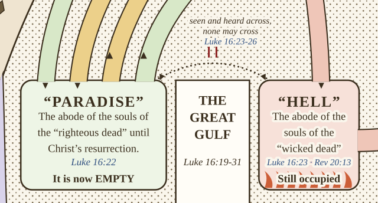

# Three Days and Three Nights

Asked for a sign that He was the Messiah, Jesus refused the request and answered it in the same
breath: no sign except Jonah. "Three days and three nights in the heart of the earth" is a
quotation, and Jonah's own account of those days calls the place Sheol and the pit. The sentence is
about where He was going and who would bring Him back.

**In one sentence:** In the sign of Jonah God shows that He raises His Son: Jesus went down into
Sheol as Jonah did, and God brought Him up holding the keys of Death and Hades, the firstfruits of a
harvest that includes you who belong to Him — and the weekday evidence favors a Friday crucifixion
three days before a Sunday resurrection.

## Key Takeaways

*(This section follows the [Key Takeaways](../about/key-takeaways.md) format — see that page for what each part is for.)*

### Types & Prophecy

**Type.** Jonah in the fish is the pattern Jesus names for Himself (Matthew 12:40, quoting Jonah 2:1
word for word as the Greek Old Testament has it), and what it carries is burial and emergence: the
fish's belly is "the belly of Sheol," and God *brings him up* (Jonah 2:2-6).

**Prophecy.** Psalm 16:10 is a stated prediction rather than a resemblance, and Peter says so in the
first Christian sermon: David "foresaw and spoke about the resurrection of the Christ, that he was
not abandoned to Hades, nor did his flesh see corruption" (Acts 2:31).

### Lessons about Jesus

- He answered a demand for proof by pointing at His own burial. The sign He gave was the one thing
  His questioners could not have asked for.
- He named the place He was going before He went there, and He named it from Scripture.
- He came back holding what had held Him: "I have the keys of Death and Hades" (Revelation 1:18).
- God raised Him as He brought Jonah up from the pit. The resurrection is the Father's own answer to
  the demand for a sign, and He has given it to you.

### Memory verses

> ✝️ Matthew 12:40 (ESV)
>
> 40 For just as Jonah was three days and three nights in the belly of the great fish, so will the
> Son of Man be three days and three nights in the heart of the earth.

> ✝️ Revelation 1:18 (ESV)
>
> 18 and the living one. I died, and behold I am alive forevermore, and I have the keys of Death
> and Hades.

### Be Transformed

- **Think.** The scribes had the sign of Jonah in their own Scriptures and asked for a different
  one. The request "show me something" is usually a wish for evidence of a kind that costs
  nothing to accept.
- **Attitude.** Where the pieces do not sit flat, the honest move is to say which reading you hold and what it costs you.
- **Do.** The men of Nineveh "repented at the preaching of Jonah" (Matthew 12:41, ESV), with a
  smaller sign than the one you have been given. Name one thing you already know God is asking of
  you and have put off until you are surer, and do it this week.

### Prayer

Lord Jesus, you have already given more than enough testimony of who you are and of your
redemption plan. Help me to understand the signs and wonders already given in Scripture. Forgive me
when I doubt and ask for more evidence.

You were dead and now you are alive forevermore. I trust you as my Saviour and my God — the one who
conquered death itself.

In Jesus' name. Amen.

## Study outline

- [The sign, and what Jonah said it was](#the-sign-and-what-jonah-said-it-was). Jesus quotes Jonah 2:1; Jonah calls the fish's belly Sheol and says God brought him up.
- [Three days, three appointed times](#three-days-three-appointed-times). Passover, Unleavened Bread and Firstfruits, and the sheaf waved on the day after the Sabbath.
- [Sheol and Hades](#sheol-and-hades-one-place-two-languages). One realm of the dead, holding the righteous and the unrighteous, and temporary.
- **Abraham's side and paradise** — [Luke 16's two conditions](#abrahams-side-paradise-and-the-great-chasm), and [where Jesus and the thief were on the Friday](#which-paradise-did-jesus-and-the-thief-go-to).
- [What those days achieved](#what-those-days-achieved). Death's holder destroyed, the keys changing hands, the first of a harvest.
- [Can the crucifixion be dated?](#can-the-crucifixion-be-dated) The weekday and the year, argued in their own study.
- [Where that leaves it](#where-that-leaves-it). What the three days are for.
- [Discussion questions](#discussion-questions). Six, for a group or on your own.

## The sign, and what Jonah said it was

Jesus is quoting, and the quotation is exact: Matthew 12:40
reproduces the Septuagint of Jonah 2:1 word for word — *ἦν Ἰωνᾶς ἐν τῇ κοιλίᾳ τοῦ κήτους τρεῖς
ἡμέρας καὶ τρεῖς νύκτας*, "Jonah was in the belly of the sea creature three days and three nights."
(The verse is Jonah 1:17 in English Bibles and 2:1 in the Hebrew and the Greek. References here
follow whichever text is being cited.)

Jonah interprets his own three days in the prayer that follows immediately, and he describes death.

> ✝️ Jonah 2:2-6 (ESV)
>
> 2 saying, "I called out to the LORD, out of my distress, and he answered me; out of the belly of
> Sheol I cried, and you heard my voice. 3 For you cast me into the deep, into the heart of the
> seas, and the flood surrounded me; all your waves and your billows passed over me… 6 at the roots
> of the mountains. I went down to the land whose bars closed upon me forever; yet you brought up my
> life from the pit, O LORD my God."

**The belly of the fish is "the belly of Sheol."** The place is "the pit," a land with bars that
close. And God *brings him up* — וַתַּעַל,
from עָלָה (*ʿalah*), the ordinary verb for going or bringing up. Nothing in
the word itself carries resurrection; the burial is carried by everything around it. Jonah's three
days are a death and a raising, described as such by the man they happened to.

**And one word travels from Jonah's prayer into Jesus's sentence.** Jonah 2:3 in English (Jonah 2:4 in the
Hebrew) puts him "in the heart of the seas" — בִּלְבַב יַמִּים, which the
Septuagint renders **καρδίας θαλάσσης**. Jesus says He will be in the **καρδίᾳ τῆς γῆς**, "the heart
of the earth." He has taken the noun out of the passage He is quoting and moved it from the sea to
the ground.

Jesus calls it the *only* sign this generation will get (Matthew 12:39) and adds that
"something greater than Jonah is here" (Matthew 12:41).

This shows that God answers for His Son: the One who brought Jonah up from the pit raised Jesus from
the dead, and the resurrection is His vindication of Jesus as the Christ. So you have the sign the
scribes were given, and it is the empty tomb.

## Three days, three appointed times

The span lands on three consecutive festivals in Leviticus 23, and the New Testament names Christ as
the fulfilment of the first and the third.

| Appointed time | Leviticus 23 | That week | Named of Christ |
|---|---|---|---|
| **Passover** | 23:5, Nisan 14 | the crucifixion | "Christ, our Passover lamb, has been sacrificed" (1 Corinthians 5:7) |
| **Unleavened Bread** | 23:6, from Nisan 15 | the body in the tomb, on the Sabbath | — |
| **Firstfruits** | 23:10-11 | the resurrection | "Christ has been raised from the dead, the firstfruits of those who have fallen asleep" (1 Corinthians 15:20; cf. 15:23) |

The third row carries a date instruction that decides the day of the week:

> ✝️ Leviticus 23:11 (ESV)
>
> 11 and he shall wave the sheaf before the LORD, so that you may be accepted. On the day after the
> Sabbath the priest shall wave it.

**"On the day after the Sabbath"** — the first day of the week. The sheaf of the first-cut harvest
was lifted before the LORD on the morning the tomb was found empty, and Paul calls Christ *the
firstfruits* using that feast's own noun. So on this reckoning the resurrection falls on the
appointed day for the offering it fulfils. The interval is bounded by two feasts, with the Sabbath
sitting between them.

This shows that God wrote the death and resurrection of His Son into Israel's calendar: Jesus is the
Passover lamb sacrificed and the firstfruits raised. A sheaf is waved because a harvest is coming, so
you who belong to Christ will be raised after Him (1 Corinthians 15:23).

## Sheol and Hades: one place, two languages

### Sheol and Hades named as the same place

**The New Testament settles the equation itself, by quoting.** Peter quotes Psalm 16:10 at Acts
2:27, and the ESV renders each in its own language:

> ✝️ Psalm 16:10 (ESV)
>
> 10 For you will not abandon my soul to Sheol, or let your holy one see corruption.

> ✝️ Acts 2:27 (ESV)
>
> 27 For you will not abandon my soul to Hades, or let your Holy One see corruption.

One sentence, quoted once. Where the Hebrew has שְׁאוֹל (*sheol*, H7585), the Greek
has **ᾅδης** (*hadēs*, G86) — the Septuagint's standing practice, which the Greek Old Testament follows
from Genesis onward.

### Sheol holds the righteous too

**Sheol receives the righteous too.** Jacob, mourning Joseph, expects to go there:

> ✝️ Genesis 37:35 (ESV)
>
> 35 All his sons and all his daughters rose up to comfort him, but he refused to be comforted and
> said, "No, I shall go down to Sheol to my son, mourning." Thus his father wept for him.

The Hebrew is שְׁאֹלָה and the Septuagint renders it εἰς ᾅδου. Whatever Sheol is
in the Old Testament, it is where the dead are.

### Samuel called up at En-dor

**One narrative shows the arrangement from the inside.** When Saul has the medium at En-dor call up
Samuel, the account is specific about the state of the dead.

> ✝️ 1 Samuel 28:13-15 (ESV)
>
> 13 The king said to her, "Do not be afraid. What do you see?" And the woman said to Saul, "I see a
> god coming up out of the earth." 14 He said to her, "What is his appearance?" And she said, "An old
> man is coming up, and he is wrapped in a robe." And Saul knew that it was Samuel, and he bowed with
> his face to the ground and paid homage. 15 Then Samuel said to Saul, "Why have you disturbed me by
> bringing me up?"

**The direction is up, out of the earth.** עָלָה (*ʿalah*,
H5927) runs five times through these eight verses (1 Samuel 28:8, 11 twice, 13, 14, 15) — Samuel's own word
for what has been done to him is לְהַעֲלוֹת, its hiphil. It is the same verb
Jonah uses when God "brought up my life from the pit"; both texts assume the dead are *down*.

Samuel tells Saul: "tomorrow you and your sons shall be
**with me**" (1 Samuel 28:19). Saul is a king under judgment, about to die on Mount Gilboa by his own hand.
Samuel is a prophet who died in honour. And they are going to the same place.

That sentence is hard to fit into a straight heaven-and-hell reading of the afterlife, which would
have to put Saul in heaven with Samuel. It sits naturally in the picture Luke 16 will later draw:
one realm of the dead holding both, in conditions that are not the same. The minimal reading — "you
will be dead as I am dead" — still concedes a common place and state for the righteous and the
unrighteous dead.

(Whether it was truly Samuel has been debated since antiquity. This study follows the narrator, who
calls him Samuel throughout and reports a prophecy that came true, as do the *ESV Study Bible* and
the *NIV Biblical Theology* and *Cultural Backgrounds* volumes.)

### Hades is temporary

**And Hades is temporary.** It occurs ten times in the New Testament (Matthew 11:23; 16:18;
Luke 10:15; 16:23; Acts 2:27, 31; Revelation 1:18; 6:8; 20:13, 14), and the last two are its end:
Hades "gave up the dead who were in them," and then "Death and Hades were thrown into the lake of
fire" (Revelation 20:13-14). A place that is emptied and then destroyed is a holding place.

## Abraham's side, paradise, and the great chasm

Jesus describes the far side of death once at length, in Luke 16, and the description is the reason
this question has a traditional answer at all.

> ✝️ Luke 16:22-23, 26 (ESV)
>
> 22 The poor man died and was carried by the angels to Abraham's side. The rich man also died and
> was buried, 23 and in Hades, being in torment, he lifted up his eyes and saw Abraham far off and
> Lazarus at his side… 26 And besides all this, between us and you a great chasm has been fixed, in
> order that those who would pass from here to you may not be able, and none may cross from there to
> us.

### κόλπος Ἀβραάμ, a place-name

**"Abraham's side" is κόλπος — literally his bosom or lap.** The familiar
phrase "Abraham's bosom" comes from the KJV and survives in the WEB; the ESV has "side," and the CSB
footnotes the idiom precisely: "lit *to the fold of Abraham's robe*." It is the posture of the
guest reclining nearest the host at a feast, which is the same word John uses of the beloved disciple
at the last supper (John 13:23) and of the Son "at the Father's side" (John 1:18).

**The lexicographers treat it as a place-name.** Louw-Nida's semantic domain 1 is *geographical
objects and features*, and three entries sit in it:

| Domain | Word | Where |
|---|---|---|
| **1.14** | παράδεισος, *paradise* | Luke 23:43; 2 Corinthians 12:4; Revelation 2:7 |
| **1.16** | κόλπος Ἀβραάμ, *Abraham's side* | Luke 16:22, 23 |
| **1.19** | ᾅδης, *Hades* | ten times |

At Luke 16:22 the annotation tags **both** words — κόλπος and Ἀβραάμ — with the same code, 1.16:
one name for one location. Luke 16's own vocabulary is spatial: two conditions, a fixed chasm between them, and each visible from the other.

### Two compartments of one Hades, and the commentaries that disagree

**The traditional reading takes those as two compartments of one Hades**, the righteous dead held in
comfort at Abraham's side and the unrighteous in torment, separated but within sight. It is the
historic dispensational position, and this study holds it, for three reasons: Sheol in the Old
Testament genuinely receives the righteous (Genesis 37:35), Luke 16 places the whole scene in
ᾅδης with a chasm *inside* it rather than between earth and heaven, and Hades is a place Revelation
later empties and destroys.

*From Larkin's chart, redrawn: the two-compartment reading this study holds, each side in sight of the other and the chasm fixed between (Luke 16:23-26). The whole chart is in [At Home with the Lord](../last-things/at-home-with-the-lord.md).*

**The commentaries on this site's shelf mostly read it otherwise.**
The *ESV Study Bible* takes Abraham's side as "the fellowship of other believers already in heaven"
and the chasm as "the unbridgeable gulf between heaven and hell"; the *NIV Biblical Theology Study
Bible* has it as "the prominent place next to Abraham, reclining at the heavenly feast." Both also
note the caution that Luke 16 is a parable and its details should not be pressed too far. The
*Cultural Backgrounds Study Bible* supplies what supports the older reading: Second Temple Jewish
stories and artwork did depict angels escorting the righteous to paradise, so the two-compartment
picture is the furniture Jesus's hearers brought with them rather than a later Christian
construction.

## Which paradise did Jesus and the thief go to?

To the dying thief Jesus names a destination and a time:

> ✝️ Luke 23:43 (ESV)
>
> 43 And he said to him, "Truly, I say to you, today you will be with me in paradise."

*Today* — on the day of the crucifixion. So wherever paradise is, Christ was
there on the Friday.

**παράδεισος occurs three times in the New Testament, and the other two locate it in heaven.** Paul
is "caught up to the third heaven" and "caught up into paradise" (2 Corinthians 12:2-4), and John's
tree of life stands "in the paradise of God" (Revelation 2:7). Both were written after the
ascension. Luke 23:43 was spoken before it. That gap is the whole question.

### "I have not yet ascended" (John 20:17)

**And John sharpens it three days later:**

> ✝️ John 20:17 (ESV)
>
> 17 Jesus said to her, "Do not cling to me, for I have not yet ascended to the Father; but go to my
> brothers and say to them, 'I am ascending to my Father and your Father, to my God and your God.'"

**Μή μου ἅπτου** is *mē* with a present imperative,
which forbids a continuing action rather than starting one — "stop clinging," as the ESV's "do not
cling" and the *NIV Biblical Theology Study Bible*'s "Stop clinging to me" both render it. It is not
a rule about contact: minutes later the other women "took hold of his feet" (Matthew 28:9), and a
week after that Thomas is invited to put his hand in Jesus's side (John 20:27). Mary was holding on,
and was told to let go. **ἀναβέβηκα** is a perfect: the ascension had not happened.

### Paradise moved, or paradise is the Father's presence

Two readings follow.

- **Paradise was in Hades, and moved.** On the two-compartment reading, Christ went on the Friday to
  where the righteous dead were held, which is what Luke 23:43 promises the thief; the ascension then
  relocated paradise upward, which is why Paul and John find it in the third heaven. John 20:17 is
  straightforwardly true on this reading: He had been to paradise and had not yet been to the Father.
- **Paradise is the Father's presence, and did not move.** The *ESV Study Bible* takes this line, and
  reads John 20:17 as denying only the *bodily* ascension: Christ's spirit went to the Father at the
  moment of death, while His body rose on the Sunday and ascended forty days later. On this reading
  Luke 23:43 and Revelation 2:7 name the same place throughout.

*From Larkin's chart, redrawn: the first reading, drawn. The thief and Christ go down to Paradise on the Friday, and the righteous rise with Him.*

This study holds the first, on the strength of the section above, and John 20:17 fits both. What
neither reading permits is the popular third one, that Jesus was somehow untouchable until He had
been to heaven. Matthew 28:9 rules it out in the same twenty-four hours.

Whichever reading holds, the promise to the thief shows that God receives a dying man who trusts
Jesus into His Son's company that same day. That promise is made to you on the same terms.

## What those days achieved

**Death's holder was destroyed, and its hostages freed.** "That through death he might destroy the
one who has the power of death, that is, the devil, and deliver all those who through fear of death
were subject to lifelong slavery" (Hebrews 2:14-15). The mechanism is *through death*.

**The authority changed hands.** "I died, and behold I am alive forevermore, and I have the keys of
Death and Hades" (Revelation 1:18). Keys are held by whoever opens and shuts; the sentence reports a
transfer. And the transfer has a terminus: the Hades whose keys He holds is the Hades that
Revelation 20:14 destroys.

**And the resurrection is the first of a harvest.** That is the force of the
firstfruits language above: a sheaf is waved because a field is coming. "Christ the firstfruits,
then at his coming those who belong to Christ" (1 Corinthians 15:23).

**Peter's statement is contested.** "He went and proclaimed to the spirits in prison"
(1 Peter 3:19) has been read as Christ preaching in Hades between death and resurrection, as the
pre-incarnate Christ preaching through Noah to that generation, and as a proclamation of victory to
fallen angels. This study does not settle it; it is named because any account of the three days that
quietly leaves it out is trimming the evidence.

What the New Testament does not do is narrate the interval. There is no description of it anywhere —
only these statements about its boundaries and its outcome, made afterwards.

This shows that God overcame death through the death of His Son: Jesus, our Passover lamb, went into
death and came out holding its keys. So you need not live in the fear of death that Hebrews 2:15
calls slavery; the One who holds the keys of Death and Hades is the One who died for you.

Where the believing dead are now, between death and the resurrection, is the subject of
[At Home with the Lord](../last-things/at-home-with-the-lord.md), which sets Larkin's whole chart of
the underworld beside its argument.

---

## Can the crucifixion be dated?

Everything above holds whichever day of the week the cross fell on. Read as a measurement, Matthew 12:40
requires roughly seventy-two hours, and that is the whole of the case for moving the crucifixion to a
Wednesday or a Thursday. [Friday, 3 April AD 33: Dating the Cross](../chronology/dating-the-cross.md#the-day-a-friday)
weighs it, from Mark's **προσάββατον** (*prosabbaton*, G4315) and Luke 24:21, and holds Friday.

## Where that leaves it

The sign Jesus gave was His burial and His return from it, and the New Testament spends its words on
where He went and what He brought back — Sheol emptied of its hold on Him, the keys of Death and
Hades in the hands of someone who died, a firstfruits sheaf waved because a harvest is coming. That
is what the three days are for, and none of it depends on the arithmetic.

## Discussion questions

1. **The language.** Jonah says God "brought up my life from the pit" (Jonah 2:6), with
   עָלָה (*ʿalah*), the plain verb for going up — the same verb as the mist
   that "was going up from the land" (Genesis 2:6). Samuel uses it of being called back from the
   dead (1 Samuel 28:15). What does it tell you that Scripture describes a return from death with
   an everyday word for "upward"?
2. **The text in its context.** Jonah interprets his own three days, and never mentions a fish — he
   says "the belly of Sheol," "the pit," and "you brought up my life" (Jonah 2:2-6). If that is the
   sign Jesus chose, what is it a sign *of*, and what would be lost if it were only a statement
   about how long?
3. **Christ.** Asked for a sign, Jesus offered one: Jonah, swallowed and brought back up (Matthew
   12:39-40). What is He claiming about Himself by making His own burial the credential?
4. **The realm of the dead.** Samuel tells Saul, "tomorrow you and your sons shall be with me"
   (1 Samuel 28:19) — a prophet who died in honour and a king dying under judgment, going to the
   same place. What does that sentence do to the picture of death you brought to this study?
5. **The hard part.** Jesus tells the dying thief "today you will be with me in paradise" (Luke
   23:43), and tells Mary three days later "I have not yet ascended to the Father" (John 20:17).
   Both are true. What does holding them together commit you to about where He spent those days?
6. **Be transformed.** Christ died to "deliver all those who through fear of death were subject to
   lifelong slavery" (Hebrews 2:15), and He now holds "the keys of Death and Hades" (Revelation
   1:18). Where does the fear of death, your own or that of someone you love, still steer what you
   do, and what would you do differently there knowing who holds those keys?

## References & Recommended Reading

**Original-language sources** (queried in this project's own
[reference database](../scripture/original-language-data.md)):

- **SBL Greek New Testament** (SBLGNT), ed. Michael W. Holmes — the text behind every count above.
- **MACULA Greek Linguistic Datasets** (Clear Bible) — lemma and morphology for **προσάββατον**,
  **παρασκευή**, **ᾅδης**, **παράδεισος** and **κόλπος**, the occurrence lists for the three
  phrasings, and the Louw-Nida semantic-domain codes in the table above.
- **Westminster Leningrad Codex** with MACULA Hebrew morphology — שְׁאוֹל at
  Genesis 37:35 and Psalm 16:10.
- **Septuagint** — the Jonah 2:1 quotation, καρδίας θαλάσσης, and the standing rendering of
  *sheol* by ᾅδης.

**Translations quoted.** ESV throughout, except where another version is named inline. See
[Bible Translations & Source Texts](../scripture/translations.md) and
[copyright](../about/copyright.md).

**Derived cross-references.** The Matthew 12:40 → Jonah 2:1 quotation was surfaced by this project's own quotation detection over the Greek
texts, described at [How we cross-reference](../about/how-we-cross-reference.md). It is
corroborated by the inherited reference lists.

**Commentary.** Consulted for the intermediate-state sections, and cited above where they disagree
with this study's conclusion as well as where they support it.

- **ESV Study Bible** (Crossway) — notes on Matthew 12:40 (inclusive reckoning), Luke 16:22-23,
  John 20:17, and 2 Corinthians 12:2-3.
- **NIV Biblical Theology Study Bible** (Zondervan) — notes on Luke 16:22, John 20:17,
  and 2 Corinthians 12:2.
- **NIV / NKJV Cultural Backgrounds Study Bible** (Zondervan / Thomas Nelson) — Second Temple
  depictions of angels escorting the righteous, and Hades as the realm of the dead.
- **CSB Ancient Faith Study Bible** (Holman) — translator footnote at Luke 16:22.

**Related on this site.**

- [Friday, 3 April AD 33: Dating the Cross](../chronology/dating-the-cross.md) — the weekday and
  the year: Mark 15:42 and Luke 24:21 for a Friday, and AD 33 over AD 30.
- [Prophecy: Events and Times](../last-things/prophecy-events-times.md) — Daniel's seventy weeks
  worked through to the same week.
- [The Day No One Knows](the-day-no-one-knows.md) — the other place a single sentence of Jesus about
  time is read more precisely than it was meant.
- [At Home with the Lord](../last-things/at-home-with-the-lord.md) — where the believing dead are
  now, with Clarence Larkin's chart of the underworld redrawn.
