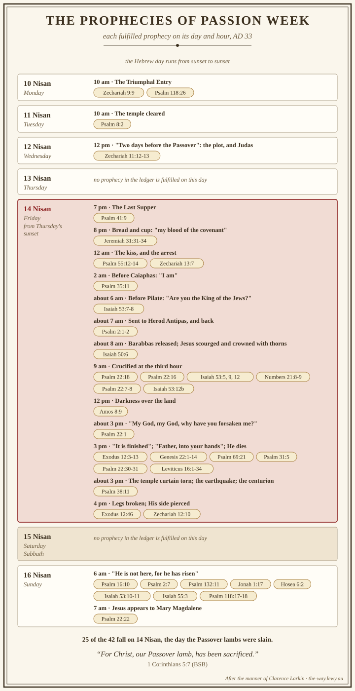
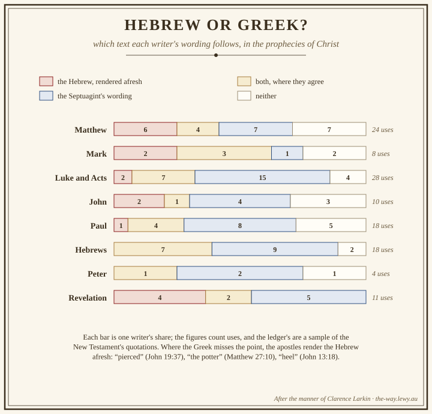

# Weighing the Prophecies: The Ledger of the Prophecies of Christ in Depth

Joseph took the child Jesus and His mother into Egypt by night and stayed there until Herod died.
Matthew writes: "This fulfilled what the Lord had spoken through the prophet: 'Out of Egypt I called
My Son'" (Matthew 2:15, BSB). The prophet is Hosea, and Hosea was remembering the exodus: "When Israel
was a child, I loved him, and out of Egypt I called My son" (Hosea 11:1, BSB). Matthew calls a piece
of Israel's history a fulfilment. This study weighs claims like that one, first with the apostles'
own words and then with the whole ledger of [The Prophecies of Christ](../prophecies-of-christ.md).

**In one sentence:** The New Testament grades its own claims on the Old (fulfilled, a type, applied,
echoed), and weighed by those grades and by measures anyone can check, the prophecies of Christ show
God writing His Son into every part of Scripture, speaking in His voice in the Psalms, and bringing
it about through hands that could not have arranged it.

## Key Takeaways

*(This section follows the [Key Takeaways](../about/key-takeaways.md) format — see that page for what each part is for.)*

### Types & Prophecy

- **Hosea 11:1 is a type.** It tells what God did for Israel, His son (Exodus 4:22). Matthew says the
  same words were fulfilled when God brought His Son Jesus out of Egypt (Matthew 2:15). A type is a
  history God shaped to point to Christ, and the New Testament counts it as prophecy.
- **The apostles mark the difference themselves.** Hebrews calls the tabernacle a παραβολή and says
  "the Holy Spirit was showing" through it (Hebrews 9:8-9, BSB). It uses the same word of Isaac's
  return from the altar, "in a sense" (Hebrews 11:19, BSB), and says nothing of the Spirit's intent.
  The first is a type the Spirit intended; the second, as Hebrews words it, is a likeness the writer
  draws.

### Lessons about Jesus

- **He is the Son Israel was called to be.** Israel left Egypt and failed in the wilderness. Jesus
  came out of Egypt, was tested forty days in the wilderness, and answered every temptation from
  Deuteronomy (Matthew 4:4, 7, 10).
- **He speaks in the Psalms.** "When Christ came into the world, He said" Psalm 40's words (Hebrews
  10:5, BSB). Fifteen of the eighteen Old Testament texts the New Testament puts in His mouth are psalms.
- **All of Scripture testifies about Him.** "These are the very words that testify about Me" (John
  5:39, BSB): the Law, the Prophets and the Psalms (Luke 24:44).

### Memory verses

> ✝️ Hosea 11:1 (BSB)
>
> 1 When Israel was a child, I loved him, and out of Egypt I called My son.

> ✝️ John 5:39-40 (BSB)
>
> 39 You pore over the Scriptures because you presume that by them you possess eternal life. These are the very words that testify about Me, 40 yet you refuse to come to Me to have life.

### Be Transformed

- **Think.** God wrote His Son into Israel's history as well as into its prophecies. The Holy Spirit
  was showing through the tabernacle that the way into God's presence was not yet open (Hebrews
  9:8), the way Jesus opened through His body (Hebrews 10:19-20).
- **Attitude.** Come to the Scriptures to come to Him. The men Jesus spoke to pored over the text
  and refused to come to Him for life (John 5:40).
- **Do.** This week read Hosea 11 aloud, then Matthew 2:13-4:11, and thank God that the Son He
  called out of Egypt obeyed where Israel failed (Hosea 11:2; Matthew 4:10).

### Prayer

Father, You loved Israel as a child and called Your son out of Egypt, and in the fullness of time You
sent Your Son Jesus, who obeyed You in the wilderness where Israel fell. Thank You that You wrote Him
into the Law, the Prophets and the Psalms long before He came, and that through Him You have adopted
me as Your son and given me the Spirit who cries "Abba, Father." Keep me from studying Your word
without coming to Him. Open the Scriptures to me, and let me find Him there. In Jesus' name. Amen.

## Study outline

- [How the apostles grade their claims](#how-the-apostles-grade-their-claims). One Greek word used
  twice, six kinds of use, and the three tiers the ledger builds from them.
- [Out of Egypt: one prophecy weighed](#out-of-egypt-one-prophecy-weighed). Hosea 11:1 in Hosea, in
  Matthew, and the case that Hosea saw further.
- [The six checks on every card](#the-six-checks-on-every-card). What each card checks, and [why no
  card carries odds](#why-no-card-carries-odds).
- [What the whole ledger shows](#what-the-whole-ledger-shows). The Psalms as His voice, hands that
  could not arrange it, Passion Week day by day, Hebrew or Greek, and two comings in one text.
- [What the weighing shows of God](#what-the-weighing-shows-of-god). The Spirit who wrote ahead, and
  the Son who makes you a son.
- [Discussion questions](#discussion-questions). Five, for a group or on your own.
- [Annex: the ledger in numbers](#the-ledger-in-numbers). The counts by subject, rebuilt from the
  ledger with every build.

## How the apostles grade their claims

### παραβολή: one word, two grades

In the first three Gospels παραβολή (*parabolē*, pa-ra-bo-LAY, G3850) names Jesus' parables. Outside
them it appears twice in the New Testament, both times in Hebrews. Each time it names something in
Israel's history that pictured something greater. Each time the writer grades it differently.

Of the tabernacle and the high priest's yearly entry into the Most Holy Place:

> ✝️ Hebrews 9:8-9 (BSB)
>
> 8 By this arrangement the Holy Spirit was showing that the way into the Most Holy Place had not yet been disclosed as long as the first tabernacle was still standing. 9 It is an illustration for the present time, because the gifts and sacrifices being offered were unable to cleanse the conscience of the worshiper.

"Illustration" is παραβολή. The writer adds who meant it: τοῦτο δηλοῦντος τοῦ πνεύματος τοῦ ἁγίου,
"the Holy Spirit making this plain". The tabernacle's arrangement was the Spirit's lesson, built into
it by Him. The lesson was that the way in was not yet open, and Hebrews names the way that opened it:
"the new and living way opened for us through the curtain of His body" (Hebrews 10:20, BSB).

Of Abraham and Isaac:

> ✝️ Hebrews 11:19 (BSB)
>
> 19 Abraham reasoned that God could raise the dead, and in a sense, he did receive Isaac back from death.

"In a sense" is ἐν παραβολῇ, the same noun (the ESV has "figuratively speaking"). Here the writer
says nothing of the Spirit's intent. He draws a likeness between Isaac's return and a resurrection,
and leaves it there. Whether Hebrews means more by it is contested: the NASB renders the phrase "as a
type", and the case for a likeness rests on what the writer leaves unsaid. The ledger files Isaac as
a type in the second tier, on the words Hebrews does use.

### δηλόω: the Spirit making Christ plain

The verb at Hebrews 9:8, δηλόω (*dēloō*, day-LO-oh, G1213), "to make plain", is used of the Spirit
in one other place. Peter writes of the prophets, "trying to determine the time and setting to which
the Spirit of Christ in them was pointing when He predicted the sufferings of Christ and the glories
to follow" (1 Peter 1:11, BSB). "Was pointing" is ἐδήλου, the same verb. The Spirit was making His
meaning plain through the tabernacle's arrangement and through the prophets' words. A type and a
verbal prediction come from the same Author with the same purpose. [Known Before, Seen
After](known-before-seen-after.md#sufferings-then-glories) follows Peter's sentence to its end.

### Six kinds of use

Each prophecy here is an entry in this site's ledger, [The Prophecies of
Christ](../prophecies-of-christ.md) (`docs/data/prophecies-of-christ.toml`). It holds 118 Old
Testament texts that the New Testament, or the church after it, reads of Jesus. The counts in this
study's prose were taken from it on 27 November 2026. The tables in [the
annex](#the-ledger-in-numbers) are rebuilt from it every time the site is built.

The ledger records 241 places where the New Testament uses one of those texts. It labels each by
what the New Testament writer claims, from the signal in the writer's own words:

| Kind | The signal | Example | Uses |
|---|---|---|---|
| **Fulfilled** | "to fulfill", "this is what was spoken", "he foresaw and spoke" | Matthew 1:22-23 of Isaiah 7:14 | 87 |
| **Part now, part still to come** | the quotation stops part-way, or the context keeps back the rest | Luke 4:19 stops before Isaiah 61:2's "day of vengeance" | 15 |
| **A type** | τύπος and its kin, "as… so", or the type named outright | "Christ, our Passover lamb" (1 Corinthians 5:7, BSB) | 12 |
| **Applied** | the words used of Him with no claim of fulfilment | Luke 23:46 and Psalm 31:5 | 35 |
| **Its imagery** | shared pictures with changed details | Revelation 1:13-16 and the Ancient of Days (Daniel 7:9) | 10 |
| **An allusion** | the words echoed without a citation | John 1:29 and the Passover lamb | 82 |

### πληρόω and τύπος: to fill, and a pattern

The most common verb of the first kind is πληρόω (*plēroō*, play-RO-oh, G4137), "to fill" or "to
fulfil". Matthew uses it 16 times. The type has its own vocabulary. τύπος (*typos*, TOO-pos, G5179)
is the mark a blow leaves, then a pattern: Adam "is a pattern of the One to come" (Romans 5:14,
BSB), and Moses built the tabernacle "according to the pattern shown you on the mountain" (Hebrews
8:5, BSB). Paul writes of Israel in the wilderness, "These things took place as examples" (τύποι,
1 Corinthians 10:6, BSB). Then he writes the adverb, τυπικῶς (*typikōs*, too-pee-KOHS, G5179):

> ✝️ 1 Corinthians 10:11 (BSB)
>
> 11 Now these things happened to them as examples and were written down as warnings for us, on whom the fulfillment of the ages has come.

The events happened as types, and they were written down for the church. Paul has just said of the
water in the wilderness, "that rock was Christ" (1 Corinthians 10:4, BSB).

### Three tiers

The ledger grades each prophecy by the strongest thing the New Testament says of it:

- **Fulfilled in Him, spoke of Him, or shaped to point to Him** (59 entries). A fulfilment formula,
  a writer saying the text spoke of Him (Acts 2:31), or a type the New Testament says God made:
  the Passover lamb (1 Corinthians 5:7), the Day of Atonement (Hebrews 9:8), the rock (1 Corinthians
  10:4, 11).
- **Applied to Him** (31 entries). The words used of Jesus, or a likeness drawn, where the text does
  not say the original pointed to Him: Isaac received back "in a sense" (Hebrews 11:19), Jacob's
  ladder (John 1:51), the key of David (Revelation 3:7).
- **A reading of tradition** (28 entries). The church has read it of Christ, and the New Testament
  at most alludes to it. These are the weakest, and the cards say so.

Twelve entries are types. Nine sit in the first tier, because the New Testament says God shaped them
to point to Christ. Three sit in the second, because it draws the likeness without saying so. The
grade comes from the apostle's words, which is why the two halves of Hebrews' παραβολή land in
different tiers.

## Out of Egypt: one prophecy weighed

### The son in Hosea

Hosea prophesied to the northern kingdom in the eighth century BC, under Jeroboam son of Jehoash
(Hosea 1:1). Chapter 11 is the LORD speaking as a father. Hosea 11:1 looks back:

וּמִמִּצְרַיִם קָרָאתִי לִבְנִי (*u-mi-mitsrayim qarati livni*), "and out of
Egypt I called My son". The word is בֵּן (*ben*, BAYN, H1121), "son", with
the suffix "my". The LORD had named Israel so at the exodus: "Israel is My firstborn son... let My son
go so that he may worship Me" (Exodus 4:22-23, BSB).

The next verse turns at once: "But the more I called Israel, the farther they departed from Me. They
sacrificed to the Baals" (Hosea 11:2, BSB). The son was called and ran the other way. The chapter
moves to judgment, Egypt and Assyria (Hosea 11:5), and then past it to a second exodus: "They will
come trembling like birds from Egypt and like doves from the land of Assyria" (Hosea 11:11, BSB). In
Hosea's own setting the son is the nation, and the pattern is one God means to repeat.

### The Son in Matthew

Matthew quotes the line while the family is still in Egypt (Matthew 2:15), before the angel calls
them home (Matthew 2:19-21). The whole stay is framed by God's call.

Matthew translated the Hebrew himself. The Septuagint reads ἐξ Αἰγύπτου μετεκάλεσα τὰ τέκνα
αὐτοῦ, "out of Egypt I called back his children" (Hosea 11:1, Brenton LXX; translation ours). Matthew
writes Ἐξ Αἰγύπτου ἐκάλεσα τὸν υἱόν μου, "Out of Egypt I called My Son" (Matthew 2:15, SBLGNT),
rendering the Hebrew's singular "My son" afresh. The argument needs the singular, and the Greek
translation had lost it.

Then Matthew tells Jesus' story in Israel's order. The Son comes out of Egypt (Matthew 2:15). He
passes through water, and the Father says, "This is My beloved Son" (Matthew 3:17, BSB). He is led
into the wilderness for forty days (Matthew 4:1-2), as Israel was led "these forty years" (Deuteronomy
8:2, BSB). He answers each temptation with a sentence Moses spoke to Israel in that wilderness:
Deuteronomy 8:3 (Matthew 4:4), Deuteronomy 6:16 (Matthew 4:7) and Deuteronomy 6:13 (Matthew 4:10).
Israel, the son, was called and departed. Jesus, the Son, was called and obeyed.

### Filled full in Jesus

That is what πληρόω means here. Matthew claims that the history Hosea remembered was filled full in
Jesus. God had shaped the exodus of His son so that it would describe His Son. The ledger enters it
as a type, in the first tier, on Matthew's fulfilment formula.

### Did Hosea see further?

Whether Hosea himself looked past the nation is contested, and the text gives reasons on both sides.

- **For a further sight.** Balaam spoke of the exodus twice. The first time the object is plural, "God
  brought them out of Egypt" (Numbers 23:22, BSB), מוֹצִיאָם (*motsi'am*,
  mo-tsee-AHM, H3318). The second time it is singular, מוֹצִיאוֹ (*motsi'o*,
  mo-tsee-OH, H3318), "God brought him out of Egypt", in the verse after "His king will be greater
  than Agag" (Numbers 24:7-8, BSB). The Septuagint, before Christ, reads Numbers 24:7 as "a man shall
  come forth from his seed" (Brenton LXX; translation ours). Read so, the one brought out of Egypt is
  the coming king, and Hosea, who knew the Law, echoes him. Hosea himself looks for "David their
  king" in the last days (Hosea 3:5, BSB).
- **For the nation alone.** Numbers 24:5 has just addressed "your tents, O Jacob" (BSB), and Numbers
  24:7 runs on in the singular, "his buckets... his seed... His king", the king being Jacob's. The
  "him" of Numbers 24:8 can be Jacob, the people as one man, as Hosea's "Israel was a child" is. The
  only king Hosea 11 names is Assyria, who will rule them (Hosea 11:5).

The ledger's grade rests on Matthew's word. He says the words were fulfilled, and that is a type's
claim whichever reading of Hosea is right. [The Donkey and Her
Prophet](../biblical-figures/the-donkey-and-her-prophet.md#the-third-oracle-balaks-verbs-turned-on-israel)
reads the third oracle.

## The six checks on every card

Every card in the ledger carries the same checks. Each answers a question a doubter would ask.

- **How far ahead was it written?** The latest year the text could have been written on the
  traditional dates, against the year it came to pass, with the critics' later date where this site
  records one. Where no critical date is recorded, a witness brackets it: Sirach names Jeremiah,
  Ezekiel and "the twelve prophets" (Sirach 49:6-10), and its translator wrote after 132 BC. The
  dates and their sources are in [What Literary Criticism
  Declares](../scripture/what-literary-criticism-declares.md), and [the span
  chart](foretold-long-ago.md#the-prophets-view-and-historys-view) draws each one. Hosea names
  his kings (Hosea 1:1), and Sirach's bracket alone puts Hosea 11:1 at least 127 years before the
  flight into Egypt.
- **Is there a copy older than the event?** Whether a manuscript survives from before the
  fulfilment, such as the Great Isaiah Scroll of about 125 BC, and whether the Hebrew is among the
  Dead Sea Scrolls, all copied before AD 68. No letter of Hosea 11:1 survives at Qumran: in 4Q82, a
  copy of the Twelve Prophets, the line that held it is an editor's reconstruction.
- **Was it read of the Messiah before Jesus?** By a witness older than Him; before Him, but not of
  the part He fulfilled; only in a later Jewish source; or in no Jewish source at all. [Known
  Before, Seen After](known-before-seen-after.md#what-known-before-means) sets out the witnesses.
- **Who brought it about?** God alone, His opponents, someone with no thought of the prophecy, His
  followers, or Jesus Himself, knowingly. This measures whether it could have been arranged.
- **Which text does the New Testament follow?** The Hebrew rendered afresh, the Septuagint's
  wording, or both where they agree.
- **Does one text hold two comings?** Where the New Testament divides one prophecy between His first
  coming and His return, the card names the part fulfilled, the part still to come, and the text
  that divides them.

### Why no card carries odds

No card puts odds on its prophecy. Each measure above can be checked against a text or
a manuscript. In [How unlikely by chance?](foretold-long-ago.md#how-unlikely-by-chance) you set the
chance yourself, and the floor counts only the prophecies that pass every check.

## What the whole ledger shows

A single card shows one prophecy. Laid side by side, the cards show patterns none of them shows
alone. The [ledger's explorer](../prophecies-of-christ.md) draws the ledger three ways, and every
mark there is a filter you can choose.

### The Psalms: His own voice

Jesus named three parts of Scripture: "Everything must be fulfilled that is written about Me in the
Law of Moses, the Prophets, and the Psalms" (Luke 24:44, BSB). [Foretold Long
Ago](foretold-long-ago.md#proving-from-the-scriptures) follows that method from Jesus into
the apostles' preaching. The ledger shows how much the third part carries.

The Psalms supply 78 of the New Testament's 241 uses, and Isaiah 65. Thirty-eight of the Psalms'
uses claim fulfilment in whole or in part, against Isaiah's 27. Fourteen of the 26 prophecies of His
suffering come from the Psalms. The New Testament hears Christ speaking in them:

> ✝️ Hebrews 10:5 (BSB)
>
> 5 Therefore, when Christ came into the world, He said: "Sacrifice and offering You did not desire, but a body You prepared for Me.

The words are Psalm 40:6, and Hebrews gives them to Christ at His coming into the world. "He says: 'I
will proclaim Your name to My brothers'" (Hebrews 2:12, BSB) is Psalm 22:22. Peter calls David the
speaker and the prophet both: "But he was a prophet... Foreseeing this, David spoke about the
resurrection of the Christ" (Acts 2:30-31, BSB), of Psalm 16:10. Of the 18 texts in the ledger that
the New Testament puts in His mouth, 15 are psalms. In the Psalms the prophecy of Christ is a prayer, and much of it
is a prayer He prayed from the cross (Psalm 22:1; 31:5).

### Hands that could not arrange it

Of the 118, 81 were brought about by God alone, by His opponents, or by someone with no thought of
the prophecy. Two were brought about by His followers. The explorer's third picture, "Could it be
arranged?", sets each against whether anyone read it of the Messiah beforehand, and [Known Before,
Seen After](known-before-seen-after.md#who-brought-each-fulfilment-about) makes the case.

### Passion Week, day by day

The site's chronology dates 38 of the ledger's fulfilments to the week from His entry into Jerusalem
to His rising. Twenty-five of them fall on one Hebrew day, 14 Nisan, which ran from the supper on
Thursday evening to the burial on Friday before sunset: the day the Passover lambs were slain. Nine
fall on the day He rose.

Passion is the widest of the ledger's subjects, 26 of 118 entries. His opponents brought about 15 of
them, and no witness older than Jesus read any of the 26 of a suffering Messiah ([Known Before, Seen
After](known-before-seen-after.md#hidden-the-suffering)).

### Hebrew or Greek?

Of the 121 uses that quote words, 51 follow the Septuagint's wording, 29 agree with both texts, 24
follow neither and 17 render the Hebrew afresh. Acts and Hebrews keep to the Greek: neither book
renders the Hebrew afresh once in the ledger. Matthew does so six times and Revelation four.

The fresh renderings come where the Septuagint misses the point. Matthew needed Hosea's "My Son".
John needed Zechariah's "pierced" (John 19:37), where the Septuagint has "danced in triumph"
(κατωρχήσαντο, *katōrchēsanto*). Matthew needed "the potter" (Matthew 27:10), where the Septuagint
has "the furnace" (Zechariah 11:13), and Isaiah's "infirmities" for the healings (Matthew 8:17),
where the Septuagint has "sins" (Isaiah 53:4). Each time the Hebrew carries the detail Jesus
fulfilled.

### Two comings in one text

Thirty entries are fulfilled in part, with the rest still to come, and for seventeen of them the
ledger names the text that divides His two comings. The divider is often a word in the text,
"until" (Micah 5:3; Psalm 110:1 with Hebrews 10:12-13), or Jesus stopping His reading short (Luke
4:19). [Two mountain peaks](../last-things/immediately-after.md#two-mountain-peaks) explains how a
prophet saw them as one, and [Where Jesus Stopped Reading](where-jesus-stopped-reading.md) works
through Isaiah 61.

### The LORD's words

Fourteen entries take a text about the LORD (יהוה, *YHWH*) and say it of
Jesus. They run from "the First and the Last" (Isaiah 44:6; Revelation 1:17) to the bowing of every
knee (Isaiah 45:23; Philippians 2:10). [Foretold Long Ago](foretold-long-ago.md#i-am-he) draws them.

## What the weighing shows of God

The apostles never claimed more than the text gave them. They wrote "fulfilled" of words that came
to pass and of histories God had shaped (Matthew 2:15), "a pattern" where God had made one (Romans
5:14), and "in a sense" where they saw a likeness (Hebrews 11:19). Their care makes the strongest
claims stronger.

Weighed so, the ledger shows that God wrote His Son into history as well as into words. The
tabernacle was built to a pattern, and the Holy Spirit was showing through it that the way in was
not yet open, the way Christ opened (Hebrews 8:5; 9:8; 10:19-20). The exodus was arranged so that
its words would one day describe Him (Hosea 11:1; Matthew 2:15). The prophets spoke "as they were
carried along by the Holy Spirit" (2 Peter 1:21, BSB). This is inspiration: one Author behind the
Law, the Prophets and the Psalms, writing about one Person.

It also shows why He wrote it. Israel was God's son and failed, and God has not given him up (Hosea
11:8-9). Jesus is the Son who obeyed. "When the time had fully come, God sent His Son, born of a
woman, born under the law, to redeem those under the law, that we might receive our adoption as
sons" (Galatians 4:4-5, BSB). The Son was called out of Egypt so that you could be called a son. "So
you are no longer a slave, but a son; and since you are a son, you are also an heir through God"
(Galatians 4:7, BSB). That is adoption.

The men who pored over the Scriptures in John 5 had every text in this ledger. Jesus told them what
the texts were for: "These are the very words that testify about Me, yet you refuse to come to Me to
have life" (John 5:39-40, BSB). Weigh the prophecies, and then come to the One they testify about.

## Discussion questions

1. **The language.** Hebrews uses παραβολή (*parabolē*) of the tabernacle, adding "the Holy Spirit
   was showing" (Hebrews 9:8-9), and of Isaac, "in a sense" (Hebrews 11:19). What does the added
   phrase change about how firmly you can call each one a picture of Christ?
2. **The text in its context.** Hosea 11:1 is followed by "the more I called Israel, the farther they
   departed from Me" (Hosea 11:2, BSB). How does Matthew 4:1-10 answer that verse?
3. **Christ.** Hebrews says Christ spoke Psalm 40's words "when He came into the world" (Hebrews
   10:5). What changes when you read Psalm 22 or Psalm 40 as His own prayer?
4. **The hard part.** Balaam's "him" in Numbers 24:8 may be the king of Numbers 24:7 or the nation
   of Numbers 24:5. If Hosea meant only the nation, is Matthew's "fulfilled" still true? Why?
5. **Be transformed.** Jesus said the men He spoke to studied the Scriptures and would not come to Him
   (John 5:39-40). Where do you read the Bible without coming to Him, and what would coming look like
   this week?

## Annex: the ledger in numbers {#the-ledger-in-numbers}

<!-- prophecies-of-christ: measures -->

## References & Recommended Reading

- **Scripture.** Berean Standard Bible (BSB), public domain. Greek: SBL Greek New Testament (SBLGNT,
  CC BY 4.0); the Septuagint from Brenton's edition (public domain), translations ours. Hebrew: the
  Westminster Leningrad Codex. The ESV (Crossway) and NASB (The Lockman Foundation) checked at
  Hebrews 9:9 and 11:19 for comparison. Verified against `bible-text.db` and `study-notes.db`, 27
  November 2026.
- **Word counts.** πληρόω in Matthew, παραβολή, δηλόω and τύπος from the MACULA Greek SBLGNT
  morphology (CC BY 4.0).
- **Dead Sea Scrolls.** 4Q82 in Martin G. Abegg Jr., James E. Bowley and Edward M. Cook's
  transcriptions (ETCBC Text-Fabric edition, CC BY-NC 4.0).
- **The ledger.** `docs/data/prophecies-of-christ.toml`, with the years and copies computed from it
  by `references/build/export_prophecies.py`; the Passion Week days from the site's chronology
  (`docs/data/chronology.json`).
- **Study notes**, consulted after the exegesis to check it: *ESV Study Bible* (Crossway), *NIV
  Biblical Theology Study Bible* and *NIV Cultural Backgrounds Study Bible* (Zondervan), on Matthew
  2:15 and Hebrews 11:19. All three read Matthew as setting Jesus' history beside Israel's.
- **Method.** Gordon D. Fee and Douglas Stuart, *How to Read the Bible for All Its Worth*
  (Zondervan): exegesis before hermeneutics.
- **On this site.** [The Prophecies of Christ](../prophecies-of-christ.md) (the ledger and its
  explorer); [Foretold Long Ago](foretold-long-ago.md) (why the prophecies prove Jesus is the
  Christ, and the chance floor); [Known Before, Seen After](known-before-seen-after.md) (who
  understood them, and who brought them about); [What Literary Criticism
  Declares](../scripture/what-literary-criticism-declares.md) (the dates); [The Day of
  Atonement](../feasts/day-of-atonement.md) (the type Hebrews 9 reads); [The Donkey and Her
  Prophet](../biblical-figures/the-donkey-and-her-prophet.md) (Balaam's oracles).
