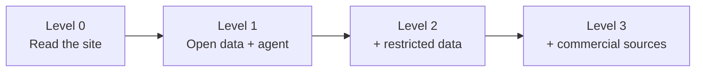

# Getting Started: Your Own Study Workbench

**In one sentence:** you can clone this repository, build a database of the Hebrew and Greek texts, word data and
cross-references in an afternoon, point an AI agent at it, and have a study desk where every claim about a word
resolves to a row you can check, without buying a single commercial Bible resource.

This guide is for the enthusiast who reads the Bible seriously, is not a trained Hebrew or Greek scholar, and
wants the tools this site's studies are built with. [AI in These Studies](../about/why-ai-assisted-study.md)
explains why the method exists and [Our Data Sources](../about/about-our-datasets.md) names every dataset. This page
is the hands-on companion: what to install, what to paste, and what to expect.

## Study outline

- [Choose your depth](#choose-your-depth): four levels, and the third is the one this guide recommends
- [Prerequisites](#prerequisites): what to install and how much disk it takes
- [Step 1: the repository and the open data](#step-1-the-repository-and-the-open-data)
- [Step 2: build the database](#step-2-build-the-database)
- [Step 3: set up the agent](#step-3-set-up-the-agent)
- [Step 4: prove it works](#step-4-prove-it-works): a first passage and a self-check
- [The commercial sources](#the-commercial-sources-what-they-add-and-what-to-change-without-them)
- [Make it yours](#make-it-yours): your doctrine, your site, your first study

## Choose your depth

The workbench comes in layers, each one optional, and each layer is a separate set of files with its own licence.



| Level | You add | Licence tier | Cost | What you can do |
|---|---|---|---|---|
| 0 | Nothing. Use the [verse and word pop-ups](../references.md) and the studies | n/a | Free | Read, with every reference one click from its text and word data |
| 1 | The open submodules and an agent | Open | Free | Full original-language word studies, cross-references, 29 English versions, syntax, the Septuagint, the church fathers |
| 2 | The restricted submodules | Restricted, non-commercial | Free | The Dead Sea Scrolls, the Byzantine and Textus Receptus Greek, the Samaritan Pentateuch |
| 3 | Your own copies of commercial Bibles and commentaries | Quotation-only | Your purchases | The ESV text on tap, translators' footnotes, study-Bible notes |

Levels 1 and 2 arrive together when you clone, because the data ships as git submodules. **Level 3 is the only one
that needs money or a hand-built extractor, and the section [below](#the-commercial-sources-what-they-add-and-what-to-change-without-them)
argues you can leave it out.**

## Prerequisites

| Need | Why | Install |
|---|---|---|
| **git** | The data comes as 19 submodules | Preinstalled on macOS; `brew install git` otherwise |
| **uv** | Runs every Python script and fetches Python 3.14, which the build needs | `brew install uv`, or the installer at docs.astral.sh/uv |
| **An AI coding agent** | Reads the skills, calls the database tools, drafts files | [Claude Code](https://docs.claude.com/en/docs/claude-code) is the one this repo is configured for |
| **Node 20+** | Only for the interactive timeline and pop-ups | `brew install node`; skip it if you only want to study |
| **~25 GB free disk** | See below | n/a |

Disk is the surprise. On the author's machine the open submodules occupy about 16 GB and the restricted ones
about 3.4 GB, mostly git history. The database built from them is 0.76 GB. A shallow clone (Step 1) cuts the
history, though I have not measured the saving, so check `du -sh references/` after your own clone.

Two habits to adopt before you start:

- **Work in a copy you own.** Fork the repository on GitHub first, so your studies and your edits to the agent's
  instructions are yours.
- **Keep the commercial material outside the repository.** Every script resolves it through one environment
  variable, `BIBLE_MEDIA_ROOT` (default `~/bible-media`). The repository is public, and a licence-restricted file
  that never enters the folder cannot be committed by accident.

## Step 1: the repository and the open data

```bash
git clone --recurse-submodules https://github.com/<your-fork>/bible_studies.git
cd bible_studies
```

To trim the download, ask for shallow history instead. This is the variant I would try first. If a submodule
refuses it, rerun without the two `--depth`/`--shallow` flags:

```bash
git clone --recurse-submodules --depth 1 --shallow-submodules https://github.com/<your-fork>/bible_studies.git
```

What you now hold, by tier. Nothing here needs a licence fee:

**Open** (`references/open-data/`, quote at any length): the Hebrew text (morphhb, unfoldingWord's UHB), the Greek
New Testament (SBLGNT, UGNT), the Septuagint (Swete, Brenton), MACULA's word-by-word morphology, syntax, semantic
domains and coreference for both testaments, Strong's numbers, 29 English versions with the WEB as default, 831,290
cross-references, and unfoldingWord's word alignment.

**Restricted, non-commercial** (`references/restricted-data/`): 262 Dead Sea Scrolls, plus BHSA and the Mounce
dictionary, which are held but not yet read by the build. The tier is free for a personal study desk. If you ever
sell what you make, remove this folder and rebuild first.

Some English text is fetched from eBible.org during the build, so Step 2 needs a network connection the first
time.

## Step 2: build the database

```bash
cd references/build
uv sync
uv run python build.py        # writes out/bible-text.db (gitignored, about 0.76 GB)
uv run pytest                 # completeness, query and syntax checks against the new database
```

`build.py` ingests every open and restricted source into one SQLite file, tagging each row with the work it came
from and that work's licence tier. Check the tier before you copy any result into something you publish:

```bash
sqlite3 out/bible-text.db "SELECT work_id, license_tier FROM works;"
```

Two commands tell you what you have and whether the catalogue is consistent. Run them from the repository root:

```bash
python3 references/build/source_catalog.py   # tiers, locations, which databases are reachable
python3 references/check_sources.py          # every source on disk documented, no drift
```

The first reports `study-notes` as missing if you skipped Level 3, which is the expected state for this guide.

**Optional: the site and its tools.**

```bash
uvx --with mkdocs-material --with mkdocs-awesome-pages-plugin \
    --with mkdocs-git-revision-date-localized-plugin --with mkdocs-redirects --with segno mkdocs serve
# the timeline and pop-ups need their bundle first:
cd app && npm install && npm run build:tools
```

The site is then at `http://localhost:8000/`.

## Step 3: set up the agent

An agent here is three things working together: **instructions** it reads at the start of every session,
**skills** that carry the method, and **tools** that query your database. The repository ships all three.

**1. Instructions.** `AGENTS.md` at the repository root is the standing brief: it names the agent a Bible scholar,
sets the translations to use, and lists the rules (accuracy to Scripture, references for every claim, exegesis
before application). `CLAUDE.md` is a symlink to it, so Claude Code loads it automatically. Other agents that read
`AGENTS.md` pick it up by that name. If the symlink ever becomes an empty file, restore it with
`ln -s AGENTS.md CLAUDE.md`.

**2. Skills.** Five live in `.claude/skills/`, and Claude Code finds them in a cloned repository without any setup:

| Skill | Question it answers |
|---|---|
| `develop-bible-study` | How do I research and write a study, exegesis first, with a resumable state file? |
| `review-bible-study` | Is this study true? Re-checks every quotation, citation and word study against source |
| `read-bible-study` | Can this be read? Restructures headings and grouping, changes no sentence |
| `simplify-bible-study` | Is it the right size? Names the one-sentence point and recommends cuts |
| `one-minute-comic` | Can the point be told in three to six panels? |

**3. Tools.** `.mcp.json` registers a local server, `bible-references`, that gives the agent about thirty lookup
tools (`passage_brief`, `bible_word`, `bible_concordance`, `bible_verse`, `bible_syntax`, `bible_crossref`,
`bible_parallel`, `source_profile` and more). Each is a thin wrapper over a function you can also run from the
terminal with `uv run python query.py --help`, so the agent and you always get the same answer.

Start the agent from the repository root, approve the project's MCP server when it asks, and confirm it registered:

```bash
claude            # then type /mcp and check that bible-references is connected
```

The server reads the database you built in Step 2, and a restart picks up a rebuilt database.

### Prompts to paste

These work in a fresh session. Edit the angle brackets.

**Check the setup.**

```text
Read AGENTS.md and the develop-bible-study skill. Then call source_profile and bible_works, and tell me
which licence tiers are loaded, which databases are reachable, and whether study-notes.db is available.
Do not answer from memory about what the database contains; show me what the tools return.
```

**Make the agent yours (do this once).**

```text
I am <a short description of yourself: your church background, whether you read Hebrew or Greek>. Rewrite
the "Agents" and "Biblical scholar principles" sections of AGENTS.md to fit me. Keep every rule about accuracy,
quotation, exegesis-before-hermeneutics and licence tiers. Change the default Bible version to <WEB or your
choice>. Leave docs/content/about/statement-of-faith.md alone until I give you mine.
```

**Start a study on a passage.**

```text
Use the develop-bible-study skill to start a study on <Book chapter:verses>. Begin with passage_brief for the
passage and tell me what it returns before you draft anything. Create the state file under
references/study-state/ so we can resume. Stop after the exegesis phase and show me what the text says in its
context, before we talk about application.
```

**One word study.**

```text
In <passage>, study the word translated "<English word>". Use bible_word for the lemma and Strong's number,
bible_concordance with count_only first to see how common it is, then the occurrences. Give me the Hebrew or
Greek with a pronunciation guide, the range of meaning shown by actual usage, and say where the translations
differ.
```

**Test an idea you already hold.**

```text
I believe <claim> about <passage>. Make the strongest case against it from the text, its context, and the
original languages. Then tell me which parts of my claim survive. Mark what is settled and what is contested.
```

**Audit a draft.**

```text
Use the review-bible-study skill on docs/content/<section>/<file>.md. Re-verify every quotation and citation
against the database, check every word study, and list what you could not verify as unverified, never as
correct.
```

**Find the gaps.**

```text
Run study_gaps on docs/content/<section>/<file>.md and tell me which verses link to this study's passages
that the study never cites.
```

The prompts share a shape worth copying: they name the skill, name the tool to start with, and ask the agent to
show its lookups. An agent that must show the row is an agent that cannot quietly make one up.

## Step 4: prove it works

Ask for one passage you know well and read the result critically:

```text
Call passage_brief for John 6:26-35 with translations WEB and ASV. Then show me where the Greek verbs for
"eat" change in these verses, with lemma and Strong's number for each.
```

You are looking for four things. The versification check comes first in the answer. The Greek verbs arrive with
Strong's numbers that you can look up yourself. The WEB and ASV text is quoted from the database. And where the
agent cannot reach a source it says so, instead of filling in from memory. If any of those four fails, return to
Step 2 before you draft anything.

## The commercial sources: what they add and what to change without them

This repository also holds a second database, `study-notes.db`, built from commercially published study Bibles.
It sits outside the repository on purpose, because quotation-only text must not be committed. It holds eleven works:
the ESV Study Bible, the NIV Biblical Theology and NIV Cultural Backgrounds Study Bibles, the NKJV Cultural
Backgrounds Study Bible, the CSB Ancient Faith Study Bible, two NLT editions, the NASB 1995 and 2020, the LSB, and
the NA28 Greek New Testament. Beside it sit the Bible Knowledge Commentary and the TWOT discussion prose, read by
hand.

### What each one buys you

| Source | What it adds | What replaces it at Level 1 or 2 |
|---|---|---|
| **ESV, NIV, NKJV, CSB, NASB text** | The default English quotation text for the site, and the means to check an ESV quotation instead of trusting recall | The WEB, ASV, KJV and BSB, all open and quotable in full. Use your own licensed ESV (a print Bible or your Bible app) to check a quotation by hand |
| **Translators' footnotes** (about 22,000, two-thirds from the LSB) | The committee's own record of a decision: "Or X", "Lit Y", "Some mss omit Z" | The Hebrew and Greek themselves, `bible_parallel` across 29 versions, and `bible_variants` for manuscript differences, backed by the Dead Sea Scrolls, Byzantine, Textus Receptus and Septuagint |
| **Study notes** (about 54,000) | Editors' commentary and cultural background | The ancient witnesses the repository holds: the church fathers (ANF and NPNF, public domain), Sefaria's Mishnah and Talmud, and Swete's Septuagint |
| **NA28 Greek** | A critical Greek text | SBLGNT and UGNT, both open, plus the Tischendorf and Byzantine texts |
| **Bible Knowledge Commentary** | A dispensational reading to test your own against | Your own statement of faith, argued from the text |
| **TWOT discussion prose** | Word-study essays | The committed TWOT map gives root numbers, lemmas and glosses; MACULA and the semantic domains carry the meaning |

### How much difference they make

My judgment, which I have not measured, is that **you can do without them, and the studies lose little in
substance.** That judgment rests on how this repository already uses them:

- The method puts the text first. The develop skill says no step of an argument rests on a study note alone and
  that a note checks an exegetical conclusion without ever carrying one. A workbench whose reasoning never
  depended on commentary loses speed when the commentary goes, not soundness.
- Every Hebrew and Greek word study, concordance count, syntax observation and cross-reference comes from Level 1
  data. That is the weight-bearing half of a study.
- The commercial tier does one thing nothing open replaces: the **ESV text on tap**. Recalling an ESV verse from
  memory fails at the level of exactness a quotation needs, and this repository has a recorded case where a draft
  had "Lord" where the ESV reads "Sir" at John 6:34. The fix is a habit, not a purchase: quote from a text the
  database holds.

What you give up, stated plainly: speed in checking how the major English committees rendered a hard verse; a
ready list of "Or X" alternatives; and the cultural-background notes on a custom or festival. The footnotes are the
most useful of these. The Song of Songs 8:6 question of whether a word ends in the divine name was worked out the
long way here, and the LSB's footnotes would have shown both options at once. The open tier reaches the same
answer through the Hebrew, a concordance and a parallel view, in more steps.

### What to change when you go without

Make these edits once, so the agent stops looking for a database you do not have.

1. **Change the default translation.** In `AGENTS.md`, replace "Default to ESV" and the paragraph about ESV, NIV,
   NKJV and CSB living in `study-notes.db` with the rule below. Quote the WEB unless you have a reason to name
   another version, and label every quotation with its translation.
2. **Tell the agent the second database is absent.** The tools return `available: false` with a remedy when
   `study-notes.db` is missing, and the standing rule is that an unreachable source is a stop sign, not a prompt to
   improvise. Without a line telling it the absence is deliberate, a session can stall at the first `study_*` call.
3. **Skip the commentary step.** The develop skill's phase six consults `study-notes.db` and reads translators'
   footnotes as a matter of course, and the review skill verifies ESV quotations there. Tell the agent to treat
   those steps as not applicable and to use `bible_parallel` and `bible_variants` for the same purpose.
4. **Expect small gaps.** The printable memory-verse cards take their ESV column from `study-notes.db`
   (`export_memory_verses.py`), so build them from the WEB. `verify_claims.py --evidence` reports an entry whose
   source is unreachable as unverified, not failed, which is the correct behaviour.

Paste this into the agent to make all four changes at once:

```text
I do not have study-notes.db and I am not going to build it. Update AGENTS.md so that: (1) the default
quotation translation is the WEB, with the ASV and KJV for comparison, and every quotation names its
translation; (2) study-notes.db and the study_* tools are noted as deliberately absent, so a missing source
is expected and not an error to stop on; (3) the develop-bible-study and review-bible-study skills skip their
study-notes and footnote steps and use bible_parallel and bible_variants instead; (4) memory-verse cards use
the WEB. Show me the diff before you apply it, and do not weaken any rule about verifying quotations.
```

### If you do want the ESV

You can add a text you own. `references/build/study_notes/sources.py` registers each source as a configuration
entry for one of five extractor families, and a purchased EPUB in the same layout often needs only a new entry.
Build it with `uv run python build_study_notes.py` into `$BIBLE_MEDIA_ROOT/local-only-build/`, outside the
repository, and open it with the `immutable=1` URI form the [references README](https://github.com/ding0t/bible_studies/blob/main/references/README.md)
documents. The licence still governs what you may print: read each publisher's permission notice, and keep
quotations to a sentence or two of commentary and to the verse limits the publisher states.

## Make it yours

**Your doctrine.** The author's convictions live in `docs/content/about/statement-of-faith.md` and the dispensational
preference in `AGENTS.md`. They shape what the agent flags and how it reads a hard text. Replace both with your own
before you write a study, and keep the rule the repository applies to its own: exegesis runs uncoerced, and a
conclusion that runs against your stated position is a signal to surface to you, not one to soften quietly.

**Your site.** A study is a markdown file at `docs/content/<section>/<slug>.md` with frontmatter described in
[`docs/CONTENT_GUIDE.md`](https://github.com/ding0t/bible_studies/blob/main/docs/CONTENT_GUIDE.md). Leave your own
studies as `draft: true` until they are ready, since a draft is hidden from the built site. To deploy, replace the
domain in `mkdocs.yml` and the project name in `wrangler.jsonc` with your own.

**Your first study.** Pick a passage you have questions about, not one you have a settled view on. Ask the agent
to start the study, read the exegesis it produces against the text itself, and ask what the passage shows about God
before you ask what it asks of you. Run the review skill last, in a fresh session, because the one that drafted a
file is the worst reader of it.

!!! quote "Where to go next"

    [Our Data Sources](../about/about-our-datasets.md) for the licence tiers, [Reading the Original-Language
    Data](../scripture/original-language-data.md) for what lemma, parsing and semantic domain mean,
    [Bible Translations & Source Texts](../scripture/translations.md) for what each text is worth as a witness,
    and [AI in These Studies](../about/why-ai-assisted-study.md) for the failure modes to watch for.
